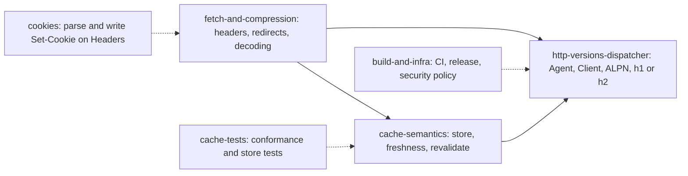
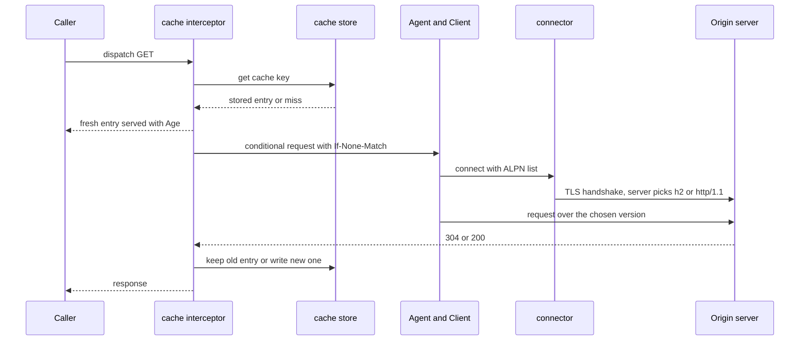

# nodejs/undici — architecture

## Module map

| Module | Responsibility | Note |
|--------|----------------|------|
| fetch-and-compression | Header storage, redirects, `Accept-Encoding`, decoding | [[undici-module-fetch-and-compression\|fetch-and-compression]] |
| cache-semantics | Store a response, judge freshness, revalidate | [[undici-module-cache-semantics\|cache-semantics]] |
| http-versions-dispatcher | Open the connection, pick HTTP/1.1 or HTTP/2 | [[undici-module-http-versions-dispatcher\|http-versions-dispatcher]] |
| cookies | Parse and write `Set-Cookie` strictly | [[undici-module-cookies\|cookies]] |
| cache-tests | Conformance and store tests for the cache | [[undici-module-cache-tests\|cache-tests]] |
| build-and-infra | CI, release, lint, security policy | [[undici-module-build-and-infra\|build-and-infra]] |

## The picture

The cache is an interceptor: it wraps a dispatcher, so it can sit in front of any client (`lib/interceptor/cache.js:628 @ 011d947`). The test worker proves the wiring by wrapping an `Agent` with `interceptors.cache(...)` and making it the global dispatcher, so `fetch` goes through the cache (`test/cache-interceptor/cache-tests-worker.mjs:56-62 @ 011d947`). `fetch` itself passes `maxRedirections: 0` to the dispatcher and follows redirects on its own (`lib/web/fetch/index.js:2227 @ 011d947`). The cookie helpers work on a `Headers` object and call `append` and `getSetCookie` (`lib/web/cookies/index.js:97,131 @ 011d947`). Cache tests run the interceptor, and CI runs those tests on 12 Node.js and OS combinations (`.github/workflows/ci.yml:56-69 @ 011d947`). [[visual-undici-module-map-internet-and-networking|explanation and sources]]

## Main flow

In plain words: the cache looks for a saved copy. If the copy is fresh, it answers without touching the network. If not, it asks the origin "is my copy still good?". The network layer picks the HTTP version while it connects.

1. The interceptor skips the cache for unsafe methods, unknown origins and `no-store` requests (`lib/interceptor/cache.js:670-713 @ 011d947`). Otherwise it builds the key and calls `store.get` (`lib/util/cache.js:189-205 @ 011d947`, `lib/interceptor/cache.js:724 @ 011d947`).
2. A fresh hit is served with an `Age` header (`lib/interceptor/cache.js:447-453 @ 011d947`). A stale hit inside `stale-while-revalidate` is served at once and refreshed in the background (`lib/interceptor/cache.js:532-558 @ 011d947`).
3. Otherwise `makeRevalidationHeaders` adds `If-None-Match` and `If-Modified-Since` (`lib/interceptor/cache.js:185-204 @ 011d947`).
4. `Agent` picks a `Client` or `Pool` per origin (`lib/dispatcher/agent.js:18-21,86-87 @ 011d947`). `Client` calls the connector (`lib/dispatcher/client.js:727-730 @ 011d947`), which sets the ALPN list (`lib/core/connect.js:98 @ 011d947`).
5. After the handshake `Client` reads `socket.alpnProtocol`: `h2` goes to `connectH2`, anything else to `connectH1` (`lib/dispatcher/client.js:557-559 @ 011d947`).
6. `CacheRevalidationHandler` counts a 304 as success; with `stale-if-error` a 500 to 504 also counts (`lib/handler/cache-revalidation-handler.js:72-74,111-120 @ 011d947`). Any other response goes to `CacheHandler`, which decides whether to store it (`lib/handler/cache-revalidation-handler.js:81-87 @ 011d947`).
7. `CacheHandler` computes `staleAt` and `deleteAt` and pipes the body into the store (`lib/handler/cache-handler.js:448-537,685-689 @ 011d947`).

[[visual-undici-request-flow-internet-and-networking|explanation and sources]]

animation candidate (`flow` scene, 7 hops):

1. caller → cache interceptor: dispatch GET (`lib/interceptor/cache.js:628 @ 011d947`)
2. cache interceptor → store: `get` by cache key (`lib/interceptor/cache.js:724 @ 011d947`)
3. cache interceptor → caller: fresh entry with `Age` (`lib/interceptor/cache.js:447-453 @ 011d947`)
4. cache interceptor → Client: conditional request (`lib/interceptor/cache.js:580-613 @ 011d947`)
5. Client → connector: connect with ALPN list (`lib/dispatcher/client.js:727-730 @ 011d947`, `lib/core/connect.js:98 @ 011d947`)
6. Client → connectH2 or connectH1: by `alpnProtocol` (`lib/dispatcher/client.js:557-559 @ 011d947`)
7. origin → revalidation handler: 304 reuses the copy (`lib/handler/cache-revalidation-handler.js:72-87 @ 011d947`)

## Module dependencies (when useful)

The dependency graph shows a layer rule: the version choice stays at the bottom. Both `connectH1` and `connectH2` return an object of the same shape (`version`, `write`, `resume`, `busy`, `destroy`), so `Client` and everything above it do not care which version is in use (`lib/dispatcher/client-h1.js:920-926 @ 011d947`, `lib/dispatcher/client-h2.js:340-345 @ 011d947`). The cache layer reaches the redirect layer only through data: each suppressed 3xx hop is stored on a hidden property of the history array so a cache can still read `no-store` or `Vary: *` (`lib/handler/redirect-handler.js:41-50,127-134 @ 011d947`).

## Worth exploring interactively

- Cache decision on a hit, fits StateMachine: fresh, stale-servable, must-revalidate, expired (`lib/interceptor/cache.js:516-558 @ 011d947`).
- Computing `staleAt`, fits AlgorithmStepper: `s-maxage`, `max-age`, `Expires`, 10% of `Last-Modified` age, `immutable` (`lib/handler/cache-handler.js:1050-1120 @ 011d947`).
- Choosing HTTP/1 or HTTP/2, fits FlowAnimation (`lib/dispatcher/client.js:557-559 @ 011d947`).
- HTTP/2 session life, fits StateMachine: connected, settings, PING probe, GOAWAY, requeue (`lib/dispatcher/client-h2.js:521-540 @ 011d947`).
- Redirect with credential stripping, fits FlowAnimation (`lib/web/fetch/index.js:1366-1376 @ 011d947`).
- `parseSetCookie` attribute loop, fits AlgorithmStepper (`lib/web/cookies/parse.js:95-170 @ 011d947`).

## Design decisions worth noticing

decision candidate: where to run the cache. Option A, inside the client, close to the connection. Option B, as an interceptor that wraps any dispatcher (chosen, `lib/interceptor/cache.js:628 @ 011d947`). The trade-off: a wrapper works with every client and is easy to test (`test/cache-interceptor/cache-tests-worker.mjs:56-62 @ 011d947`), but it has to copy rules the client already knows, such as redirect history. See [[undici-findings|findings]].

decision candidate: which HTTP version to offer first. Option A, `h2` first. Option B, `http/1.1` first with `preferH2` to flip it (chosen, `lib/core/connect.js:98 @ 011d947`). HTTP/1.1 stays the safe default. See [[undici-pattern-fail-closed-parsing|fail closed]] for the same safe-default idea in the cache.

decision candidate: store type. Option A, memory with limits (default, `lib/cache/memory-cache-store.js:19-21 @ 011d947`). Option B, SQLite for persistence, where a locked database means a cache miss (`lib/cache/sqlite-cache-store.js:425-435 @ 011d947`). See [[undici-pattern-best-effort-cache|best-effort cache]].

## Not analyzed

- `lib/web/websocket`, `lib/web/eventsource`, `lib/web/webidl`, `lib/web/subresource-integrity`: not part of the HTTP message topic.
- `lib/llhttp`, `lib/milo`, `deps/`: vendored or generated HTTP/1 parser code.
- `lib/mock`, `lib/api`, the `dns`, `dump`, `retry` and `deduplicate` interceptors, proxy and pool dispatchers: wiring and unrelated features. `Pool` was seen only through `kBusy`.
- `test/` outside `cache-interceptor` and `cookie` (about 700 files), `docs/`, `benchmarks/`, `types/`.

## My insights
