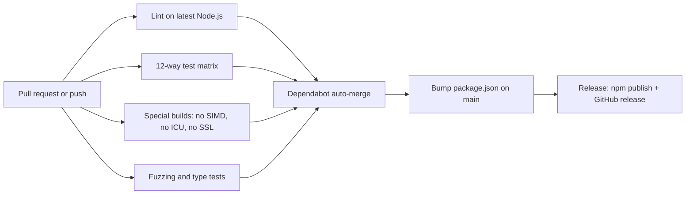

# nodejs/undici — module: build-and-infra

## Responsibility

This slice is everything around the HTTP code: the package manifest, the lint rules, the
GitHub Actions pipelines, the release job, the dependency bot and the security policy. It shows how a
library that ships inside Node.js proves, on every change, that its HTTP behaviour still works on
three operating systems and four Node.js versions. Coverage here is selected paths only: root manifest, lint config, `.github/` files in the file list. The vendored parser code and the `docs/`, `benchmarks/` and `build/` folders were not read.

## Key files

| File | Role |
|------|------|
| `package.json` | Version, Node.js floor, one npm script per test suite, dev dependencies |
| `eslint.config.js` | Lint rules built on `neostandard`, with a ban on bare globals |
| `.github/workflows/ci.yml` | Main pipeline: lint, test matrix, special Node.js builds, fuzzing, types, auto-merge |
| `.github/workflows/nodejs.yml` | Reusable job that runs every test suite once for one Node.js version and one OS |
| `.github/workflows/nodejs-shared.yml` | Builds Node.js itself with this checkout embedded (currently disabled in `ci.yml`) |
| `.github/workflows/release.yml` | Publishes to npm and creates a GitHub release when `package.json` changes on `main` |
| `.github/workflows/codeql.yml`, `scorecard.yml` | Static security scan and supply-chain score |
| `.github/dependabot.yml` | Weekly and monthly dependency update pull requests |
| `SECURITY.md` | How to report bugs and which bugs count as vulnerabilities |
| `pnpm-workspace.yaml` | Placeholder build-script approvals for four packages |

## How it works

A change goes through these steps.

1. A pull request or a push to `main`, `current`, `next` or a `v*` branch starts `CI` (`.github/workflows/ci.yml:3-10 @ 011d947`). Token permissions default to read-only (`.github/workflows/ci.yml:12-13 @ 011d947`).
2. Pull requests get a dependency review, and a lint job runs `npm run lint` on the newest Node.js (`.github/workflows/ci.yml:16-54 @ 011d947`).
3. The test job fans out over Node.js 22, 24, 25, 26 and Ubuntu, Windows, macOS: 12 combinations (`.github/workflows/ci.yml:56-69 @ 011d947`). Each calls the reusable workflow.
4. The reusable workflow installs with `npm ci`, prepares a hosts file for the Web Platform Tests, creates TLS test certificates, then runs each suite as its own step (`.github/workflows/nodejs.yml:49-204 @ 011d947`). Cache suites run separately from other suites (`.github/workflows/nodejs.yml:113-136 @ 011d947`).
5. Extra jobs test odd Node.js builds (no SIMD, no ICU, no OpenSSL), fuzzing and TypeScript types (`.github/workflows/ci.yml:71-308 @ 011d947`).
6. For Dependabot pull requests only, an `automerge` job waits for all other jobs, then merges (`.github/workflows/ci.yml:310-329 @ 011d947`).
7. After a merge that changes `package.json`, `release.yml` checks whether a GitHub release for that version exists. If the API returns 404, it releases (`.github/workflows/release.yml:5-9,30-46 @ 011d947`). It then publishes `undici`, builds and publishes `undici-types`, and creates the GitHub release (`.github/workflows/release.yml:80-101 @ 011d947`).

## Beyond the textbook

### Test the library against Node.js builds that remove features

- Textbook version: run tests on a few Node.js versions and call it done.
- What they do: besides the 12-way matrix, they compile Node.js from source with `--without-intl` and with `--without-ssl`, and run the suite on that binary. The no-SSL build only checks that `node index.js` still loads. A separate job turns off WebAssembly SIMD through the `UNDICI_NO_WASM_SIMD` variable.
- Why: undici must load on stripped Node.js builds. The no-SSL job's own step name states the goal: "Try loading Node.js without Crypto". The HTTP/1 parser is WebAssembly, so the SIMD switch tests its fallback path.
- Evidence: `.github/workflows/ci.yml:86-100,142,170 @ 011d947`, `.github/workflows/ci.yml:177-248 @ 011d947`, `.github/workflows/ci.yml:71-84 @ 011d947`, `.github/workflows/nodejs.yml:87 @ 011d947`

### Check that undici still works when embedded in Node.js

- Textbook version: a library is tested as a package from npm.
- What they do: `nodejs-shared.yml` downloads the latest Node.js source, rebuilds the llhttp and Milo parsers from vendored sources, and configures Node.js with `--shared-builtin-undici/undici-path` pointing at this checkout.
- Why: undici is bundled into Node.js (`SECURITY.md:28-33 @ 011d947`). A comment in `ci.yml` explains why the job is now off: Node.js still embeds the older behaviour of one proxy fix, so the Node.js tests would fail. It will return once a Node.js 26 release carries the fix. This is an honest record of a known gap.
- Evidence: `.github/workflows/nodejs-shared.yml:43-58,90-97 @ 011d947`, `.github/workflows/ci.yml:270-287 @ 011d947`

### Pin every Action to a commit hash and lock down tokens

- Textbook version: `uses: actions/checkout@v4`.
- What they do: each action is pinned to a full commit SHA with the version in a trailing comment. `persist-credentials: false` is set on checkouts so the Git token is not left on disk, except in the release job that must push. Workflows declare `permissions: contents: read` and raise it only per job. Some jobs run `step-security/harden-runner` in audit mode to log network egress.
- Why: a moved tag cannot change what runs, and a compromised step finds fewer powers. The OpenSSF Scorecard workflow scores these habits weekly.
- Evidence: `.github/workflows/ci.yml:20-28 @ 011d947`, `.github/workflows/ci.yml:12-13 @ 011d947`, `.github/workflows/release.yml:60-64 @ 011d947`, `.github/workflows/scorecard.yml:18,37-41 @ 011d947`

### Release by merging a version bump, with a "did we already release?" check

- Textbook version: a person runs `npm publish` from a laptop.
- What they do: the workflow starts on any push to `main` that touches `package.json`. It looks for a release tagged `v<version>`; only a 404 yields a release version, any other error is thrown. The release job runs in a protected `release` environment with `id-token: write`, installs the newest npm, and publishes two packages (`undici` and the generated `undici-types`).
- Why: re-running or unrelated `package.json` edits cannot publish twice. The inline code shows the check; the reason is my reading of it, not a comment.
- Evidence: `.github/workflows/release.yml:5-9,30-46 @ 011d947`, `.github/workflows/release.yml:48-58,72-91 @ 011d947`

### Lint rule that forbids the global `fetch` family inside the library

- Textbook version: lint for style only.
- What they do: ESLint builds a `no-restricted-globals` list from `installedExports` in `lib/global` and fails with "Use undici-own ${name} instead of the global." It also bans `process.exit` and requires the `node:` prefix on built-in imports. Generated and vendored paths are ignored globally.
- Why: undici may replace or sit beside the Node.js built-ins, so accidentally using the global would test or ship the wrong implementation. The lint run uses `latest` Node.js on purpose; a comment says different Node.js versions can change lint results.
- Evidence: `eslint.config.js:3-4,36-43 @ 011d947`, `eslint.config.js:26-27 @ 011d947`, `eslint.config.js:10-19 @ 011d947`, `.github/workflows/ci.yml:45-48 @ 011d947`

### Dependency updates that merge themselves, but only after everything is green

- Textbook version: update dependencies by hand now and then.
- What they do: Dependabot opens PRs weekly for npm roots, `docs` and `benchmarks`, monthly for Actions, daily for the Docker folder `/build`. The `automerge` job runs only for `dependabot[bot]` PRs and `needs` seven other jobs.
- Why: updates stay small and fast. The merge gate is the same test suite humans face. The pin-by-SHA habit above works because Dependabot can bump those hashes.
- Evidence: `.github/dependabot.yml:1-30 @ 011d947`, `.github/workflows/ci.yml:310-329 @ 011d947`

### A written threat model that decides what is a bug

- Textbook version: "email us if you find a vulnerability".
- What they do: `SECURITY.md` gives reporting channels and reply times (5 days acknowledge, 10 days detail), explains coordinated release with Node.js, and lists what undici trusts and does not trust. Response headers, bodies, WebSocket frames and TLS certificate validation are untrusted. Examples of vulnerabilities include request smuggling, response desynchronisation and CRLF injection in headers.
- Why: it tells the reporter, and the learner, which HTTP failures matter. It also lists non-vulnerabilities: buffering a whole body with `body.json()` or `.text()` from an untrusted server is the application's job to avoid, and HTTP/1.1 keep-alive with untrusted servers needs `pipelining: 0` or HTTP/2 for isolation.
- Evidence: `SECURITY.md:9-12 @ 011d947`, `SECURITY.md:28-33 @ 011d947`, `SECURITY.md:102-115 @ 011d947`, `SECURITY.md:153-169 @ 011d947`, `SECURITY.md:200-231 @ 011d947`

## Tests and what they protect

The `package.json` scripts show what the team protects, one script per area. They include unit, fetch, node-fetch compatibility, cache, cache interceptor, cookies, interceptors, event source, subresource integrity, websocket and webidl (`package.json:73-74,76-98 @ 011d947`). The sqlite cache store is tested with `--experimental-sqlite` (`package.json:79 @ 011d947`), and `test:cache-tests` runs a separate cache-conformance script in CI mode (`package.json:103 @ 011d947`). Three other layers exist: Web Platform Tests for fetch, mimesniff, xhr, websockets, eventsource and service-workers (`package.json:101-102 @ 011d947`); an Autobahn WebSocket conformance run (`package.json:99-100 @ 011d947`); and a fuzzing script (`package.json:82 @ 011d947`) using `fast-check` (`package.json:126 @ 011d947`). Types are tested with `tsd` and `tsc` (`package.json:96 @ 011d947`). Each suite uses a 180 s timeout and some expose `gc` (`package.json:91 @ 011d947`). Coverage uses `c8` and is uploaded to Codecov only from Ubuntu on Node.js 24, 25 and 26 (`.github/workflows/ci.yml:66 @ 011d947`, `.github/workflows/nodejs.yml:202-211 @ 011d947`). Jest has its own folder (`package.json:149-153 @ 011d947`). Each test job has a 30 minute limit (`.github/workflows/nodejs.yml:27 @ 011d947`).

## Error handling, performance, and security

- Failure isolation: `fail-fast: false` lets every matrix cell report, so a Windows-only failure does not hide a Linux one (`.github/workflows/ci.yml:59 @ 011d947`). The 12-way matrix sets `max-parallel: 0`, which I read as "no limit" (`.github/workflows/ci.yml:60 @ 011d947`); I did not confirm this in GitHub docs.
- Build cache: the Node.js source builds use `ccache` and `ninja` to cut build time, and have a 150 minute timeout (`.github/workflows/ci.yml:94,129-135 @ 011d947`).
- Supply chain: `npm ci` installs from the lockfile (`.github/workflows/nodejs.yml:49-50 @ 011d947`); a dependency review action runs on pull requests (`.github/workflows/ci.yml:30-31 @ 011d947`); CodeQL scans JavaScript and TypeScript on push, pull request and weekly (`.github/workflows/codeql.yml:14-21,37-38 @ 011d947`); Scorecard publishes results (`.github/workflows/scorecard.yml:41 @ 011d947`).
- Node.js floor: `engines.node` is `>=22.19.0` (`package.json:137-139 @ 011d947`).
- Unfinished config: `pnpm-workspace.yaml` holds placeholder text "set this to true or false" for four build-script approvals, while CI uses `npm ci`, so it looks unused in CI (`pnpm-workspace.yaml:1-5 @ 011d947`).
- Platform quirk handled in CI: macOS gets Python 3.14 because a newer Python removed a class that the WPT server needs (`.github/workflows/nodejs.yml:63-69 @ 011d947`).

## Technologies and services seen

- GitHub Actions — runs all CI and release (`.github/workflows/ci.yml:1-15 @ 011d947`)
- Node.js 22, 24, 25, 26 — test matrix targets (`.github/workflows/ci.yml:62 @ 011d947`)
- npm and npm registry — install with `npm ci`, publish `undici` and `undici-types` (`.github/workflows/release.yml:70,76-89 @ 011d947`)
- borp — test runner with `-p` file patterns (`package.json:76 @ 011d947`)
- Jest — a second runner for `test/jest` (`package.json:90,149-153 @ 011d947`)
- c8 and Codecov — coverage report and upload (`package.json:121 @ 011d947`, `.github/workflows/nodejs.yml:207-211 @ 011d947`)
- esbuild — bundles `undici-fetch.js` (`package.json:65 @ 011d947`)
- ESLint with neostandard — lint (`eslint.config.js:3 @ 011d947`)
- TypeScript, tsd — type tests (`package.json:96 @ 011d947`)
- fast-check — property-based fuzzing (`package.json:126 @ 011d947`)
- Husky — Git hooks on `prepare` (`package.json:111 @ 011d947`)
- Web Platform Tests — shared browser-standard tests (`package.json:101-102 @ 011d947`)
- Autobahn — WebSocket conformance (`package.json:99-100 @ 011d947`)
- llhttp and Milo WebAssembly parsers — rebuilt in the shared job (`.github/workflows/nodejs-shared.yml:43-58 @ 011d947`; `package.json:66-68 @ 011d947`)
- Dependabot — dependency pull requests (`.github/dependabot.yml:1-30 @ 011d947`)
- CodeQL — static analysis (`.github/workflows/codeql.yml:54-57 @ 011d947`)
- OpenSSF Scorecard — supply-chain score (`.github/workflows/scorecard.yml:37 @ 011d947`)
- step-security harden-runner — egress audit (`.github/workflows/ci.yml:20-23 @ 011d947`)
- HackerOne and GitHub Security Advisories — reports (`SECURITY.md:5-7 @ 011d947`)
- nodejs.org release index and downloads — find and fetch Node.js source (`.github/workflows/ci.yml:120,127 @ 011d947`)
- ccache and ninja — faster Node.js builds (`.github/workflows/ci.yml:129-135 @ 011d947`)
- Docker — used to build llhttp (`package.json:67 @ 011d947`) and watched by Dependabot (`.github/dependabot.yml:27-30 @ 011d947`)

## Worth exploring interactively

- Pull request to release — steps: trigger (`.github/workflows/ci.yml:3-10 @ 011d947`), lint (`.github/workflows/ci.yml:33-54 @ 011d947`), 12-way matrix (`.github/workflows/ci.yml:56-69 @ 011d947`), special builds (`.github/workflows/ci.yml:71-248 @ 011d947`), automerge gate (`.github/workflows/ci.yml:310-329 @ 011d947`), release check (`.github/workflows/release.yml:30-46 @ 011d947`), publish (`.github/workflows/release.yml:80-91 @ 011d947`) — fits FlowAnimation because the learner would watch one change pass through each gate.
- Test matrix — Node.js versions against OS, with the extra rows for no-SIMD, no-ICU and no-SSL (`.github/workflows/ci.yml:62-63,77-78,92,183 @ 011d947`) — fits SystemDiagram because it shows which part of the platform each row removes.

## Open questions

- `.github/codeql/codeql-config.yml` is referenced (`.github/workflows/codeql.yml:58 @ 011d947`) but was not in this slice, so its query set is unknown.
- `scripts/release.js` (`.github/workflows/release.yml:101 @ 011d947`) builds the release notes and was not read.
- How `lib/global` computes `installedExports` was not read (`eslint.config.js:4 @ 011d947`).

## My insights
