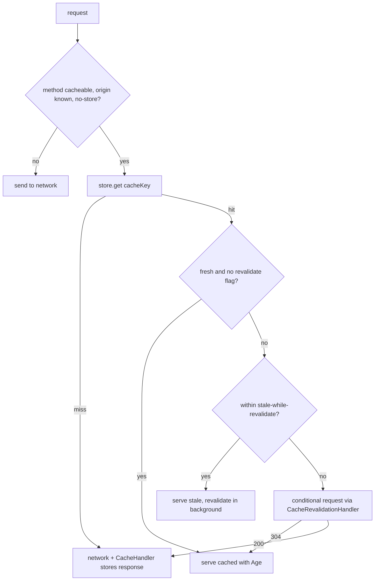

# nodejs/undici — module: cache-semantics

## Responsibility

This module is an HTTP cache that sits in front of the network client. It decides three things. First, whether a response may be stored (RFC 9111 rules for `Cache-Control`, `Vary`, `Authorization`, `Set-Cookie`). Second, whether a stored response is still fresh. Third, how to ask the origin "is my copy still good?" with `If-None-Match` and `If-Modified-Since`. It works as a dispatcher interceptor (`lib/interceptor/cache.js:628 @ 011d947`), so it wraps any request the client sends. Background: [[HTTP caching]], [[Cache-Control directives]], [[Conditional request validation]], [[Vary header]]. Runtime: [[Node.js]].

## Key files

| File | Role |
|------|------|
| `lib/interceptor/cache.js` | The read path: look up, check freshness, serve, or revalidate |
| `lib/handler/cache-handler.js` | The write path: decide if a response is storable, compute `staleAt` and `deleteAt`, stream the body into the store |
| `lib/handler/cache-revalidation-handler.js` | Wraps the conditional request; turns a 304 (or a 5xx) into "use the cached copy" |
| `lib/util/cache.js` | Strict `Cache-Control` and `Vary` parsers, cache key, ETag check |
| `lib/cache/memory-cache-store.js` | Default store: a `Map` with size and count limits |
| `lib/cache/sqlite-cache-store.js` | Optional store backed by `node:sqlite`, with zstd compression |

## How it works

1. The interceptor is built from options: store (default `MemoryCacheStore`), methods (default `GET`), type (`shared` by default), and an optional origin allow-list (`lib/interceptor/cache.js:629-635 @ 011d947`). Bad options throw a `TypeError` at setup (`lib/interceptor/cache.js:641-651 @ 011d947`).
2. Per request, it skips the cache when no trusted origin exists, the method is not cached, the origin is not on the allow-list, or the request says `no-store` (`lib/interceptor/cache.js:670-713 @ 011d947`). A legacy `Pragma: no-cache` is treated like `Cache-Control: no-cache` (`lib/interceptor/cache.js:56-78`, `lib/interceptor/cache.js:705-709 @ 011d947`).
3. The cache key is origin, method, path (with query) and the request headers (`lib/util/cache.js:189-205 @ 011d947`). Unsafe methods (POST and similar) go straight to the network wrapped in a `CacheHandler`, which then deletes the stored entries for that URL (`lib/interceptor/cache.js:720-722 @ 011d947`, `lib/handler/cache-handler.js:329-338 @ 011d947`).
4. On a hit, `handleResult` computes the age in seconds and checks request directives `max-age`, `max-stale`, `min-fresh` (`lib/interceptor/cache.js:516-520`, `lib/interceptor/cache.js:253-282 @ 011d947`).
5. A fresh entry is served by `sendCachedValue`, which adds an `Age` header. A stale one also gets `Warning: 110 - "response is stale"` (`lib/interceptor/cache.js:447-453 @ 011d947`).
6. A stale entry inside the `stale-while-revalidate` window is served at once, and a background request refreshes it (`lib/interceptor/cache.js:532-558 @ 011d947`).
7. Otherwise a conditional request is sent. `makeRevalidationHeaders` adds `If-Modified-Since` (from `Last-Modified`, or the cache time) and `If-None-Match` (from the stored ETag), and copies the `Vary` request headers (`lib/interceptor/cache.js:185-204 @ 011d947`).
8. `CacheRevalidationHandler` counts a 304 as success. With `stale-if-error` allowed, a 500 to 504 status or a connection error also counts as success, so the stale copy is served (`lib/handler/cache-revalidation-handler.js:72-74`, `lib/handler/cache-revalidation-handler.js:111-120 @ 011d947`).
9. Any other response flows on to a `CacheHandler`, which decides whether to store the new body (`lib/handler/cache-revalidation-handler.js:81-87 @ 011d947`).
10. When storing, `CacheHandler` computes `staleAt` (freshness end) and `deleteAt` (when the store may drop it), strips hop-by-hop headers, and pipes the body into `store.createWriteStream` (`lib/handler/cache-handler.js:448-537`, `lib/handler/cache-handler.js:685-689 @ 011d947`).

## Beyond the textbook

### Freshness order and heuristics

- Textbook version: a response is fresh for `max-age` seconds.
- What they do: a shared cache looks at `s-maxage` first, then `max-age`, then `Expires`, then 10% of the time since `Last-Modified`, then one year for `immutable`. A `no-cache` response with a validator gets lifetime 0, so it is stored but always revalidated.
- Why: the code cites RFC 9111 section 5.2.2.10, section 5.3 and the heuristic-freshness section, and RFC 8246 for `immutable`.
- Evidence: `lib/handler/cache-handler.js:1041-1131 @ 011d947`

### Zero freshness is still storable

- Textbook version: `max-age=0` means "do not cache".
- What they do: such an entry is kept when it has an ETag or `Last-Modified`, because every reuse sends a conditional request first. Retention is a fixed 24 hours. `isStale` also treats `staleAt <= cachedAt` as stale, so a clock step cannot make it fresh.
- Why: comments cite RFC 9111 section 5.2.2.4 and section 4.2.
- Evidence: `lib/handler/cache-handler.js:451-455 @ 011d947`, `lib/handler/cache-handler.js:101-103 @ 011d947`, `lib/interceptor/cache.js:253-258 @ 011d947`

### Delete time is longer than stale time

- Textbook version: an entry is removed when it expires.
- What they do: `deleteAt` equals `staleAt` plus a buffer as long as the freshness lifetime, plus up to 1 second of padding because the `Date` header has only second precision. With `stale-while-revalidate` or `stale-if-error`, the longest window wins.
- Why: the comment says this keeps the entry long enough "to be revalidated instead of silently disappearing".
- Evidence: `lib/handler/cache-handler.js:1157-1176 @ 011d947`

### Defensive parsing of `Cache-Control`

- Textbook version: split on commas, read `key=value`.
- What they do: quoted lists such as `no-cache="a, b"` are rejoined after the comma split. Bad numbers (`max-age=abc`, spaces around `=`) delete the directive and record it as invalid, and the freshness code then returns 0 rather than guess. Numbers are capped at 2147483647. Duplicate numeric directives keep the smaller value. A malformed `no-store`, `private` or `no-cache` is still treated as present, so errors fail toward not caching.
- Why: restrictive directives fail closed. The code encodes this with `RESTRICTIVE_DIRECTIVE_NAMES`.
- Evidence: `lib/util/cache.js:15 @ 011d947`, `lib/util/cache.js:123-147 @ 011d947`, `lib/util/cache.js:398-441 @ 011d947`, `lib/handler/cache-handler.js:1046-1048`, `lib/handler/cache-handler.js:1061-1063 @ 011d947`

### Shared versus private cache

- Textbook version: one cache, one set of rules.
- What they do: a `type` option picks `shared` (default) or `private`. A shared cache refuses `Cache-Control: private` and any response with `Set-Cookie`, treats `s-maxage` as implying `proxy-revalidate`, and refuses `Authorization` requests unless the response says `public`, `s-maxage` or `must-revalidate`. It even deletes older shared entries that contain `Set-Cookie`.
- Why: a shared cache can leak one user's data to another (RFC 9111 "storing responses to authenticated requests", linked in the code).
- Evidence: `lib/handler/cache-handler.js:781-847 @ 011d947`, `lib/interceptor/cache.js:114-122 @ 011d947`, `lib/interceptor/cache.js:499-508 @ 011d947`

### Redirect cache-poisoning guards

- Textbook version: cache the final response under the URL you asked for.
- What they do: nothing is stored under the original key if the redirect chain left the cache key's origin, or if the original request carried `authorization`, `cookie` or `proxy-authorization`. Rules from redirect hops (`no-store`, `private`, `Vary`, shortest freshness) are folded into the final entry. The SQLite table name carries `VERSION = 5` with the note "invalidates entries that may have been poisoned through redirects".
- Why: comments describe one principal's data being replayed to another, and a redirect target controlling an entry for a trusted URL.
- Evidence: `lib/handler/cache-handler.js:340-394 @ 011d947`, `lib/handler/cache-handler.js:474-519 @ 011d947`, `lib/cache/sqlite-cache-store.js:10-11 @ 011d947`

### `Vary` as a stored snapshot

- Textbook version: add the `Vary` header to the key.
- What they do: the entry stores the values of the request headers named in `Vary`. A lookup matches only if each stored value equals the new request's value. `Vary: *` and invalid header names make the response uncacheable. After a 304, if the new response adds a header to `Vary` that the stored entry did not have, the cache refetches instead of reusing.
- Why: it keeps one URL with several variants (for example by language) correct.
- Evidence: `lib/util/cache.js:600-649 @ 011d947`, `lib/cache/memory-cache-store.js:255-280 @ 011d947`, `lib/interceptor/cache.js:156-168`, `lib/interceptor/cache.js:597-600 @ 011d947`

### Validating the 304 before trusting it

- Textbook version: a 304 means "reuse the cache".
- What they do: reuse is refused (and the entry refetched) when the 304 came from a different URL after a redirect, when its ETag does not match the stored one (weak ETags compare by the opaque part), or when it says `no-store`, `private` (shared cache), `Set-Cookie`, or a bad `Vary`. A 304 that carries a new `Cache-Control` deletes the stored entry so the new rules apply. Empty ETags are treated as unusable, a documented deviation from the spec.
- Why: a 304 only describes headers, so a mismatch means the stored body may belong to another representation.
- Evidence: `lib/interceptor/cache.js:129-145`, `lib/interceptor/cache.js:206-245`, `lib/interceptor/cache.js:586-602 @ 011d947`, `lib/util/cache.js:651-683 @ 011d947`

### Streaming body with backpressure

- Textbook version: read the whole body, then store it.
- What they do: the body is teed. One copy goes to the caller and one into the store's write stream. If the store's buffer is full, the origin response is paused until `drain`. On a 304 the origin response is paused while the cached body replays. Store errors delete the entry but do not break the caller's response.
- Why: large bodies stay out of memory, and a failing store must not fail the request.
- Evidence: `lib/handler/cache-handler.js:695-714 @ 011d947`, `lib/handler/cache-handler.js:718-735 @ 011d947`, `lib/handler/cache-handler.js:672-676 @ 011d947`

## Tests and what they protect

Not in this slice. The tests of the cache are in the `cache-tests` module note. The only hint here is `test/cache-interceptor` in the slice plan.

## Error handling, performance, and security

- Errors in downstream handlers are turned into per-request errors, because they run on later ticks where a throw would crash the process (`lib/interceptor/cache.js:430-439 @ 011d947`). Async stores that reject are routed to `onResponseError` (`lib/interceptor/cache.js:736-757 @ 011d947`).
- Store deletes never throw into the request path (`lib/interceptor/cache.js:170-176 @ 011d947`).
- A request with a stream body is never revalidated, because the stream cannot be replayed (`lib/interceptor/cache.js:524-528 @ 011d947`).
- `only-if-cached` with no stored entry returns a synthetic 504 Gateway Timeout (`lib/interceptor/cache.js:317-343 @ 011d947`).
- Header hygiene: `connection`, `transfer-encoding`, `te`, `upgrade`, proxy headers and `age` are dropped before storing, plus any header named in a qualified `no-cache` or `private` (`lib/handler/cache-handler.js:1185-1209 @ 011d947`).
- An absurd `Age` (at or above 2147483647000 ms) or an unparsable `Date` makes the response non-storable (`lib/handler/cache-handler.js:428-439 @ 011d947`).
- Memory store limits: 1024 entries, 100 MB total, 5 MB per entry. When over the limit it evicts down to half and emits a `maxSizeExceeded` event (`lib/cache/memory-cache-store.js:19-21`, `lib/cache/memory-cache-store.js:175-193`, `lib/cache/memory-cache-store.js:200-205 @ 011d947`). An oversize body destroys the write stream, so it is not stored (`lib/cache/memory-cache-store.js:146-148 @ 011d947`).
- SQLite store: WAL journal, `synchronous = NORMAL`, indexes on `(url, method, deleteAt)`, zstd compression when available and the body is large or of a compressible type, and `SQLITE_BUSY` or `LOCKED` errors are swallowed so a locked database means a cache miss, not a failed request (`lib/cache/sqlite-cache-store.js:155-158`, `lib/cache/sqlite-cache-store.js:180`, `lib/cache/sqlite-cache-store.js:316-322`, `lib/cache/sqlite-cache-store.js:425-435 @ 011d947`).

## Technologies and services seen

- Node.js streams (`node:stream`) — `Readable.from` replays cached bodies; `Writable` collects new ones (`lib/interceptor/cache.js:4 @ 011d947`, `lib/cache/memory-cache-store.js:3 @ 011d947`).
- `node:sqlite` (`DatabaseSync`) — persistent cache store, loaded lazily (`lib/cache/sqlite-cache-store.js:149-152 @ 011d947`).
- zstd (Node zlib) — compresses stored bodies when Node supports it (`lib/cache/sqlite-cache-store.js:21 @ 011d947`).
- RFC 9111, RFC 5861 (`stale-while-revalidate`, `stale-if-error`), RFC 8246 (`immutable`) — cited in code comments (`lib/interceptor/cache.js:530 @ 011d947`, `lib/handler/cache-handler.js:1121 @ 011d947`).
- No external network service is used in this slice.

## Worth exploring interactively

- Cache decision on a hit — steps: build key (`lib/util/cache.js:189 @ 011d947`), `store.get` (`lib/interceptor/cache.js:724 @ 011d947`), compute age and `isStale` (`lib/interceptor/cache.js:516-520 @ 011d947`), serve fresh (`lib/interceptor/cache.js:621 @ 011d947`), or serve stale inside the SWR window (`lib/interceptor/cache.js:532-558 @ 011d947`), or send the conditional request (`lib/interceptor/cache.js:580-613 @ 011d947`), then 304 reuse or 200 replace (`lib/handler/cache-revalidation-handler.js:72-87 @ 011d947`) — fits StateMachine because an entry moves between fresh, stale-servable, must-revalidate and expired as the clock advances.
- Computing `staleAt` — steps: `s-maxage` (`lib/handler/cache-handler.js:1050 @ 011d947`), `max-age` (`lib/handler/cache-handler.js:1065 @ 011d947`), `Expires` (`lib/handler/cache-handler.js:1075 @ 011d947`), 10% of `Last-Modified` age (`lib/handler/cache-handler.js:1116 @ 011d947`), `immutable` (`lib/handler/cache-handler.js:1120 @ 011d947`) — fits AlgorithmStepper because the learner changes headers and sees which rule wins.

## Open questions

- How the `getRedirectPolicy` function (`lib/handler/cache-handler.js:862 @ 011d947`) combines several hops was only skimmed, not traced.
- The middle of the SQLite `createWriteStream` (compression on stream end) was not read in full.

## My insights
