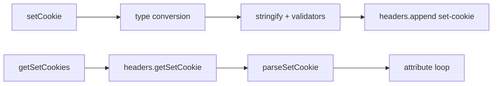

# nodejs/undici — module: cookies

## Responsibility

This module gives code that uses `Headers` five helpers: read the `Cookie` request header, read the `Set-Cookie` response headers, write a `Set-Cookie` header, delete a cookie, and parse one `Set-Cookie` string. It does the parsing and the checking itself, so a bad name, value, path or domain is rejected before it reaches a header (commit `011d947`, MIT license). The same job in a second library is in [[cookie-module-set-cookie-serialize|jshttp/cookie serialize]] and [[cookie-module-set-cookie-parse|jshttp/cookie parse]].

## Key files

| File | Role |
|------|------|
| `lib/web/cookies/index.js` | Public functions `getCookies`, `getSetCookies`, `setCookie`, `deleteCookie`, `parseCookie`; input type conversion |
| `lib/web/cookies/parse.js` | Parser for one `Set-Cookie` string, following the RFC 6265bis steps |
| `lib/web/cookies/util.js` | Checks for name, value, path, domain, max-age; the date formatter; `stringify` |
| `lib/web/cookies/constants.js` | Two size limits: 1024 for an attribute value, 4096 for name plus value |
| `test/cookie/cookies.js` | 879 lines of tests, begun from Deno's test file |

## How it works

Write path (`setCookie`):

1. Check that two arguments exist and that `headers` is a real `Headers` object (`lib/web/cookies/index.js:122-124 @ 011d947`).
2. Convert the cookie object to typed fields. `sameSite` may only be `Strict`, `Lax` or `None` (`lib/web/cookies/index.js:148-197 @ 011d947`).
3. `stringify` builds the string. An empty name returns `null`, so nothing is written (`lib/web/cookies/util.js:274-276 @ 011d947`; `lib/web/cookies/index.js:130-132 @ 011d947`).
4. Name and value are checked, then each attribute is checked as it is added (`lib/web/cookies/util.js:278-279, 304, 309, 314 @ 011d947`).
5. The string is appended as a new `set-cookie` header line (`lib/web/cookies/index.js:131 @ 011d947`).

Read path (`parseSetCookie`):

1. Any control character except tab means the whole string is ignored (`lib/web/cookies/parse.js:18-20 @ 011d947`).
2. Split at the first `;` into the name-value pair and the attributes (`lib/web/cookies/parse.js:28-44 @ 011d947`).
3. Split the pair at the first `=`; with no `=`, the whole text is the value (`lib/web/cookies/parse.js:49-63 @ 011d947`).
4. Trim, and drop the cookie if name plus value is over 4096 (`lib/web/cookies/parse.js:67-75 @ 011d947`).
5. Loop over attributes: each is trimmed, dropped if its value is over 1024, then matched by lowercase name (`lib/web/cookies/parse.js:95-170 @ 011d947`).
6. Unknown attributes are kept as `name=value` strings in `unparsed` (`lib/web/cookies/parse.js:305-309 @ 011d947`).

`deleteCookie` is `setCookie` with an empty value and an expiry of 1970 (`lib/web/cookies/index.js:78-85 @ 011d947`).

## Beyond the textbook

### Strict when writing, forgiving when reading

- Textbook version: one function that joins `name=value; Attr` strings, and one that splits on `;`.
- What they do: the writer throws on bad characters; the parser never throws and returns `null` or skips a piece instead.
- Why: the writer follows the RFC 6265 grammar for names and values (grammar quoted in comments), while the parser follows the "ignore what you cannot read" steps of RFC 6265bis. See [[Strict output, lenient input]].
- Evidence: `lib/web/cookies/util.js:61-96 @ 011d947`; `lib/web/cookies/parse.js:180-183, 196-204 @ 011d947`.

### Domain checked against the DNS name syntax

- Textbook version: copy the `Domain` string into the header.
- What they do: check length (255), label length (63), no empty label, no leading or trailing hyphen, letters, digits and hyphen only.
- Why: the code comments cite RFC 1034, 1123 and 1035; a bad domain cannot add a new attribute.
- Evidence: `lib/web/cookies/util.js:149-193 @ 011d947`.

### Cookie prefixes enforced on write

- Textbook version: the caller must remember that `__Host-` cookies need `Secure`, `Path=/` and no `Domain`.
- What they do: `stringify` sets those fields for the caller. `__Secure-` forces `Secure`. `__Host-` forces `Secure`, drops `Domain`, sets `Path=/`.
- Why: the comments link the cookie-prefixes draft; the test checks the output `__Host-Kitty=Meow; Secure; Path=/`.
- Evidence: `lib/web/cookies/util.js:283-293 @ 011d947`; `test/cookie/cookies.js:463-474 @ 011d947`.

### An iterative attribute parser, fixed after a security advisory

- Textbook version: parse attributes by calling the parser again on the rest of the string.
- What they do: a `while (true)` loop. A regression test cites advisory GHSA-pf6r-83r6-f2x8: `a=b;;;;...` once recursed per attribute and overflowed the stack. The test sends 5000 empty attributes.
- Why: one short header must not crash the process.
- Evidence: `lib/web/cookies/parse.js:94-96 @ 011d947`; `test/cookie/cookies.js:713-725 @ 011d947`.

### Values are never percent-decoded

- Textbook version: decode the value for the caller.
- What they do: keep the raw text. A test feeds `%0d%0aSet-Cookie:` and `%00` and expects them unchanged.
- Why: decoding would turn text into control characters or a second header; the test name says the parser does not percent-decode. See [[Header injection]].
- Evidence: `test/cookie/cookies.js:728-742 @ 011d947`.

### Hostile names and numbers

- `getCookies` returns an object with a null prototype, so a cookie named `__proto__` is kept as plain data (`lib/web/cookies/index.js:45-48 @ 011d947`; `test/cookie/cookies.js:62-77 @ 011d947`).
- `expires` as `NaN`, `Infinity` or past the Date range is skipped, not formatted into the header (`lib/web/cookies/util.js:318-339 @ 011d947`; `test/cookie/cookies.js:444 @ 011d947`).
- `Max-Age` is checked with a type test, not truthiness, so `0` is a valid value; a negative value throws (`lib/web/cookies/util.js:303-305 @ 011d947`; `test/cookie/cookies.js:280-292 @ 011d947`).

### Exact SameSite match

- Textbook version: test if the value contains `strict`.
- What they do: compare the whole lowercased value; `StrictLax` and `NoneOfYourBusiness` are dropped.
- Evidence: `lib/web/cookies/parse.js:281-304 @ 011d947`; `test/cookie/cookies.js:745-760 @ 011d947`.

## Tests and what they protect

- Each validator has a test that expects a throw on bad name, value, path, domain (`test/cookie/cookies.js:80-193 @ 011d947`).
- The `unparsed` list cannot carry a part like `HttpOnly; X-Custom=val` (`test/cookie/cookies.js:195-208 @ 011d947`).
- Delete output is fixed: `deno=; Expires=Thu, 01 Jan 1970 00:00:00 GMT`; and a second `Set-Cookie` line is added, not merged (`test/cookie/cookies.js:211-229 @ 011d947`).
- Both undici's `Headers` and the global `Headers` are accepted, and anything else throws (`test/cookie/cookies.js:763-871 @ 011d947`; `lib/web/cookies/index.js:7-18 @ 011d947`).
- An unreadable `Expires` is ignored but the cookie stays (`test/cookie/cookies.js:873-879 @ 011d947`).
- The test file starts with Deno's MIT licence text (`test/cookie/cookies.js:1-3 @ 011d947`), and `deleteCookie` points to Deno's implementation (`lib/web/cookies/index.js:78-79 @ 011d947`).

## Error handling, performance, and security

- Write errors are plain `Error('Invalid cookie name')` and similar (`lib/web/cookies/util.js:56, 76, 93, 111, 156 @ 011d947`). Parse errors do not throw.
- Size caps: 1024 per attribute value and 4096 for name plus value, taken from the WICG cookie-store spec (`lib/web/cookies/constants.js:3-7 @ 011d947`).
- Known gap: `getCookies` splits on `;` and `=` and does not decode or check anything, and the Max-Age cap of 400 days is commented out (`lib/web/cookies/index.js:54-58 @ 011d947`; `lib/web/cookies/parse.js:209-214 @ 011d947`).
- Known gap: the parser's `Domain` is lowercased but not validated (`lib/web/cookies/parse.js:231-244 @ 011d947`), while the writer validates it.
- Compare with the other library in [[cookie-module-cookie-header]] and [[Set-Cookie attributes]].

## Technologies and services seen

- WebIDL converters in `lib/web/webidl` — type-check arguments and dictionaries (`lib/web/cookies/index.js:126, 135-203 @ 011d947`).
- `node:assert` — asserts the parser state (`lib/web/cookies/parse.js:6, 104 @ 011d947`).
- `collectASequenceOfCodePointsFast` from `lib/web/infra` — cuts a string at a delimiter (`lib/web/cookies/parse.js:3, 35 @ 011d947`).
- WHATWG `Headers` and `getSetCookie()` — the storage and the multi-value read (`lib/web/cookies/index.js:97, 131 @ 011d947`).
- RFC 6265, RFC 6265bis, RFC 1034, cookie-prefixes draft, WICG cookie-store — specs named in comments (`lib/web/cookies/parse.js:10 @ 011d947`; `lib/web/cookies/util.js:124, 283 @ 011d947`).

## Worth exploring interactively

- `setCookie` write path — steps: type conversion (`lib/web/cookies/index.js:126 @ 011d947`), name and value check (`lib/web/cookies/util.js:278-279 @ 011d947`), prefix rules (`lib/web/cookies/util.js:285-293 @ 011d947`), each attribute checked and pushed (`lib/web/cookies/util.js:295-343 @ 011d947`), join with `; ` (`lib/web/cookies/util.js:361 @ 011d947`), append (`lib/web/cookies/index.js:131 @ 011d947`) — fits FlowAnimation because the learner sees the string grow piece by piece and a bad piece stop the flow.
- `parseSetCookie` attribute loop — steps: control-char check (`lib/web/cookies/parse.js:18 @ 011d947`), split pair (`lib/web/cookies/parse.js:28-63 @ 011d947`), size check (`lib/web/cookies/parse.js:73 @ 011d947`), take one attribute (`lib/web/cookies/parse.js:107-126 @ 011d947`), drop or store it (`lib/web/cookies/parse.js:163-309 @ 011d947`) — fits AlgorithmStepper because the unparsed text shrinks and the result object grows each turn.

## Open questions

- The tests and code here do not show how a client uses these helpers in a fetch redirect; no cookie jar was found in this slice.

## My insights
