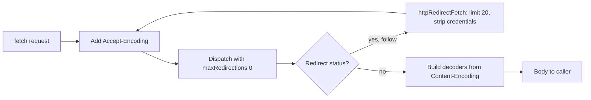

# nodejs/undici — module: fetch-and-compression

## Responsibility

This slice shows how undici handles the parts of an HTTP message that sit around the body. It stores headers the way the Fetch standard says, follows redirects, and decodes compressed bodies. Two redirect code paths exist: one inside `fetch()` that follows the Fetch spec, and one dispatcher-level `RedirectHandler` for the lower-level API. Two decompression paths exist too: one inline in `fetch()`, one as an opt-in interceptor.

## Key files

| File | Role |
|------|------|
| `lib/web/fetch/headers.js` | The `Headers` class and `HeadersList` storage (case-insensitive, combines repeated names) |
| `lib/web/fetch/index.js` | The fetch algorithm: redirects, `Accept-Encoding`, decoding in `httpNetworkFetch` |
| `lib/interceptor/decompress.js` | Opt-in interceptor that decodes `Content-Encoding` with size limits |
| `lib/handler/redirect-handler.js` | Follows 3xx for the dispatcher API, strips credentials across origins |

## How it works

1. Header names are lowercased as the key; the first spelling is kept for display (`lib/web/fetch/headers.js:241-252 @ 011d947`).
2. A repeated header is joined with `, `, but `cookie` is joined with `; ` (`lib/web/fetch/headers.js:246 @ 011d947`). `set-cookie` values are also kept in a separate list because they must not be joined (`lib/web/fetch/headers.js:255-257 @ 011d947`).
3. Before sending, `httpNetworkOrCacheFetch` adds `Accept-Encoding` if missing: `br, gzip, deflate, zstd` for HTTPS, `gzip, deflate` for plain HTTP (`lib/web/fetch/index.js:1586-1591 @ 011d947`). With a `Range` header it adds `identity` (`lib/web/fetch/index.js:1579-1581 @ 011d947`).
4. The network call passes `maxRedirections: 0`, so the dispatcher never redirects; `fetch()` does it itself (`lib/web/fetch/index.js:2227 @ 011d947`).
5. `httpFetch` checks if the status is a redirect and branches on the redirect mode: `error`, `manual`, or `follow` (`lib/web/fetch/index.js:1231-1254 @ 011d947`).
6. `httpRedirectFetch` rejects non-HTTP(S) targets, stops at 20 redirects, rewrites POST to GET for 301/302/303, and drops credential headers on a cross-origin hop (`lib/web/fetch/index.js:1299-1305`, `1346-1376 @ 011d947`).
7. When the response arrives, `onResponseStart` reads `Content-Encoding`, splits it on commas, and builds one zlib decoder per coding, last coding first (`lib/web/fetch/index.js:2285-2298 @ 011d947`).

## Beyond the textbook

### Credentials are removed on cross-origin redirects

- Textbook version: follow the `Location` header and resend the same headers.
- What they do: both redirect paths delete `authorization`, `proxy-authorization`, `cookie` and `host` when the origin changes. The handler version also lets the caller add more names to strip.
- Why: a redirect to another site must not receive the first site's secrets. The code also fixes a real bug: arrays of `[name, value]` pairs were once read as a flat list, which "defeats the cross-origin credential stripping" (comment in the code).
- Evidence: `lib/web/fetch/index.js:1366-1376 @ 011d947`, `lib/handler/redirect-handler.js:208-223 @ 011d947`, `lib/handler/redirect-handler.js:250-254 @ 011d947`

### Method and body rewrite per redirect status

- Textbook version: "301 means moved, repeat the request".
- What they do: 301/302 with POST become GET with no body; 303 becomes GET (or stays HEAD); content headers are removed, and the old body stream is destroyed.
- Why: comments cite RFC 7231 section 6.4 and the Fetch "HTTP-redirect fetch" step.
- Evidence: `lib/handler/redirect-handler.js:75-98 @ 011d947`, `lib/web/fetch/index.js:1346-1361 @ 011d947`

### Redirect loop and limit guards, with an off-by-one fixed

- Textbook version: count redirects and stop.
- What they do: the handler keeps a history of visited URLs and throws on a repeat. A 3xx that is the last allowed hop, or has no `Location`, is delivered as a normal response; an error is raised only when `throwOnMaxRedirect` is true. Fetch uses the fixed limit 20.
- Why: the comment says a `Client` or `Pool` cannot redirect across origins and would loop forever, so the message tells the user to use an `Agent`.
- Evidence: `lib/handler/redirect-handler.js:104-112 @ 011d947`, `lib/handler/redirect-handler.js:142-150 @ 011d947`, `lib/web/fetch/index.js:1304-1306 @ 011d947`

### Redirect hops are remembered for the cache

- Textbook version: a redirect is invisible once followed.
- What they do: each suppressed 3xx hop's status and headers are stored on a hidden property of the history array, so an outer cache can still honor `no-store`, `no-cache` or `Vary: *` from the hop.
- Why: code comment says the policy would otherwise be lost because the hop response is not forwarded. This links this slice to the cache module.
- Evidence: `lib/handler/redirect-handler.js:41-50 @ 011d947`, `lib/handler/redirect-handler.js:127-134 @ 011d947`

### Decompression bombs are limited three ways

- Textbook version: pipe the body through `gunzip`.
- What they do: (1) at most 5 stacked codings, citing a urllib3 advisory and a curl CVE; (2) an optional `maxSize` on decompressed bytes, applied between stages of a chain and at the end; (3) zstd window capped (`ZSTD_d_windowLogMax: 23`, i.e. 8 MiB).
- Why: a tiny compressed body can expand to gigabytes, and a long chain multiplies the effect. The default `maxSize` is 0, meaning no limit, so the guard is opt-in for the interceptor.
- Evidence: `lib/interceptor/decompress.js:291-296 @ 011d947`, `lib/interceptor/decompress.js:82-106 @ 011d947`, `lib/interceptor/decompress.js:212-219 @ 011d947`, `lib/interceptor/decompress.js:317-326 @ 011d947`, `lib/web/fetch/index.js:2290-2296 @ 011d947`

### Careful about what not to decode

- Textbook version: if `Content-Encoding` exists, decode.
- What they do: skip HEAD, CONNECT, null-body statuses and redirects that will be followed; skip 204 and 304 and (by default) error responses in the interceptor; refuse `compress` / `x-compress` because zlib cannot read that LZW format; unknown coding leaves the body untouched. After decoding, `content-encoding` and `content-length` are removed because they no longer describe the body.
- Why: comments in the file; decoding a 304 or an unknown format would turn a readable response into a `Z_DATA_ERROR` or hang.
- Evidence: `lib/web/fetch/index.js:2283 @ 011d947`, `lib/interceptor/decompress.js:66-69 @ 011d947`, `lib/interceptor/decompress.js:274-279 @ 011d947`, `lib/interceptor/decompress.js:455-456 @ 011d947`

### Lenient decoding like curl

- Textbook version: strict decoder.
- What they do: gzip and deflate use `Z_SYNC_FLUSH` for both flush and finish flush.
- Why: the comment says servers send slightly invalid streams that browsers accept, and curl does the same.
- Evidence: `lib/web/fetch/index.js:2301-2314 @ 011d947`

### Backpressure through the decoder

- Textbook version: read the whole body then decode.
- What they do: the interceptor pauses the network when the decoder's input buffer is full and resumes when output is drained; repeated `Content-Encoding` lines (an array) are joined with commas first.
- Evidence: `lib/interceptor/decompress.js:180-194 @ 011d947`, `lib/interceptor/decompress.js:500-505 @ 011d947`, `lib/interceptor/decompress.js:433-439 @ 011d947`

### Header guards are only partly implemented

- What they do: the `immutable` guard throws a `TypeError`, but forbidden header names are not enforced, because a server-side client is not a browser. The code says so in a comment.
- Evidence: `lib/web/fetch/headers.js:108-116 @ 011d947`

## Tests and what they protect

Not present in this slice. The slice lists no test files, so no test behavior is claimed here.

## Error handling, performance, and security

- Bad header names or values throw `TypeError` (`lib/web/fetch/headers.js:93-101 @ 011d947`).
- A response with too many codings aborts the fetch with an error (`lib/web/fetch/index.js:2293-2295 @ 011d947`).
- A size breach fails the stream with `ResponseExceededMaxSizeError` (`lib/interceptor/decompress.js:214-217 @ 011d947`).
- `maxRedirections` must be a non-negative integer (`lib/handler/redirect-handler.js:14-16 @ 011d947`).
- Performance: the sorted header view is cached in `sortedMap` and cleared on every write (`lib/web/fetch/headers.js:139-141 @ 011d947`, `lib/web/fetch/headers.js:237 @ 011d947`); small arrays use a binary insertion sort (`lib/web/fetch/headers.js:357 @ 011d947`).

## Technologies and services seen

- Node `zlib` (gzip, deflate, Brotli, zstd) — decoders (`lib/interceptor/decompress.js:3 @ 011d947`)
- Node `assert` and WHATWG `URL` — invariants and redirect target resolution (`lib/handler/redirect-handler.js:4 @ 011d947`, `lib/handler/redirect-handler.js:139 @ 011d947`)
- Fetch Standard, RFC 9110, RFC 9659 (zstd), RFC 7231 — cited in comments (`lib/web/fetch/index.js:1267 @ 011d947`, `lib/interceptor/decompress.js:77 @ 011d947`)
- No external service in this slice.

## Worth exploring interactively

- Redirect with credential stripping — steps: response is 3xx (`lib/web/fetch/index.js:1231 @ 011d947`); read Location (`lib/web/fetch/index.js:1283 @ 011d947`); count and check limit (`lib/web/fetch/index.js:1304-1309 @ 011d947`); rewrite method (`lib/web/fetch/index.js:1346-1354 @ 011d947`); drop auth and cookie if origin differs (`lib/web/fetch/index.js:1366-1376 @ 011d947`); append URL and request again (`lib/web/fetch/index.js:1401 @ 011d947`) — fits FlowAnimation because the learner sees headers vanish at the origin change.
- Decompression chain — steps: `Accept-Encoding` added (`lib/web/fetch/index.js:1586-1591 @ 011d947`); parse `Content-Encoding` (`lib/interceptor/decompress.js:436-446 @ 011d947`); reject over 5 codings (`lib/interceptor/decompress.js:294 @ 011d947`); build decoders last coding first (`lib/interceptor/decompress.js:301-311 @ 011d947`); insert size limiters (`lib/interceptor/decompress.js:319-324 @ 011d947`); strip `content-encoding` and `content-length` (`lib/interceptor/decompress.js:456 @ 011d947`) — fits StateMachine or FlowAnimation because bytes move through stages.

## Open questions

- Whether `fetch()` applies a size limit to decoded bodies: the inline path (`lib/web/fetch/index.js:2280-2334 @ 011d947`) shows no limit.
- Test coverage for these files is in another slice or in `test/`, which was not read.

## My insights
