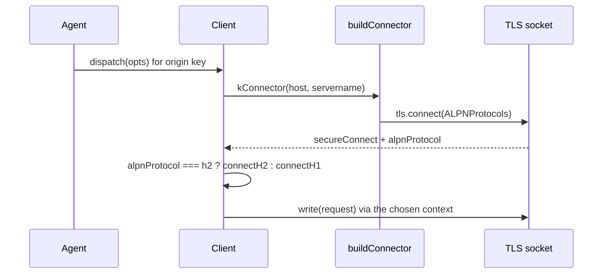

# nodejs/undici — module: http-versions-dispatcher

## Responsibility

This slice opens the network connection, decides which HTTP version to speak on it, and sends requests over it. The `Client` owns one connection and a queue. A connector builds the TCP or TLS socket and offers HTTP versions through ALPN (a TLS extension where client and server agree on a protocol name). After the socket is ready, `Client` picks the HTTP/1.1 code or the HTTP/2 code from the protocol the server chose. The `Agent` keeps one dispatcher per origin.

## Key files

| File | Role |
|------|------|
| `lib/core/connect.js` | Builds the socket: TCP or TLS, ALPN list, TLS session cache, keep-alive, connect timeout |
| `lib/dispatcher/client.js` | One connection plus request queue; chooses h1 or h2 after connect; options and defaults |
| `lib/dispatcher/client-h1.js` | HTTP/1.1 writer and response handler: keep-alive, pipelining, socket reuse checks |
| `lib/dispatcher/client-h2.js` | HTTP/2 session: streams, SETTINGS, GOAWAY, PING liveness probe |
| `lib/dispatcher/agent.js` | Map of origin to Client or Pool; separate entry for "HTTP/1 only" |
| `test/http2-alpn.js`, `test/connect-h2-alpn-order.js` | Tests that ALPN really leads to h2 and that the offer order is right |

## How it works

1. `Agent` computes a map key from the origin. If the caller sets `allowH2: false`, the key gets a `#http1-only` suffix, so an HTTP/1-only client never shares an entry with an h2-capable one (`lib/dispatcher/agent.js:86-87 @ 011d947`). It creates a `Pool`, or a single `Client` when `connections === 1` (`lib/dispatcher/agent.js:18-21 @ 011d947`).
2. `Client` queues the request. When no connection context exists, `_resume` stores the server name and calls `connect(client)` (`lib/dispatcher/client.js:727-730 @ 011d947`).
3. The connector is built once in the constructor from TLS options, `allowH2`, `useH2c` and the connect timeout (`lib/dispatcher/client.js:283-293 @ 011d947`).
4. For `https:` the connector calls `tls.connect` with an `ALPNProtocols` list. With `allowH2` off the list is only `http/1.1`. With `preferH2` it is `['h2', 'http/1.1']`. Otherwise it is `['http/1.1', 'h2']` (`lib/core/connect.js:98 @ 011d947`).
5. For plain `http:` there is no TLS, so no ALPN. The option `useH2c` forces `socket.alpnProtocol = 'h2'` to speak HTTP/2 over cleartext (`lib/core/connect.js:134-137 @ 011d947`).
6. Once connected, `Client` reads `socket.alpnProtocol`. `'h2'` goes to `connectH2`; anything else goes to `connectH1` (`lib/dispatcher/client.js:557-559 @ 011d947`). Both return an object with the same shape (`version`, `write`, `resume`, `busy`, `destroy`), so the rest of `Client` does not care about the version (`lib/dispatcher/client-h1.js:920-926 @ 011d947`, `lib/dispatcher/client-h2.js:340-345 @ 011d947`).
7. The `_resume` loop writes each queued request through `busy(request)` then `write(request)` (`lib/dispatcher/client.js:737-741 @ 011d947`).
8. The ceiling on parallel requests depends on the version: HTTP/1 uses the `pipelining` option (default 1), HTTP/2 uses the stream limit (`lib/dispatcher/client.js:93-98 @ 011d947`, `lib/dispatcher/client.js:307 @ 011d947`).

## Beyond the textbook

### ALPN offer order is a setting, and the server decides

- Textbook version: "HTTPS upgrades to HTTP/2 if the server supports it."
- What they do: the client sends a list in a chosen order. By default `http/1.1` comes first, so a server that follows the client's order picks HTTP/1.1. The `preferH2` option flips the order. Two tests assert the exact arrays that reach `tls.connect`.
- Why: HTTP/1.1 stays the safe default for a client that began as an HTTP/1.1 library; h2 is opt-in by order. The test names state the intent.
- Evidence: `lib/core/connect.js:98 @ 011d947`, `test/connect-h2-alpn-order.js:26 @ 011d947`, `test/connect-h2-alpn-order.js:46 @ 011d947`.

### The server's stream limit can lower the client's limit, never raise it

- Textbook version: "HTTP/2 allows many parallel streams on one connection."
- What they do: the client has its own cap (default 100). When the server's SETTINGS frame arrives, the client uses the smaller number. A comment explains that a default Node.js server advertises 2^32-1, which must not become the client's limit.
- Why: protects the client from unbounded concurrency.
- Evidence: `lib/dispatcher/client.js:329 @ 011d947`, `lib/dispatcher/client-h2.js:630-635 @ 011d947`.

### Replay budget after GOAWAY

- Textbook version: "On GOAWAY, retry the request on a new connection."
- What they do: a request refused by GOAWAY is replayed at most once (`MAX_GOAWAY_REPLAY_ATTEMPTS = 1`). A comment cites RFC 9113 section 8.7 and the risk of an endless connect-refuse-reconnect loop that starves the event loop.
- Why: a peer that refuses every connection must end in an error, not a loop.
- Evidence: `lib/dispatcher/client-h2.js:56-61 @ 011d947`, `lib/dispatcher/client-h2.js:211-221 @ 011d947`.

### A PING probe tells a slow stream from a dead connection

- Textbook version: "A request timeout means the request failed."
- What they do: in HTTP/1.1 a timeout destroys the socket. In HTTP/2 a stream timeout only resets that stream, so a silently dead connection would make every new stream time out. After a stream timeout the client sends a PING. If no ack arrives (at least 1 second), the session is dropped and queued requests move to a fresh connection. New streams are blocked while the probe is open. The client also sends a PING every 60 seconds by default.
- Why: stated in the comment, a NAT or load balancer may drop the connection without telling the client.
- Evidence: `lib/dispatcher/client-h2.js:64-70 @ 011d947`, `lib/dispatcher/client-h2.js:521-540 @ 011d947`, `lib/dispatcher/client-h2.js:382-385 @ 011d947`, `lib/dispatcher/client.js:326-327 @ 011d947`.

### Keep-alive reuse is validated, not assumed

- Textbook version: "Keep-alive means reuse the socket for the next request."
- What they do: the client reads the `Keep-Alive` response header and uses its timeout minus a 2 second threshold, capped by a maximum (default 4 s fallback, 600 s cap). If the result is zero or less, the socket is marked for reset. Before reusing an idle socket, it yields one event-loop turn so a FIN or unexpected bytes already waiting are seen first. It also checks the clock, because a blocked event loop cannot fire the idle timer.
- Why: a comment links the check to a security advisory (GHSA-35p6-xmwp-9g52) and to two issues about timer cost; a ref'd `setImmediate` avoids a 1 ms timer floor and a 500 ms idle stall.
- Evidence: `lib/dispatcher/client-h1.js:708-716 @ 011d947`, `lib/dispatcher/client.js:309-311 @ 011d947`, `lib/dispatcher/client-h1.js:1090-1106 @ 011d947`, `lib/dispatcher/client-h1.js:1141-1148 @ 011d947`.

### Pipelining is off by default and unsafe requests wait

- Textbook version: "HTTP/1.1 allows pipelining."
- What they do: the default is 1 request at a time per connection. Even with pipelining on, a non-idempotent request, an upgrade, or a stream body waits until earlier requests finish, because an error could break the others. HTTP/2 skips this rule, because streams are independent. The comments in the h2 `busy` say so.
- Why: the comment says a stream or non-idempotent request "cannot be retried".
- Evidence: `lib/dispatcher/client.js:307 @ 011d947`, `lib/dispatcher/client-h1.js:951-987 @ 011d947`, `lib/dispatcher/client-h2.js:390-398 @ 011d947`.

### Pool fan-out stops when HTTP/2 is active

- Textbook version: "A pool opens more connections when busy."
- What they do: `kBusy` is how a `Pool` decides to add another `Client`. For h1 a pending request means busy. For h2 that signal is switched off, so concurrent requests share one session.
- Why: the comment says more connections would defeat multiplexing.
- Evidence: `lib/dispatcher/client.js:388-399 @ 011d947`.

### TLS session resumption with weak references

- Textbook version: "Reuse TLS sessions to skip the full handshake."
- What they do: a cache keyed by server name holds sessions through `WeakRef`. Entries are evicted when the cache is full (dead ones first, then the oldest). Default size is 100.
- Why: reuse without keeping sessions alive forever. A TODO admits that parallel first connections can still resolve the same name twice.
- Evidence: `lib/core/connect.js:10-14 @ 011d947`, `lib/core/connect.js:15-65 @ 011d947`, `lib/core/connect.js:74 @ 011d947`.

## Tests and what they protect

- `test/http2-alpn.js` starts a TLS server that allows both HTTP/2 and HTTP/1, then checks that undici's response body reports `alpnProtocol: 'h2'` and `httpVersion: '2.0'`. A plain `https` request restricted to `http/1.1` gets `1.1` from the same server. So the test shows that undici moved up to h2 on the same port (`test/http2-alpn.js:18-58 @ 011d947`, `test/http2-alpn.js:93-125 @ 011d947`).
- The same test fails if the client emits an unexpected `disconnect` (`test/http2-alpn.js:65-69 @ 011d947`). A second test repeats this for POST (`test/http2-alpn.js:134 @ 011d947`).
- `test/connect-h2-alpn-order.js` mocks `tls.connect` and asserts the exact `ALPNProtocols` array in both orders (`test/connect-h2-alpn-order.js:29-41 @ 011d947`). Tests use the real server with a fixture certificate, not a stub (`test/connect-h2-alpn-order.js:13-15 @ 011d947`).
- Not covered in this slice: GOAWAY, PING probe, keep-alive timing. Their tests were not in the slice.

## Error handling, performance, and security

- Option checks throw `InvalidArgumentError` for bad HTTP/2 values, such as a stream limit below 1 (`lib/dispatcher/client.js:243-245 @ 011d947`). Old option names throw with a hint to the new one (`lib/dispatcher/client.js:145-147 @ 011d947`).
- A certificate name mismatch (`ERR_TLS_CERT_ALTNAME_INVALID`) fails the running requests and the queued ones for that server name at once. Other connect errors go through the normal error path (`lib/dispatcher/client.js:622-632 @ 011d947`).
- Connect timeout is 10 s by default. If every address tried by `autoSelectFamily` times out, the `AggregateError` is turned into `ConnectTimeoutError` with the original as `cause` (`lib/core/connect.js:75 @ 011d947`, `lib/core/connect.js:173-196 @ 011d947`).
- Sockets get TCP keep-alive (initial delay 60 s) and `setNoDelay(true)` (`lib/core/connect.js:141-149 @ 011d947`).
- If the servername changes between requests on an https client, the connection is destroyed and rebuilt, but only when no request is running (`lib/dispatcher/client.js:713-720 @ 011d947`).
- HTTP/2 performance: larger flow-control windows than Node defaults (256 KB stream, 512 KB connection), with comments on why (`lib/dispatcher/client.js:331-337 @ 011d947`); server push is disabled (`lib/dispatcher/client-h2.js:277-282 @ 011d947`).
- A stream abort destroys the stream synchronously to avoid a memory leak that a comment ties to issue #5558 (`lib/dispatcher/client-h2.js:1170-1181 @ 011d947`).
- Header safety: the h2 header builder uses `Object.hasOwn` so a `__proto__` header does not read through the prototype chain (`lib/dispatcher/client-h2.js:936-938 @ 011d947`).
- Idle sockets are `unref`'d so an idle client does not keep Node alive (`lib/dispatcher/client-h1.js:1130-1136 @ 011d947`).

## Technologies and services seen

- `node:tls` — TLS sockets, ALPN, session events (`lib/core/connect.js:81 @ 011d947`)
- `node:net` — plain TCP sockets and IP checks (`lib/core/connect.js:3 @ 011d947`)
- `node:http2` — the HTTP/2 session and stream implementation (`lib/dispatcher/client-h2.js:77-81 @ 011d947`)
- llhttp (or the Milo parser) — HTTP/1 response parser, chosen per client (`lib/dispatcher/client-h1.js:913-915 @ 011d947`)
- `node:test` and `@matteo.collina/tspl` — test runner and plan helper (`test/connect-h2-alpn-order.js:3-4 @ 011d947`)
- `diagnostics_channel` events (`beforeConnect`, `connected`, `connectError`) — hooks for observability (`lib/dispatcher/client.js:512-530 @ 011d947`)
- TLS fixtures (`test/fixtures/key.pem`, `cert.pem`, `ca.pem`) — local certificates for tests (`test/connect-h2-alpn-order.js:13-15 @ 011d947`)

## Worth exploring interactively

- Choosing HTTP/1 or HTTP/2 for a connection — steps: `Agent` makes the key (`lib/dispatcher/agent.js:86-87 @ 011d947`); `_resume` calls `connect` (`lib/dispatcher/client.js:727-730 @ 011d947`); connector sets the ALPN list (`lib/core/connect.js:98 @ 011d947`); `secureConnect` returns the socket (`lib/core/connect.js:150-157 @ 011d947`); `Client` picks `connectH2` or `connectH1` (`lib/dispatcher/client.js:557-559 @ 011d947`); `write` goes to the chosen context (`lib/dispatcher/client.js:741 @ 011d947`) — fits FlowAnimation because the learner sees one request travel through the functions and the branch change with the server's answer.
- HTTP/2 session life — states: connected (`lib/dispatcher/client-h2.js:340-341 @ 011d947`), settings received and stream cap lowered (`lib/dispatcher/client-h2.js:634-635 @ 011d947`), stream timeout then PING probe (`lib/dispatcher/client-h2.js:521-540 @ 011d947`), GOAWAY received (`lib/dispatcher/client-h2.js:709-714 @ 011d947`), session dropped and requests requeued (`lib/dispatcher/client-h2.js:514-515 @ 011d947`) — fits StateMachine because the session moves through clear lifecycle states.

## Open questions

- The tests for GOAWAY replay, the PING probe and keep-alive timing are outside this slice. The synthesis may not be able to confirm what they protect.
- How `Pool` decides to open a new `Client` is only seen through `kBusy` here; `Pool` itself was not read.

## My insights
