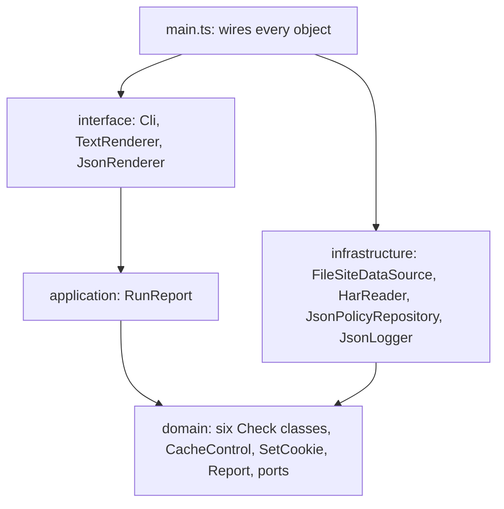

# Internet & networking — capstone

## What it is

Site network report is a Node.js command line tool. Before a launch, a team saves a site's DNS answers, TLS certificate facts and HAR responses. The tool checks them against a policy and reports problems in DNS, HTTPS and HSTS, HTTP version, caching, compression and cookies. A [[HAR file]] is the export of the browser's network panel. The exit code lets CI block a launch.

It builds on the three mini projects in [[03-mini-projects-internet-and-networking]]: the DNS record inspector, the cache header auditor and the cookie attribute linter. The project folder is `projects/frontend-engineering/how-the-web-works/internet-and-networking/capstone/`.

## Architecture at a glance



More views: [[visual-capstone-layers-internet-and-networking|Layers]], [[visual-capstone-request-flow-internet-and-networking|One run]], [[visual-capstone-deployment-internet-and-networking|Run recipe]].

## Layers and key classes

- **domain**: six `Check` classes (`DnsCheck`, `TlsHstsCheck`, `HttpVersionCheck`, `CachingCheck`, `CompressionCheck`, `CookieCheck`), the parsers `CacheControl` and `SetCookie`, `Report`, and the ports.
- **application**: `RunReport`, the one use case. It loads each input once and isolates a crashing check.
- **infrastructure**: `FileSiteDataSource`, `HarReader`, `JsonPolicyRepository`, `JsonLogger`, the clocks, and `loadConfig`.
- **interface**: `Cli`, `TextRenderer`, `JsonRenderer`. `src/main.ts` wires everything.

## Ideas applied

- Dependency inversion: `RunReport` receives ports, so tests use in-memory fakes.
- Open/closed: a new check is a new class. A new cookie rule is a row of data ([[Rules as data]]).
- Unreadable data is a finding, not a pass ([[Three-valued results]], [[Fail closed]]).
- Strict output and lenient input in the parsers ([[Strict output, lenient input]]).
- Exit codes carry the result to CI ([[Exit codes]]). The cookie rules come from [[Set-Cookie attributes]]; the cache rules from [[HTTP caching]].

## Borrowed from production

| Practice | Source note | Applied in |
|---|---|---|
| Report which freshness rule won | [[undici-takeaways]] | `src/domain/freshness.ts` |
| Unreadable header is its own result | [[undici-takeaways]] | `src/domain/finding.ts` |
| Shared-cache leak and Vary checks | [[undici-takeaways]] | `src/domain/checks/cachingCheck.ts` |
| Name the client that made the HAR | [[undici-takeaways]] | `src/domain/checks/httpVersionCheck.ts` |
| Cookie rules as one list, lenient reader | [[cookie-takeaways]] | `src/domain/checks/cookieCheck.ts` |
| Fixtures with expected findings and a skip list | [[undici-takeaways]], [[cookie-takeaways]] | `fixtures/`, `README.md` |

## How to run it

```bash
cd projects/frontend-engineering/how-the-web-works/internet-and-networking/capstone
npm install
npm test              # 52 tests
npm start             # good sample, exit 0
npm run start:bad     # bad sample, exit 1 on purpose
```

Node.js 26 runs the TypeScript directly. Settings are environment variables; see `.env.example`.

## How to extend it

Add a class that implements `Check` in `src/domain/checks/`, a test, and one line in `src/main.ts`. For live data, write a new `SiteDataSource` class and change one line in `src/main.ts`.

## My insights
