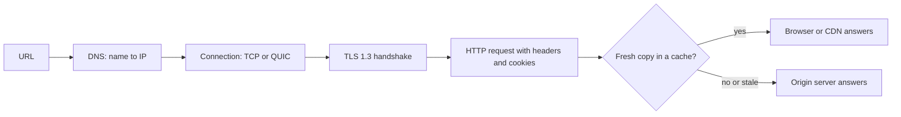

## In one sentence

Every page load is a chain of network steps (DNS, connection, TLS, HTTP, caches) and each step has headers or settings that make it faster or safer.

## The mental model



Find the slow or broken step first, then change the setting that belongs to that step.

## Visual refresher

- [[visual-how-it-works-internet-and-networking|The journey of one web request]]: the whole chain in order.
- [[visual-dns-resolution-chain-internet-and-networking|DNS resolution chain]]: resolver, root, TLD and authoritative server.
- [[visual-http-versions-lab-internet-and-networking|HTTP versions lab]]: interactive mode. Redo the checkpoint where one packet is lost under HTTP/2 and HTTP/3.
- [[visual-tls13-handshake-internet-and-networking|TLS 1.3 handshake]]: explainer video, storyboard only.
- [[visual-http-cache-lab-internet-and-networking|HTTP cache lab]]: hybrid mode. Redo the `no-cache` and `Vary` presets.
- [[visual-cookie-send-lab-internet-and-networking|Cookie send lab]]: interactive mode. Redo the cross-site POST preset.
- [[visual-realtime-transport-deck-internet-and-networking|Realtime transport deck]]: branching mode. Redo the chat branch.

All visuals: [[visuals-internet-and-networking|all visuals]].

## Key ideas

- Data crosses the internet as packets. TCP resends lost packets and keeps order; UDP does not.
- DNS turns a name into records. The TTL decides how long resolvers cache an answer, so lower it before a move.
- HTTP/1.1 waits per connection, HTTP/2 multiplexes streams on one TCP connection, and HTTP/3 runs on QUIC, so a lost packet blocks only its own stream.
- TLS 1.3 needs one round trip. The certificate chain proves the server's name; 0-RTT data can be replayed.
- Status codes carry behavior: 307 and 308 redirect and keep the method and body, 401 asks for credentials while 403 refuses valid ones, 206 returns one byte range, and 429 with `Retry-After` says when to try again.
- A cached response is fresh until `max-age` (or `s-maxage` for shared caches) runs out; then the cache revalidates with `ETag` and gets `304`.
- A cookie goes with a request only if Domain, Path, Secure and SameSite allow it. `__Host-` locks it to one host.
- Origin is scheme, host and port; site is scheme plus registrable domain.

## When to use it / when not to

Use these settings when:
- You ship hashed assets: give them a long `max-age` with `immutable`, and let HTML revalidate.
- A login cookie exists: set `Secure`, `HttpOnly`, `SameSite` and a `__Host-` prefix.

Do not:
- Use `no-store` to mean "check first". `no-cache` already revalidates and keeps the copy.
- Pick WebSockets for one-way server updates. Server-Sent Events are simpler and use plain HTTP.

## Trade-offs and failure modes

- A long TTL during a host move. Symptom: some users still reach the old server for hours.
- `Vary: *` or a missing `Vary`. Symptom: a CDN stores nothing, or it serves the wrong language or encoding.
- A shared cache stores a personal response. Symptom: one user sees another user's page; use `private`.
- `SameSite=None` without `Secure`. Symptom: the browser rejects the cookie.

## Commands or code worth remembering

```http
Cache-Control: public, max-age=31536000, immutable
Cache-Control: no-cache
ETag: "v42"
Set-Cookie: __Host-session=abc; Secure; HttpOnly; SameSite=Lax; Path=/
Strict-Transport-Security: max-age=31536000; includeSubDomains
```

## What production systems do differently

- undici stores a response with `max-age=0` when it has a validator, so it can revalidate later: [[undici-findings|undici findings]].
- undici strips `Authorization` and `Cookie` on a cross-origin redirect: [[undici-findings|undici findings]].
- jshttp/cookie writes strictly and reads leniently, and checks every `Set-Cookie` attribute to block header injection: [[cookie-findings|cookie findings]].

## Go deeper

[[01-brief-internet-and-networking|Brief]] · [[02-lesson-internet-and-networking|Lesson]] · [[03-mini-projects-internet-and-networking|Mini projects]] · [[00-digests-internet-and-networking|Digests]] · [[00-repo-intel-internet-and-networking|Repository deep dive]] · [[06-capstone-internet-and-networking|Capstone]] · [[08-recall-internet-and-networking|Recall cards]]

## My insights
