# Concept map of Internet & networking

Generated from the research curriculum. A solid arrow points from a concept to the concept that refines it; a dotted arrow shows a prerequisite.

```mermaid
flowchart TD
  internet_packets_and_routing["How the internet moves packets"]
  tcp_vs_udp["TCP versus UDP"]
  routing_and_isps["Routing, ISPs and autonomous systems"]
  domains_and_hosting["Domain names and hosting"]
  registrars_tlds_nameservers["Registrars, TLDs and nameservers"]
  dns_resolution["DNS resolution"]
  dns_record_types["DNS record types and TTL"]
  dns_prefetch_and_doh["DNS prefetch and DNS over HTTPS"]
  http_messages["HTTP request and response messages"]
  http_methods_and_idempotency["HTTP methods and idempotency"]
  http_status_codes["HTTP status codes"]
  content_negotiation_and_keep_alive["Content negotiation, headers and keep-alive"]
  http_versions["HTTP/1.1, HTTP/2 and HTTP/3"]
  head_of_line_blocking_and_multiplexing["Head-of-line blocking and multiplexing"]
  header_compression_and_priorities["Header compression and stream priorities"]
  quic_0rtt_and_migration["QUIC, 0-RTT and connection migration"]
  http1_era_anti_patterns["Why domain sharding and sprites are anti-patterns now"]
  tls_and_https["TLS and HTTPS"]
  tls13_handshake["The TLS 1.3 handshake"]
  certificates_and_chain_of_trust["Certificates, CAs and the chain of trust"]
  hsts_and_mixed_content["HSTS and mixed content"]
  certificate_transparency["Certificate transparency"]
  urls_and_origins["URLs and origins"]
  url_parts_and_encoding["URL parts and encoding"]
  origin_vs_site["Origin versus site and the public suffix list"]
  http_caching["HTTP caching"]
  cache_control_directives["Cache-Control directives"]
  validation_etag_last_modified["Revalidation with ETag and Last-Modified"]
  vary_and_shared_caches["Vary, browser caches and shared caches"]
  hashed_filenames_cache_busting["Cache busting with hashed filenames"]
  cdns_and_edge["CDNs and the edge"]
  pops_cache_keys_and_purge["PoPs, origin shield, cache keys and purge"]
  edge_compute_and_image_cdns["Edge compute and image CDNs"]
  http_compression["HTTP compression"]
  gzip_brotli_zstd["gzip, Brotli and Zstandard"]
  compression_dictionaries["Compression dictionaries"]
  cookies["Cookies"]
  set_cookie_attributes["Set-Cookie attributes and SameSite"]
  cookie_prefixes_and_chips["Cookie prefixes and partitioned cookies (CHIPS)"]
  third_party_cookies["First-party and third-party cookies"]
  realtime_transports["Realtime transports"]
  polling_and_sse["Polling, long polling and Server-Sent Events"]
  websockets["WebSockets"]
  webtransport_and_webrtc["WebTransport and WebRTC"]
  api_styles["REST, GraphQL and RPC"]
  graphql_queries["Query-based GraphQL"]
  rpc_trpc_grpc_web["RPC: tRPC, gRPC-web and Connect"]
  internet_packets_and_routing --> tcp_vs_udp
  internet_packets_and_routing --> routing_and_isps
  domains_and_hosting --> registrars_tlds_nameservers
  registrars_tlds_nameservers -. needed for .-> dns_resolution
  dns_resolution --> dns_record_types
  dns_resolution --> dns_prefetch_and_doh
  tcp_vs_udp -. needed for .-> http_messages
  http_messages --> http_methods_and_idempotency
  http_messages --> http_status_codes
  http_messages --> content_negotiation_and_keep_alive
  http_messages -. needed for .-> http_versions
  http_versions --> head_of_line_blocking_and_multiplexing
  http_versions --> header_compression_and_priorities
  http_versions --> quic_0rtt_and_migration
  http_versions --> http1_era_anti_patterns
  tcp_vs_udp -. needed for .-> tls_and_https
  tls_and_https --> tls13_handshake
  tls_and_https --> certificates_and_chain_of_trust
  tls_and_https --> hsts_and_mixed_content
  tls_and_https --> certificate_transparency
  urls_and_origins --> url_parts_and_encoding
  urls_and_origins --> origin_vs_site
  http_messages -. needed for .-> http_caching
  http_caching --> cache_control_directives
  http_caching --> validation_etag_last_modified
  http_caching --> vary_and_shared_caches
  http_caching --> hashed_filenames_cache_busting
  http_caching -. needed for .-> cdns_and_edge
  cdns_and_edge --> pops_cache_keys_and_purge
  cdns_and_edge --> edge_compute_and_image_cdns
  content_negotiation_and_keep_alive -. needed for .-> http_compression
  http_compression --> gzip_brotli_zstd
  http_compression --> compression_dictionaries
  origin_vs_site -. needed for .-> cookies
  cookies --> set_cookie_attributes
  cookies --> cookie_prefixes_and_chips
  cookies --> third_party_cookies
  http_versions -. needed for .-> realtime_transports
  realtime_transports --> polling_and_sse
  realtime_transports --> websockets
  realtime_transports --> webtransport_and_webrtc
  http_messages -. needed for .-> api_styles
  api_styles --> graphql_queries
  api_styles --> rpc_trpc_grpc_web
```

Back to [[visuals-internet-and-networking|all visuals]].

## My insights
