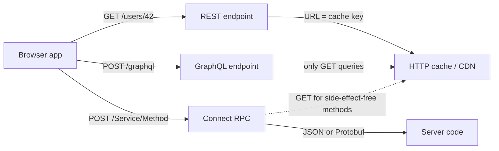

# One request in REST, GraphQL and Connect RPC, and which one HTTP caches

**Comparison** · teaches REST, GraphQL and RPC, Query-based GraphQL, RPC over HTTP: gRPC-web and Connect

**Why this visual.** Show where each API style puts its contract in the HTTP request, and why only GET requests, keyed by URL, fit HTTP caching.

## What it shows

HTTP identifies each resource by a URL (RFC 9110). A REST-style endpoint, simplified here, gives each resource its own URL, which HTTP caches and CDNs use as the cache key. GraphQL sends every operation to one endpoint, usually /graphql, with POST; only GET queries can be cached. Connect RPC posts to a URL named after the service and method, with JSON or Protobuf. A Connect method marked side-effect free can be sent as GET, so caches can store it too.

Text alternative: Flowchart from a browser app to three endpoints. GET /users/42 goes to a REST endpoint, whose URL is the cache key for an HTTP cache or CDN. POST /graphql goes to a GraphQL endpoint, which reaches the cache only for GET queries, drawn as a dotted line. POST /Service/Method goes to Connect RPC, which sends JSON or Protobuf to server code; a dotted line shows that side-effect-free Connect methods sent with GET can also reach the cache.

## Check yourself

Why can a CDN cache GET /users/42 but not a GraphQL query sent as POST /graphql, and how can a Connect RPC call become cacheable?

Answer: HTTP caches use the URL of a GET request as the key. Every GraphQL POST goes to the same URL with the query in the body, so the URL does not identify the data; sending the query with GET puts it in the URL. Connect can send a method marked side-effect free as a GET request, which caches can store the same way.

## Sources

- RFC 9110: HTTP Semantics — https://www.rfc-editor.org/rfc/rfc9110 (`rfc-9110-http-semantics`)
- Learn GraphQL (graphql.org) — https://graphql.org/learn/ (`graphql-learn`)
- Connect RPC documentation — https://connectrpc.com/docs/introduction (`connectrpc-docs`)

## Used in

- lesson page `/frontend-engineering/how-the-web-works/internet-and-networking/lesson/12-api-styles-in-production/` (file `site/src/content/lessons/frontend-engineering/how-the-web-works/internet-and-networking/12-api-styles-in-production.mdx`)

Back to [[visuals-internet-and-networking|all visuals]].

## My insights
