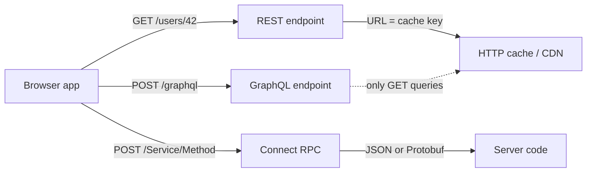

# One request in REST, GraphQL and Connect RPC, and which one HTTP caches

**Comparison** · teaches REST, GraphQL and RPC, Query-based GraphQL, RPC over HTTP: gRPC-web and Connect

**Why this visual.** Show where each API style puts its contract in the HTTP request, and why only URL-based requests fit HTTP caching by default.

## What it shows

A REST-style endpoint names each resource by its URL, so the URL is the cache key that HTTP caches and CDNs use. GraphQL sends every operation to one endpoint, usually /graphql, with POST; only queries sent with GET can use HTTP caching. Connect RPC posts to a URL named after the service and method and carries JSON or binary Protobuf over HTTP/1.1, HTTP/2 or HTTP/3.

Text alternative: Flowchart from a browser app to three endpoints. GET /users/42 goes to a REST endpoint, whose URL is the cache key for an HTTP cache or CDN. POST /graphql goes to a GraphQL endpoint, which reaches the cache only for GET queries, drawn as a dotted line. POST /Service/Method goes to Connect RPC, which sends JSON or Protobuf to server code, so only the URL-based style caches by default.

## Check yourself

Why can a CDN cache GET /users/42 but not a GraphQL query sent as POST /graphql?

Answer: HTTP caches use the URL as the key. Every GraphQL POST goes to the same URL with the query in the body, so the URL does not identify the data. Sending the query with GET puts it in the URL and makes caching possible.

## Sources

- Learn GraphQL (graphql.org) — https://graphql.org/learn/ (`graphql-learn`)
- Connect RPC documentation — https://connectrpc.com/docs/introduction (`connectrpc-docs`)

## Used in

- lesson page `/frontend-engineering/how-the-web-works/internet-and-networking/lesson/12-api-styles-in-production/` (file `site/src/content/lessons/frontend-engineering/how-the-web-works/internet-and-networking/12-api-styles-in-production.mdx`)

Back to [[visuals-internet-and-networking|all visuals]].

## My insights
