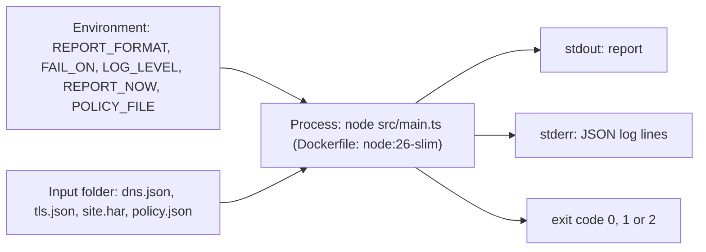

# Site network report: run recipe

**Deployment** · teaches DNS resolution, [[TLS and HTTPS]], HTTP/1.1, HTTP/2 and HTTP/3, [[HTTP caching]], HTTP compression, Cookies

**Why this visual.** Show what the process reads and writes when it runs locally or in the Docker container.

## What it shows

The process is node src/main.ts, started by npm start or by the Dockerfile on node:26-slim. It reads settings from environment variables and four files from one input folder. It writes the report to stdout, JSON log lines to stderr, and exits with code 0, 1 or 2. It uses no network, database or queue.

Text alternative: Flowchart with an environment-variable box and an input-folder box both pointing to the node process. The process points to three outputs: the report on stdout, JSON log lines on stderr, and an exit code of 0, 1 or 2.

## Check yourself

Why can a CI job use the exit code alone to block a launch?

Answer: Exit 1 means findings reached the FAIL_ON level and exit 2 means bad input, so only exit 0 lets the job pass.

## Sources

- nodejs/undici: HTTP/1.1 client for Node.js (fetch, cache interceptor, cookies) — https://github.com/nodejs/undici (`nodejs-undici-repo`)
- jshttp/cookie: RFC 6265 cookie parse and serialize for Node.js — https://github.com/jshttp/cookie (`jshttp-cookie-repo`)
- RFC 9111: HTTP Caching — https://www.rfc-editor.org/rfc/rfc9111 (`rfc-9111-http-caching`)
- RFC 9846: The Transport Layer Security (TLS) Protocol Version 1.3 — https://www.rfc-editor.org/rfc/rfc9846 (`rfc-9846-tls13`)

## Used in

- `projects/frontend-engineering/how-the-web-works/internet-and-networking/capstone/ARCHITECTURE.md`
- [[06-capstone-internet-and-networking]]

Back to [[visuals-internet-and-networking|all visuals]].

## My insights
