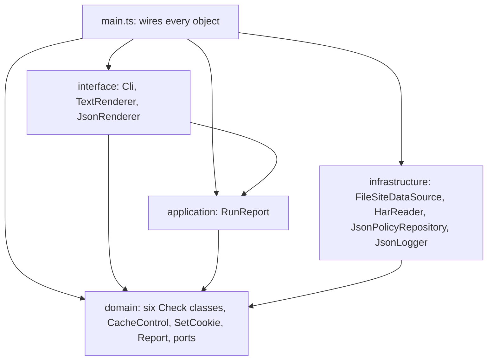

# Site network report: layers

**Architecture** · teaches DNS resolution, [[TLS and HTTPS]], HTTP/1.1, HTTP/2 and HTTP/3, [[HTTP caching]], HTTP compression, Cookies

**Why this visual.** Show the four layers of the capstone and that every dependency points inward to the domain.

## What it shows

main.ts creates every object. The interface layer (Cli and two renderers) calls the application layer (RunReport). RunReport and the infrastructure adapters both depend on the domain, which holds the six Check classes, the CacheControl and SetCookie parsers, Report and the port interfaces. The domain imports nothing from the other layers.

Text alternative: Flowchart with six boxes. main.ts points to the interface layer and the infrastructure layer. The interface layer points to the application layer, RunReport. The application layer and the infrastructure layer both point to the domain layer with the six checks, parsers, Report and ports.

## Check yourself

Which layer would you edit to add a seventh check, and why does the infrastructure layer not change?

Answer: The domain layer: add one Check class. Infrastructure only reads files and does not know which checks exist.

## Sources

- nodejs/undici: HTTP/1.1 client for Node.js (fetch, cache interceptor, cookies) — https://github.com/nodejs/undici (`nodejs-undici-repo`)
- jshttp/cookie: RFC 6265 cookie parse and serialize for Node.js — https://github.com/jshttp/cookie (`jshttp-cookie-repo`)
- RFC 9111: HTTP Caching — https://www.rfc-editor.org/rfc/rfc9111 (`rfc-9111-http-caching`)
- RFC 9846: The Transport Layer Security (TLS) Protocol Version 1.3 — https://www.rfc-editor.org/rfc/rfc9846 (`rfc-9846-tls13`)

## Used in

- `projects/frontend-engineering/how-the-web-works/internet-and-networking/capstone/ARCHITECTURE.md`
- [[06-capstone-internet-and-networking]]

Back to [[visuals-internet-and-networking|all visuals]].

## My insights
