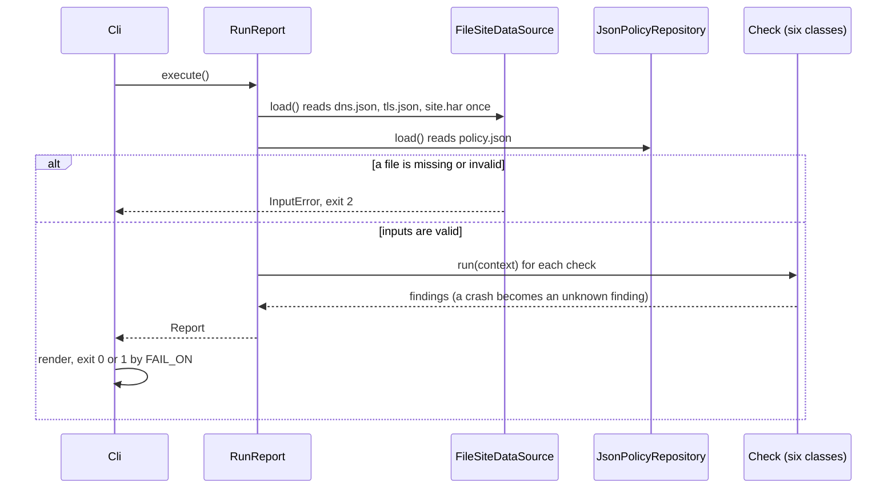

# Site network report: one run

**Sequence** · teaches DNS resolution, [[TLS and HTTPS]], HTTP/1.1, HTTP/2 and HTTP/3, [[HTTP caching]], HTTP compression, Cookies

**Why this visual.** Show one run from Cli to Report, including the invalid-input path and the crashing-check path.

## What it shows

Cli calls RunReport.execute. RunReport asks FileSiteDataSource to read dns.json, tls.json and site.har once, and JsonPolicyRepository to read policy.json. A missing or invalid file raises InputError and the Cli exits 2. Otherwise each Check runs on the same context; a check that throws becomes an unknown finding. Cli renders the Report and exits 0 or 1 by FAIL_ON.

Text alternative: Sequence diagram with Cli, RunReport, FileSiteDataSource, JsonPolicyRepository and Check. Cli calls RunReport.execute, which loads the data and policy. An alt block shows InputError and exit 2 for bad files, or each check returning findings to RunReport, then Report to Cli, which renders it and picks exit 0 or 1.

## Check yourself

What does the report show if one Check class throws an exception?

Answer: An unknown finding for that check. The other checks still run, and the crash is never counted as a pass.

## Sources

- nodejs/undici: HTTP/1.1 client for Node.js (fetch, cache interceptor, cookies) — https://github.com/nodejs/undici (`nodejs-undici-repo`)
- jshttp/cookie: RFC 6265 cookie parse and serialize for Node.js — https://github.com/jshttp/cookie (`jshttp-cookie-repo`)
- RFC 9111: HTTP Caching — https://www.rfc-editor.org/rfc/rfc9111 (`rfc-9111-http-caching`)
- RFC 9846: The Transport Layer Security (TLS) Protocol Version 1.3 — https://www.rfc-editor.org/rfc/rfc9846 (`rfc-9846-tls13`)

## Used in

- `projects/frontend-engineering/how-the-web-works/internet-and-networking/capstone/ARCHITECTURE.md`
- [[06-capstone-internet-and-networking]]

Back to [[visuals-internet-and-networking|all visuals]].

## My insights
