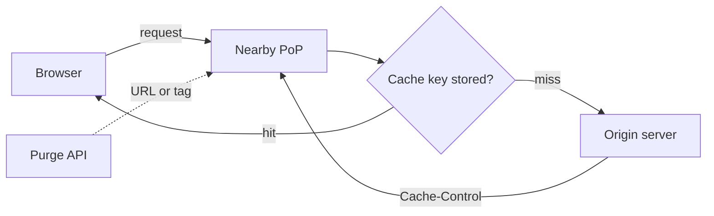

# One request through a CDN

**Workflow** · teaches CDNs and the edge, PoPs, tiered caching, cache keys and purge, [[HTTP caching]]

**Why this visual.** Show which layer of a CDN answers a request, where the cache key decides hit or miss, and what a purge removes.

## What it shows

The browser sends its request to a nearby point of presence (PoP), a CDN data center close to the user. The PoP builds a cache key; by default it is the full URL with the query string, plus a few headers such as Origin. On a hit it answers at once. On a miss it asks the origin and stores the response as its Cache-Control allows. A purge by URL or tag removes PoP copies only, so the next request refills from the origin.

Text alternative: Flowchart: the browser sends a request to a nearby PoP. The PoP checks whether its cache key is stored. A hit goes straight back to the browser. A miss goes to the origin server, which returns the response with Cache-Control to the PoP. A dashed arrow shows the purge API removing PoP copies by URL or by tag.

## Check yourself

You purge /app.js by URL. A user who loaded it one hour ago opens the page again via a link, and their cached copy is still fresh. Which layer answers, and why?

Answer: The user's browser cache answers, because its copy is still fresh and a normal navigation reuses it. A CDN purge removes copies at the PoPs only; it does not reach browser caches.

## Sources

- Cloudflare developer documentation (DNS, Cache, Workers, Images) — https://developers.cloudflare.com/ (`cloudflare-docs`)
- RFC 9111: HTTP Caching — https://www.rfc-editor.org/rfc/rfc9111 (`rfc-9111-http-caching`)

## Used in

- lesson page `/frontend-engineering/how-the-web-works/internet-and-networking/lesson/08-cdns-and-the-edge/` (file `site/src/content/lessons/frontend-engineering/how-the-web-works/internet-and-networking/08-cdns-and-the-edge.mdx`)

Back to [[visuals-internet-and-networking|all visuals]].

## My insights
