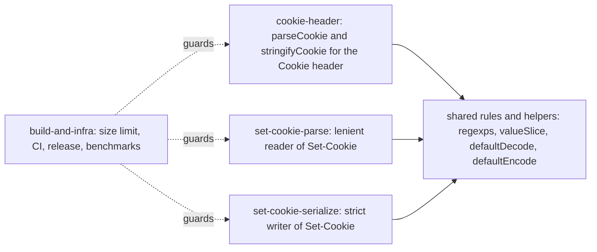

# jshttp/cookie: module map

**Architecture** · teaches Cookies

**Why this visual.** Show how the four parts of the cookie library relate, so the learner knows where each rule lives.

## What it shows

The library has three code modules and one support slice. The header module reads and writes the Cookie header. The parse module reads Set-Cookie leniently. The serialize module writes Set-Cookie strictly. All three use shared rules and helpers in one file. The build slice guards them with a size limit, CI and benchmarks.

Text alternative: Flowchart: three modules, cookie-header, set-cookie-parse and set-cookie-serialize, all point to a box of shared regular expressions and helper functions. A fourth box, build and infrastructure, points with dotted arrows at the three modules to show that it guards them.

## Check yourself

Which part decides how a bad Domain value is handled when you write a Set-Cookie header?

Answer: The set-cookie-serialize module checks the Domain against a regular expression and throws a TypeError.

## Sources

- jshttp/cookie: RFC 6265 cookie parse and serialize for Node.js — https://github.com/jshttp/cookie (`jshttp-cookie-repo`)

## Used in

- [[cookie-architecture]]

Back to [[visuals-internet-and-networking|all visuals]].

## My insights
