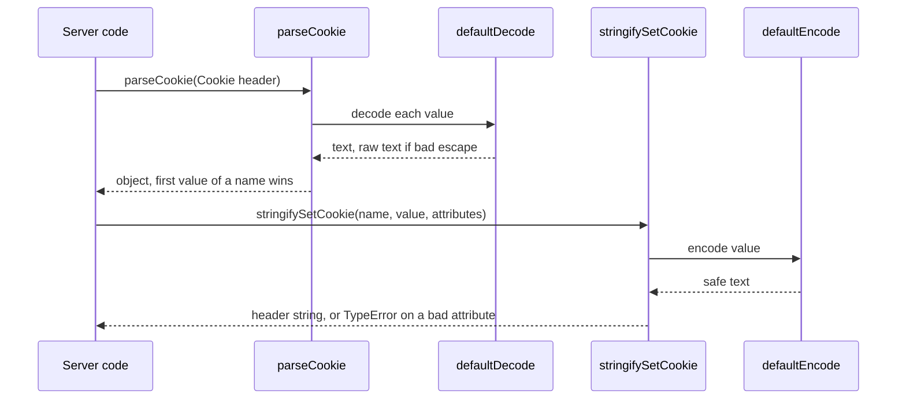

# jshttp/cookie: read a Cookie header, write a Set-Cookie header

**Sequence** · teaches Cookies

**Why this visual.** Show the order of calls when a server reads the cookies of a request and sets one in the response.

## What it shows

Server code calls parseCookie with the Cookie header. Each value goes through defaultDecode, which returns the raw text if the percent escape is bad. The result keeps the first value of each name. Later, the server calls stringifySetCookie. It encodes the value, checks each attribute, and returns the header string. A bad attribute throws a TypeError.

Text alternative: Sequence diagram: server code calls parseCookie, which calls defaultDecode for each value and returns an object. Server code then calls stringifySetCookie, which calls defaultEncode and returns the header string or throws a TypeError for a bad attribute.

## Check yourself

What happens when the Cookie header holds the value %1?

Answer: defaultDecode catches the error and returns the raw text, so parsing goes on and no exception reaches the server code.

## Sources

- jshttp/cookie: RFC 6265 cookie parse and serialize for Node.js — https://github.com/jshttp/cookie (`jshttp-cookie-repo`)

## Used in

- [[cookie-architecture]]

Back to [[visuals-internet-and-networking|all visuals]].

## My insights
