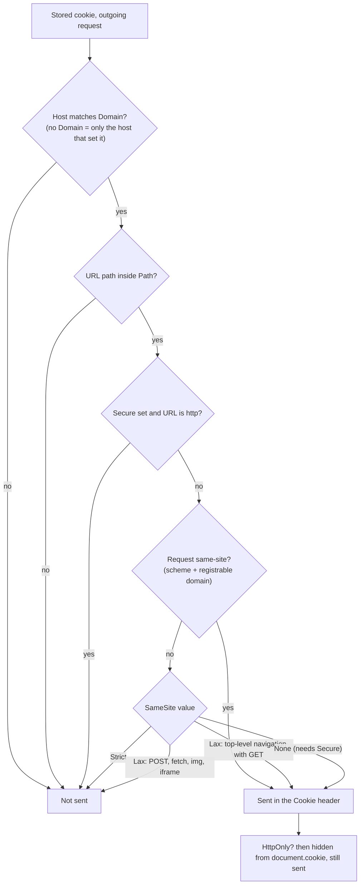

# Which checks a stored cookie passes before a request carries it

**Decision tree** · teaches Cookies, Set-Cookie attributes and SameSite, First-party and third-party cookies

**Why this visual.** Show the Domain, Path, Secure and SameSite checks that decide whether a request carries a stored cookie.

## What it shows

A request carries a stored cookie only when every check passes. Domain decides the hosts: without it, only the host that set the cookie. Path must contain the URL path. A Secure cookie needs https. For a cross-site request, Strict never goes, Lax goes only on a top-level navigation with a safe method such as GET, and None always goes but needs Secure. HttpOnly does not change sending; it hides the cookie from document.cookie.

Text alternative: Decision tree: a stored cookie goes through a Domain check, a Path check and a Secure check. A same-site request then sends it. A cross-site request checks SameSite: Strict is not sent, Lax is sent only on a top-level GET navigation, None is sent. A final note says HttpOnly hides the cookie from document.cookie but it is still sent.

## Check yourself

A cross-site image request goes to shop.example.com. Which SameSite value lets the cookie travel?

Answer: Only None, because an image is not a top-level navigation, so Lax and Strict cookies stay home. Some browsers also block third-party cookies by default.

## Sources

- MDN Web Docs: HTTP and web networking — https://developer.mozilla.org/en-US/docs/Web/HTTP (`mdn-http-docs`)
- URL Standard (WHATWG Living Standard) — https://url.spec.whatwg.org/ (`whatwg-url-standard`)

## Used in

- `projects/frontend-engineering/how-the-web-works/internet-and-networking/experiences/cookie-send-lab/experience.json`
- lesson page `/frontend-engineering/how-the-web-works/internet-and-networking/lesson/10-cookies/` (file `site/src/content/lessons/frontend-engineering/how-the-web-works/internet-and-networking/10-cookies.mdx`)

Back to [[visuals-internet-and-networking|all visuals]].

## My insights
