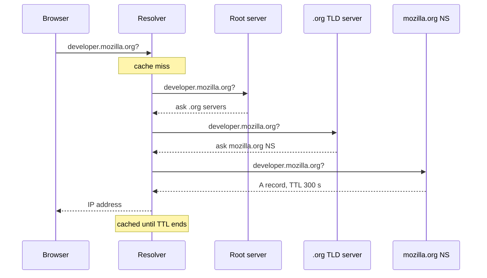

# How a resolver finds the IP address for developer.mozilla.org

**Sequence** · teaches DNS resolution, Registrars, TLDs and nameservers, DNS record types and TTL

**Why this visual.** Show the fixed order of a DNS lookup on a cache miss, and that the TTL of the answer decides how long the resolver reuses it.

## What it shows

On a cache miss, the recursive resolver asks three kinds of server in turn. The root server points to the .org TLD servers. The TLD server points to the nameservers of mozilla.org. The authoritative nameserver returns the A record with its TTL. The resolver gives the IP address to the browser and keeps the answer until the TTL ends. TTL 300 s is the Cloudflare default and is an example value here.

Text alternative: Sequence diagram with five participants: browser, recursive resolver, root server, .org TLD server and mozilla.org nameserver. The resolver misses its cache, asks the root, which refers it to .org, which refers it to the mozilla.org nameserver. That server returns an A record with TTL 300 seconds. The resolver returns the IP to the browser and caches it until the TTL ends.

## Check yourself

A second user asks the same resolver for developer.mozilla.org 2 minutes later. Which servers does the resolver contact?

Answer: None. The cached A record still has about 180 seconds of TTL left, so the resolver answers from its cache.

## Sources

- Cloudflare developer documentation (DNS, Cache, Workers, Images) — https://developers.cloudflare.com/ (`cloudflare-docs`)
- MDN Web Docs: HTTP and web networking — https://developer.mozilla.org/en-US/docs/Web/HTTP (`mdn-http-docs`)

## Used in

- lesson page `/frontend-engineering/how-the-web-works/internet-and-networking/lesson/02-domains-dns-and-hosting/` (file `site/src/content/lessons/frontend-engineering/how-the-web-works/internet-and-networking/02-domains-dns-and-hosting.mdx`)

Back to [[visuals-internet-and-networking|all visuals]].

## My insights
