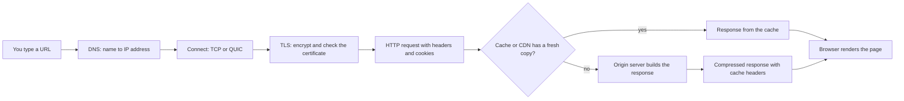

# The journey of one web request

**Workflow** · teaches DNS resolution, TCP versus UDP, [[TLS and HTTPS]], HTTP request and response messages, [[HTTP caching]], CDNs and the edge, HTTP compression, Cookies

**Why this visual.** Show the order of the network steps behind every page load, so each later page has a place in one picture.

## What it shows

The browser first asks DNS for the server's IP address. It opens a connection (TCP, or QUIC for HTTP/3) and runs a TLS handshake to encrypt it and check the certificate. It sends an HTTP request with headers and cookies. A browser cache or a CDN can answer from a fresh stored copy; otherwise the origin server builds the response, usually compressed and with cache headers. The browser then renders the page.

Text alternative: Flowchart: you type a URL, DNS turns the name into an IP address, the browser connects with TCP or QUIC, TLS encrypts and checks the certificate, the browser sends an HTTP request with headers and cookies. If a cache or CDN has a fresh copy it answers; otherwise the origin server builds a compressed response with cache headers. Both paths end with the browser rendering the page.

## Check yourself

A second visit to a page is much faster although the server is slow. Which step most likely answered, and what decided it?

Answer: A cache (the browser cache or a CDN) answered with a stored copy. The Cache-Control headers of the first response decided how long that copy stays fresh.

## Sources

- HTTP (MDN Web Docs documentation set) — https://developer.mozilla.org/en-US/docs/Web/HTTP (`mdn-http-docs`)
- High Performance Browser Networking — https://hpbn.co/ (`hpbn-book`)
- Cloudflare developer documentation (DNS, Cache, Workers, Images) — https://developers.cloudflare.com/ (`cloudflare-docs`)
- RFC 9111: HTTP Caching — https://www.rfc-editor.org/rfc/rfc9111 (`rfc-9111-http-caching`)

## Used in

- [[01-brief-internet-and-networking]]
- lesson page `/frontend-engineering/how-the-web-works/internet-and-networking/lesson/01-how-the-internet-works/` (file `site/src/content/lessons/frontend-engineering/how-the-web-works/internet-and-networking/01-how-the-internet-works.mdx`)

Back to [[visuals-internet-and-networking|all visuals]].

## My insights
