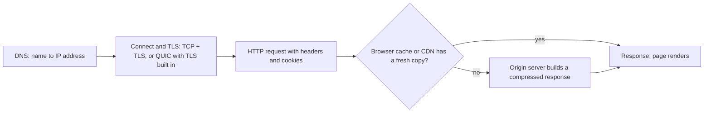

# The journey of one web request

**Workflow** · teaches DNS resolution, TCP versus UDP, [[TLS and HTTPS]], HTTP request and response messages, [[HTTP caching]], CDNs and the edge, HTTP compression, Cookies

**Why this visual.** Show the order of the network steps behind every page load, so each later page has a place in one picture.

## What it shows

The browser first asks DNS for the server's IP address. It then connects and encrypts: TCP followed by a TLS handshake, or QUIC for HTTP/3, which includes TLS in its own handshake. TLS also checks the certificate. The browser sends an HTTP request with headers and cookies. A browser cache or a CDN can answer from a fresh stored copy; otherwise the origin server builds the response, usually compressed and with cache headers. Either way, the response arrives and the browser renders the page.

Text alternative: Flowchart with six steps: DNS turns the name into an IP address; the browser connects and encrypts with TCP plus TLS, or QUIC with TLS built in; it sends an HTTP request with headers and cookies. A decision asks whether the browser cache or a CDN has a fresh copy. If yes, the response comes from the cache; if no, the origin server builds a compressed response. Both paths end at the response, where the page renders.

## Check yourself

A second visit to a page is much faster although the server is slow. Which step most likely answered, and what decided it?

Answer: A cache (the browser cache or a CDN) answered with a stored copy. The Cache-Control headers of the first response decided how long that copy stays fresh.

## Sources

- MDN Web Docs: HTTP and web networking — https://developer.mozilla.org/en-US/docs/Web/HTTP (`mdn-http-docs`)
- High Performance Browser Networking — https://hpbn.co/ (`hpbn-book`)
- Cloudflare developer documentation (DNS, Cache, Workers, Images) — https://developers.cloudflare.com/ (`cloudflare-docs`)
- RFC 9111: HTTP Caching — https://www.rfc-editor.org/rfc/rfc9111 (`rfc-9111-http-caching`)

## Used in

- [[01-brief-internet-and-networking]]
- lesson page `/frontend-engineering/how-the-web-works/internet-and-networking/lesson/01-how-the-internet-works/` (file `site/src/content/lessons/frontend-engineering/how-the-web-works/internet-and-networking/01-how-the-internet-works.mdx`)

Back to [[visuals-internet-and-networking|all visuals]].

## My insights
