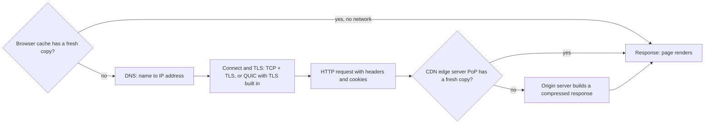

# The journey of one web request

**Workflow** · teaches DNS resolution, TCP versus UDP, [[TLS and HTTPS]], HTTP request and response messages, [[HTTP caching]], CDNs and the edge, HTTP compression, Cookies

**Why this visual.** Show the order of the network steps behind every page load, so each later page has a place in one picture.

## What it shows

The browser first checks its own cache. A fresh stored copy answers at once, with no network. On a miss, DNS gives the server IP address. The browser connects and encrypts: TCP plus a TLS handshake, or QUIC for HTTP/3, which includes TLS. It sends an HTTP request with headers and cookies. A CDN edge server near the user can answer from a fresh copy; otherwise the origin builds a compressed response. Every path ends at the response.

Text alternative: Flowchart with seven nodes. A first decision asks whether the browser cache has a fresh copy; if yes, the response comes straight from it with no network. If no, DNS turns the name into an IP address; the browser connects and encrypts with TCP plus TLS, or QUIC with TLS built in; it sends an HTTP request with headers and cookies. A second decision asks whether the CDN edge server has a fresh copy. If yes, the CDN sends the response; if no, the origin server builds a compressed response. All paths end at the response, where the page renders.

## Check yourself

A second visit to a page sends no network request at all, and the page still shows. Which step answered, and what would make the browser go on to DNS and the CDN instead?

Answer: The browser cache answered with a fresh stored copy, so the trip stopped at the first decision. When that copy is missing or stale (its Cache-Control lifetime has passed), the browser goes on to DNS, connects, and sends the request, and then a fresh CDN copy or the origin answers.

## Sources

- MDN Web Docs: HTTP and web networking — https://developer.mozilla.org/en-US/docs/Web/HTTP (`mdn-http-docs`)
- High Performance Browser Networking — https://hpbn.co/ (`hpbn-book`)
- Cloudflare developer documentation (DNS, Cache, Workers, Images) — https://developers.cloudflare.com/ (`cloudflare-docs`)
- RFC 9111: HTTP Caching — https://www.rfc-editor.org/rfc/rfc9111 (`rfc-9111-http-caching`)

## Used in

- [[01-brief-internet-and-networking]]
- lesson page `/frontend-engineering/how-the-web-works/internet-and-networking/lesson/01-how-the-internet-works/` (file `site/src/content/lessons/frontend-engineering/how-the-web-works/internet-and-networking/01-how-the-internet-works.mdx`)

Back to [[visuals-internet-and-networking|all visuals]].

## My insights
