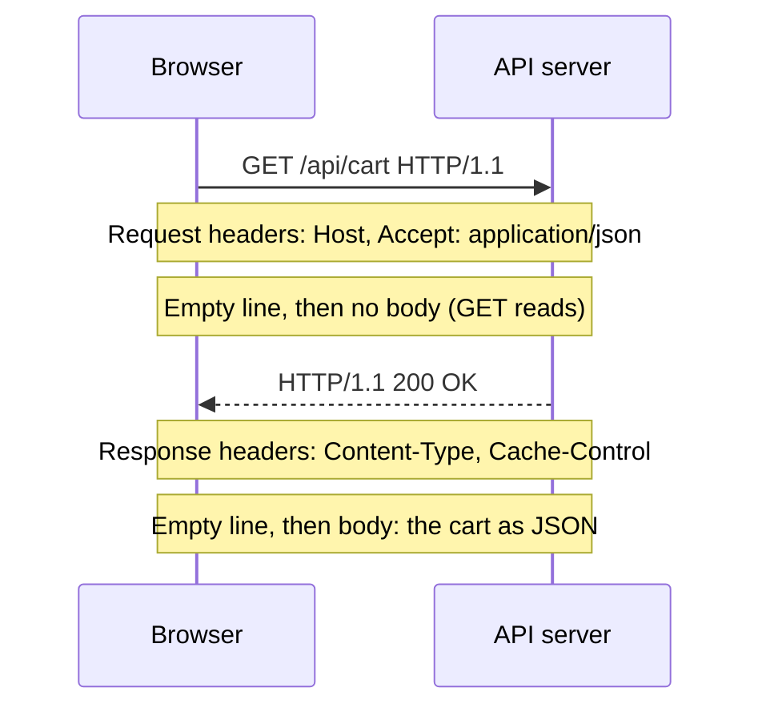

# One HTTP request and its response, part by part

**Sequence** · teaches HTTP request and response messages, HTTP methods and idempotency, HTTP status codes, Content negotiation, headers and keep-alive

**Why this visual.** Show that a request and a response have the same parts: a start line, header fields, an empty line and an optional body. Only the start line differs.

## What it shows

The browser sends a request whose start line holds the method, the target and the version. Header fields follow, then an empty line. A GET has no body. The server answers with a status line, its own header fields, an empty line and the body. Accept asks for a format, and Content-Type names the format the server chose.

Text alternative: Sequence diagram with two participants, browser and API server. The browser sends GET /api/cart HTTP/1.1 with Host and Accept headers and no body. The server answers HTTP/1.1 200 OK with Content-Type and Cache-Control headers and a JSON body, so both messages share one structure and differ only in the start line.

## Check yourself

Which part of the response tells the browser that the request worked, and which part tells it how to read the body?

Answer: The status code 200 in the start line says the request worked. The Content-Type header says the body is JSON.

## Sources

- RFC 9110: HTTP Semantics — https://www.rfc-editor.org/rfc/rfc9110 (`rfc-9110-http-semantics`)
- HTTP (MDN Web Docs documentation set) — https://developer.mozilla.org/en-US/docs/Web/HTTP (`mdn-http-docs`)

## Used in

- lesson page `/frontend-engineering/how-the-web-works/internet-and-networking/lesson/04-http-messages/` (file `site/src/content/lessons/frontend-engineering/how-the-web-works/internet-and-networking/04-http-messages.mdx`)

Back to [[visuals-internet-and-networking|all visuals]].

## My insights
