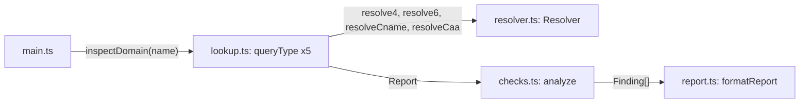

# DNS record inspector flow

**Data flow** · teaches DNS resolution

**Why this visual.** Show how the inspector turns one domain name into five record lookups, a report and a list of findings.

## What it shows

main.ts calls inspectDomain, which runs queryType once for each of five record types through a Resolver interface. The real resolver uses node:dns; tests use a stub. The Report goes to analyze, which runs the TTL, CNAME and CAA checks, and formatReport prints the findings.

Text alternative: Flowchart with four boxes: main.ts calls lookup.ts, which queries the Resolver for each record type, passes a Report to checks.ts analyze, which passes a list of findings to report.ts formatReport for printing.

## Check yourself

Why can the tests run without a network?

Answer: queryType talks only to the Resolver interface, so tests pass a stub resolver instead of node:dns.

## Sources

- Cloudflare developer documentation (DNS, Cache, Workers, Images) — https://developers.cloudflare.com/ (`cloudflare-docs`)
- MDN Web Docs: HTTP and web networking — https://developer.mozilla.org/en-US/docs/Web/HTTP (`mdn-http-docs`)

## Used in

- `projects/frontend-engineering/how-the-web-works/internet-and-networking/mini-01-dns-record-inspector/README.md`

Back to [[visuals-internet-and-networking|all visuals]].

## My insights
