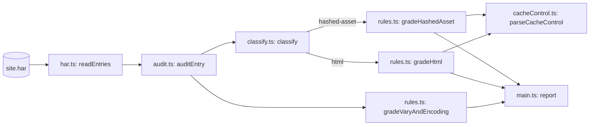

# Cache header auditor: from HAR file to report

**Data flow** · teaches [[HTTP caching]]

**Why this visual.** Show how one HAR response becomes findings, so the learner sees which function owns each rule.

## What it shows

main.ts reads the HAR file and readEntries flattens each response into an Entry. auditEntry asks classify whether the entry is a hashed asset or HTML, and runs the matching grader. Both graders read Cache-Control through parseCacheControl. gradeVaryAndEncoding runs for every entry. main.ts prints each finding that is not ok.

Text alternative: Flowchart: site.har goes to readEntries, then auditEntry, then classify. Hashed assets go to gradeHashedAsset and HTML goes to gradeHtml. Both call parseCacheControl. auditEntry also calls gradeVaryAndEncoding. All three graders feed the report in main.ts.

## Check yourself

Why does the auditor run gradeVaryAndEncoding for every entry but gradeHtml only for HTML?

Answer: Compression and Vary rules apply to any cacheable text response, while the freshness rules depend on the kind of file: hashed files may live a year, HTML must revalidate.

## Sources

- RFC 9111: HTTP Caching — https://www.rfc-editor.org/rfc/rfc9111 (`rfc-9111-http-caching`)
- HTTP (MDN Web Docs documentation set) — https://developer.mozilla.org/en-US/docs/Web/HTTP (`mdn-http-docs`)
- nodejs/undici: HTTP/1.1 client for Node.js (fetch, cache interceptor, cookies) — https://github.com/nodejs/undici (`nodejs-undici-repo`)

## Used in

- `projects/frontend-engineering/how-the-web-works/internet-and-networking/mini-02-cache-header-auditor/README.md`

Back to [[visuals-internet-and-networking|all visuals]].

## My insights
