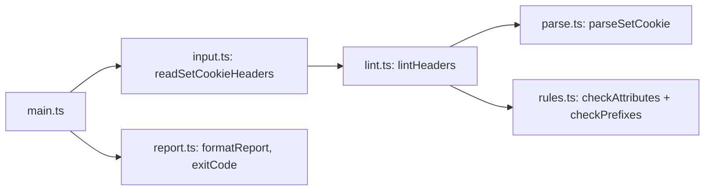

# Cookie attribute linter flow

**Data flow** · teaches Cookies, Set-Cookie attributes and SameSite, Cookie prefixes and partitioned cookies (CHIPS)

**Why this visual.** Show how the linter turns raw Set-Cookie header strings into findings and an exit code.

## What it shows

main.ts reads a text or HAR file with readSetCookieHeaders and passes the header strings to lintHeaders. For each header, parseSetCookie builds a cookie or returns null. lintCookie runs checkAttributes and checkPrefixes on the cookie. formatReport prints the findings and exitCode returns 1 when any finding is an error.

Text alternative: Flowchart with five boxes in a row: input.ts readSetCookieHeaders, lint.ts lintHeaders, parse.ts parseSetCookie, rules.ts checkAttributes and checkPrefixes, then report.ts formatReport and exitCode.

## Check yourself

Why does the linter report a header with Max-Age=soon even though the parser accepts it?

Answer: The parser is lenient and drops the bad value into ignored; lintHeaders turns every ignored piece into a warning, so nothing is hidden.

## Sources

- MDN Web Docs: HTTP and web networking — https://developer.mozilla.org/en-US/docs/Web/HTTP (`mdn-http-docs`)
- jshttp/cookie: RFC 6265 cookie parse and serialize for Node.js — https://github.com/jshttp/cookie (`jshttp-cookie-repo`)
- nodejs/undici: HTTP/1.1 client for Node.js (fetch, cache interceptor, cookies) — https://github.com/nodejs/undici (`nodejs-undici-repo`)

## Used in

- `projects/frontend-engineering/how-the-web-works/internet-and-networking/mini-03-cookie-attribute-linter/README.md`

Back to [[visuals-internet-and-networking|all visuals]].

## My insights
