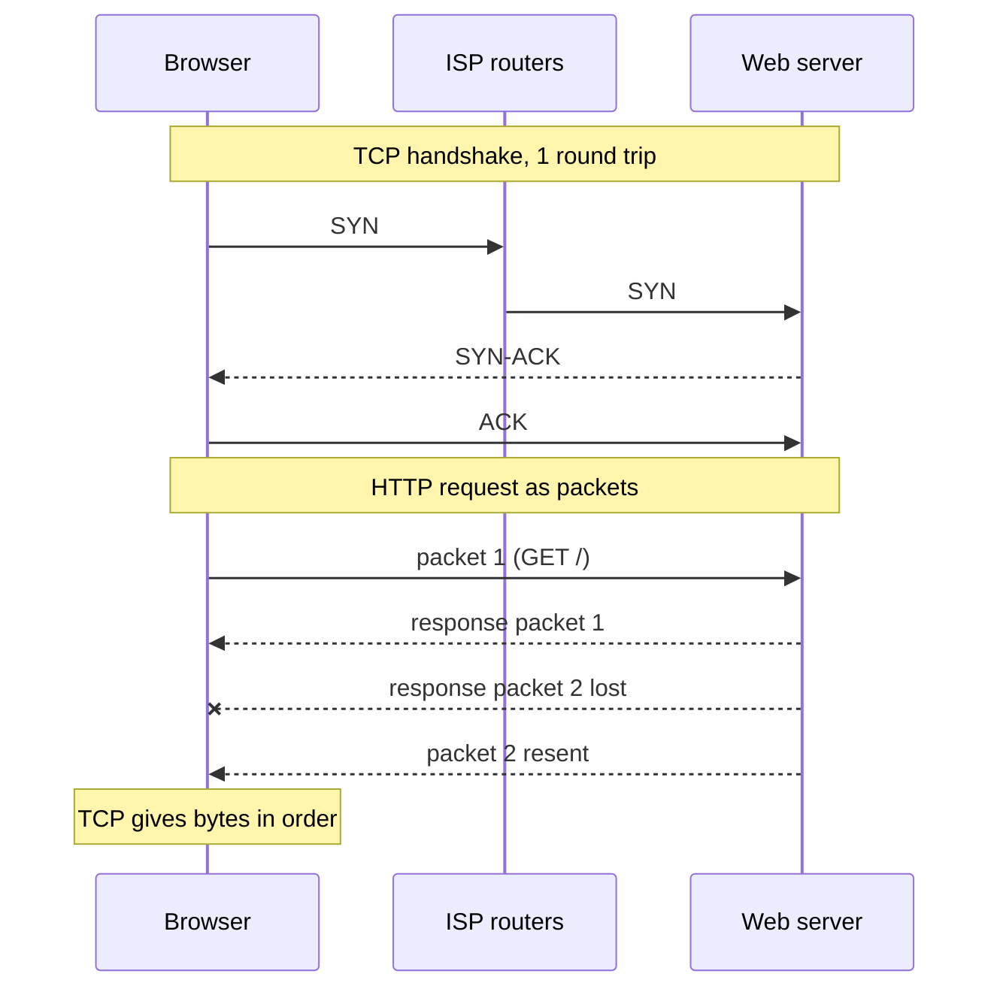

# A request crosses the internet as packets

**Sequence** · teaches How the internet moves packets, TCP versus UDP, Routing and ISPs

**Why this visual.** Show that a request travels as packets through routers, that TCP spends one round trip on a handshake, and that TCP resends a lost packet before the browser can read later bytes.

## What it shows

Before any HTTP data moves, TCP runs a three-way handshake: SYN, SYN-ACK, ACK. That costs one full round trip. The request and the response then cross the routers of several networks as separate packets. When a packet is lost, the server sends it again, and TCP holds back later bytes until the gap is filled. Reliable order costs time on a lossy network.

Text alternative: Sequence diagram with three participants: browser, ISP routers and web server. The browser sends SYN, the server answers SYN-ACK, the browser sends ACK, so one round trip passes before data. The browser sends the GET request; the server sends response packet 1, packet 2 is lost and sent again, and TCP delivers the bytes in order.

## Check yourself

The server is 100 ms away (one round trip). How long before the first HTTP request byte can leave the browser on a new TCP connection, and what happens to packet 3 if packet 2 is lost?

Answer: About 100 ms, because the TCP handshake takes one round trip first. Packet 3 waits in the receiver's buffer until packet 2 is resent, because TCP delivers bytes only in order.

## Sources

- High Performance Browser Networking — https://hpbn.co/ (`hpbn-book`)

## Used in

- lesson page `/frontend-engineering/how-the-web-works/internet-and-networking/lesson/01-how-the-internet-works/` (file `site/src/content/lessons/frontend-engineering/how-the-web-works/internet-and-networking/01-how-the-internet-works.mdx`)

Back to [[visuals-internet-and-networking|all visuals]].

## My insights
