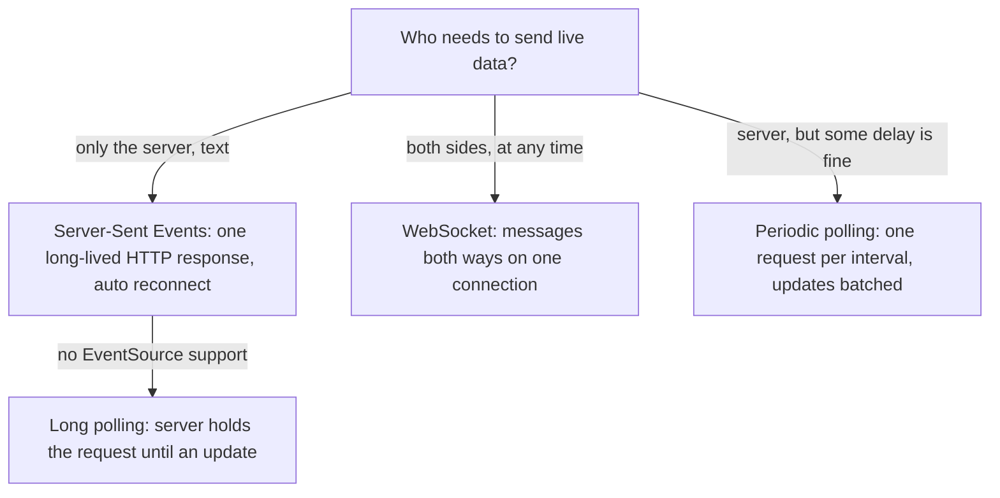

# Choosing a realtime transport by who sends

**Decision tree** · teaches Realtime transports, Polling, long polling and Server-Sent Events, WebSockets

**Why this visual.** Show how the direction of the data and the tolerated delay pick polling, long polling, Server-Sent Events or WebSocket.

## What it shows

If only the server sends text updates, Server-Sent Events keep one HTTP response open and push each event at once. If both sides send at any time, WebSocket is the transport that carries messages both ways on one connection. If some delay is fine, periodic polling batches updates into fewer requests. Long polling is the fallback when EventSource is not available.

Text alternative: Decision flowchart. Question: who needs to send live data? Only the server with text leads to Server-Sent Events. Both sides at any time leads to WebSocket. Server with tolerated delay leads to periodic polling. From Server-Sent Events, a branch for no EventSource support leads to long polling.

## Check yourself

A chat app must send the user's messages and receive other people's messages. Which transport does the diagram pick, and why?

Answer: WebSocket, because both sides send at any time and WebSocket carries messages in both directions on one connection.

## Sources

- High Performance Browser Networking — https://hpbn.co/ (`hpbn-book`)

## Used in

- `projects/frontend-engineering/how-the-web-works/internet-and-networking/experiences/realtime-transport-deck/experience.json`
- lesson page `/frontend-engineering/how-the-web-works/internet-and-networking/lesson/11-realtime-transports/` (file `site/src/content/lessons/frontend-engineering/how-the-web-works/internet-and-networking/11-realtime-transports.mdx`)

Back to [[visuals-internet-and-networking|all visuals]].

## My insights
