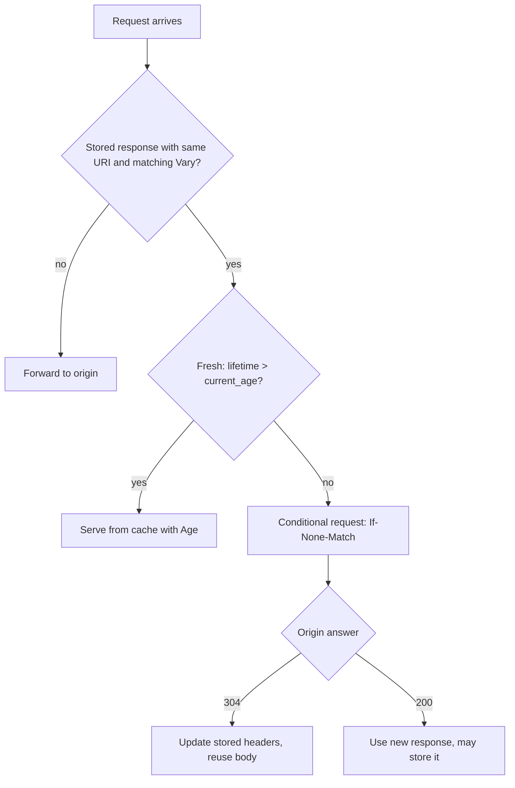

# How a cache answers one request

**Workflow** · teaches [[HTTP caching]]

**Why this visual.** See the three outcomes of a cache lookup: fresh hit, validated reuse, or full fetch.

## What it shows

A cache first matches the URI and Vary fields. A fresh match is served at once. A stale match is checked with the origin: a 304 reuses the stored body, a 200 replaces it.

Text alternative: Flowchart: a request is matched against stored responses by URI and Vary. No match goes to the origin. A fresh match is served with an Age header. A stale match sends a conditional request; a 304 updates the stored headers and reuses the body, a 200 brings a new response.

## Check yourself

What does a cache do with a stale response that has an ETag?

Answer: It sends If-None-Match; a 304 lets it reuse the stored body, a 200 replaces it.

## Sources

- RFC 9111: HTTP Caching — https://www.rfc-editor.org/rfc/rfc9111 (`rfc-9111-http-caching`)

## Used in

- [[rfc-9111-http-caching-internet-and-networking]]

Back to [[visuals-internet-and-networking|all visuals]].

## My insights
