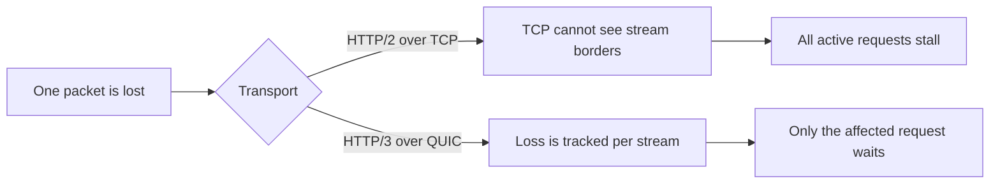

# Why HTTP/3 avoids transport head-of-line blocking

**Comparison** · teaches HTTP/1.1, HTTP/2 and HTTP/3, Head-of-line blocking and multiplexing, TCP versus UDP

**Why this visual.** Show why one lost packet hurts every request on HTTP/2 over TCP but only one request on HTTP/3 over QUIC.

## What it shows

When one packet is lost, TCP holds back all data behind it, because it does not know which HTTP/2 streams are independent. In HTTP/3, each request uses its own QUIC stream and QUIC recovers loss per stream. Only the request that lost data waits.

Text alternative: Flowchart: one lost packet leads to a transport choice. On HTTP/2 over TCP, TCP cannot see stream borders, so all active requests stall. On HTTP/3 over QUIC, loss is tracked per stream, so only the affected request waits.

## Check yourself

A page loads ten files over one connection and one packet is lost. Which files wait on HTTP/2 over TCP and which on HTTP/3?

Answer: On HTTP/2 over TCP, all ten can stall. On HTTP/3, only the file whose stream lost the packet waits.

## Sources

- RFC 9114: HTTP/3 — https://www.rfc-editor.org/rfc/rfc9114 (`rfc-9114-http3`)

## Used in

- [[rfc-9114-http3-internet-and-networking]]

Back to [[visuals-internet-and-networking|all visuals]].

## My insights
