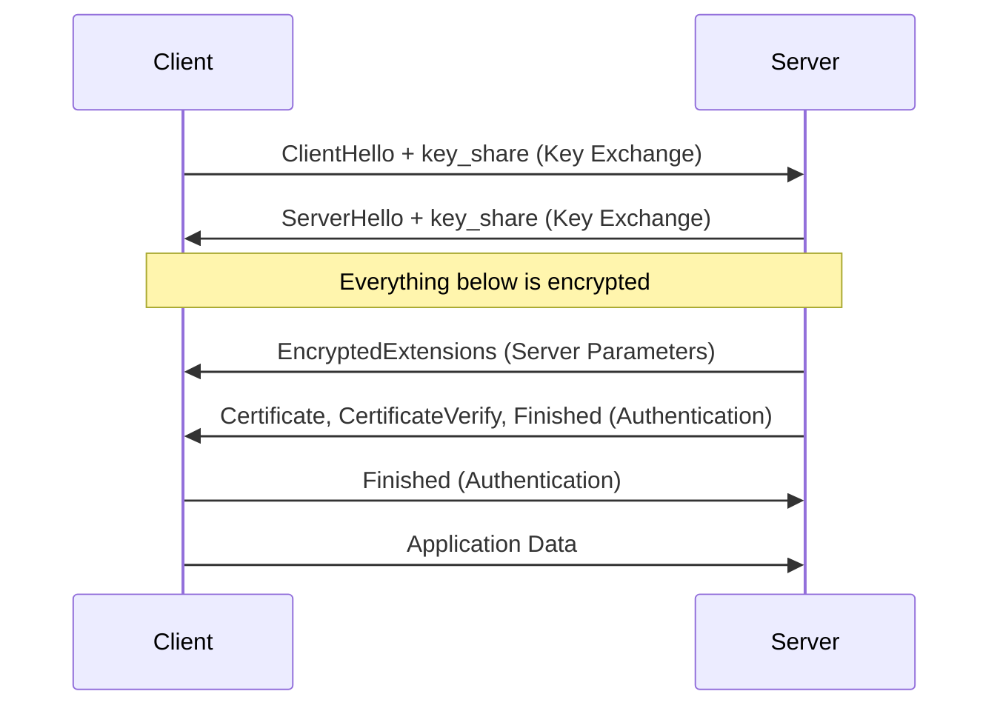

# The full TLS 1.3 handshake in three phases

**Workflow** · teaches [[TLS and HTTPS]]

**Why this visual.** Show which message belongs to which handshake phase and where encryption starts.

## What it shows

The client sends a ClientHello with a key share. The server answers with a ServerHello and its own key share, and both sides can now derive keys. From this point every handshake message is encrypted. The server sends EncryptedExtensions, then its Certificate, a CertificateVerify signature and a Finished MAC. The client answers with its Finished message, and application data can flow. Optional messages such as client certificates are left out.

Text alternative: Sequence diagram between client and server: ClientHello with key share, ServerHello with key share, a note that everything after is encrypted, then EncryptedExtensions, Certificate with CertificateVerify and Finished from the server, Finished from the client, and finally application data.

## Check yourself

In the Network or Security view, the handshake takes one round trip before the first request. Which messages carry the key exchange, and which prove the server owns its certificate?

Answer: ClientHello and ServerHello carry the key shares. The server's CertificateVerify signature proves it holds the private key for its certificate, and Finished confirms the handshake was not altered.

## Sources

- RFC 9846: The Transport Layer Security (TLS) Protocol Version 1.3 — https://www.rfc-editor.org/rfc/rfc9846 (`rfc-9846-tls13`)

## Used in

- [[rfc-9846-tls13-internet-and-networking]]

Back to [[visuals-internet-and-networking|all visuals]].

## My insights
