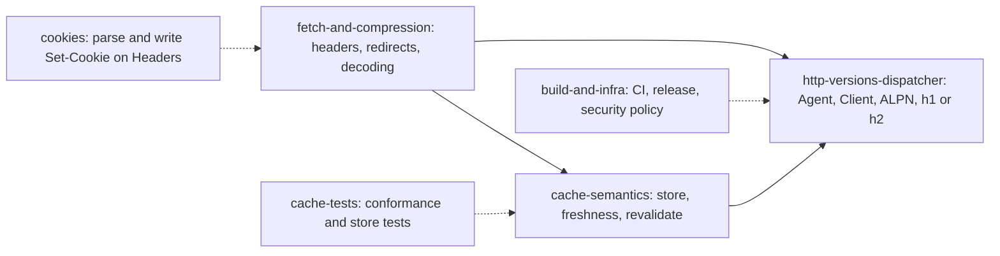

# nodejs/undici: module map

**Architecture** · teaches [[HTTP caching]], HTTP/1.1, HTTP/2 and HTTP/3, Cookies, HTTP compression

**Why this visual.** Show which part of undici does which job in the HTTP message path, so the learner knows where cache, version and cookie rules live.

## What it shows

Fetch handles headers, redirects and decoding. The cache interceptor sits between the caller and the network client and decides to reuse, revalidate or store. The dispatcher layer opens the connection and chooses HTTP/1.1 or HTTP/2 through ALPN. The cookie helpers work on Headers objects on their own. Tests guard the cache. Build and infra guard everything with CI and a release flow.

Text alternative: Flowchart: fetch-and-compression points to cache-semantics and to http-versions-dispatcher; cache-semantics points to http-versions-dispatcher. Dotted arrows: cookies to fetch, cache-tests to cache-semantics, build-and-infra to the dispatcher.

## Check yourself

Which module decides whether the connection speaks HTTP/2?

Answer: http-versions-dispatcher: the connector offers ALPN protocols and Client picks connectH2 or connectH1 from the answer.

## Sources

- nodejs/undici: HTTP/1.1 client for Node.js (fetch, cache interceptor, cookies) — https://github.com/nodejs/undici (`nodejs-undici-repo`)

## Used in

- [[undici-architecture]]

Back to [[visuals-internet-and-networking|all visuals]].

## My insights
