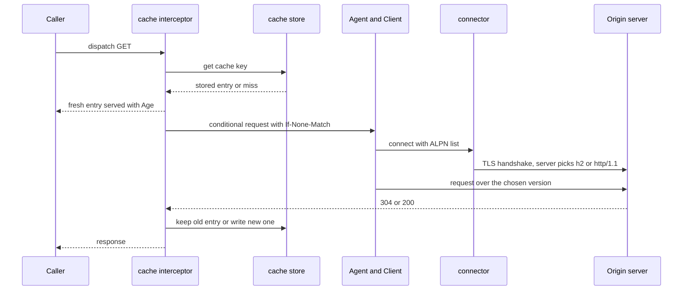

# nodejs/undici: a cached GET that needs revalidation

**Sequence** · teaches [[HTTP caching]], HTTP/1.1, HTTP/2 and HTTP/3

**Why this visual.** Show the order of calls for one GET through the cache interceptor, the connector and the origin.

## What it shows

The cache interceptor builds a key and asks the store. A fresh entry is served at once with an Age header. A stale entry triggers a conditional request. The client connects, offers ALPN protocols, and the server picks h2 or http/1.1. A 304 keeps the stored body. A 200 replaces it.

Text alternative: Sequence diagram: caller dispatches GET to the cache interceptor, which asks the store. On a fresh hit it answers directly. Otherwise it sends a conditional request through Agent and Client, the connector does TLS with ALPN, the origin answers 304 or 200, and the store is updated.

## Check yourself

What does the interceptor do when the origin answers 304?

Answer: It checks the 304 (ETag, URL, Vary) and then serves the stored body; a mismatch makes it refetch.

## Sources

- nodejs/undici: HTTP/1.1 client for Node.js (fetch, cache interceptor, cookies) — https://github.com/nodejs/undici (`nodejs-undici-repo`)

## Used in

- [[undici-architecture]]

Back to [[visuals-internet-and-networking|all visuals]].

## My insights
