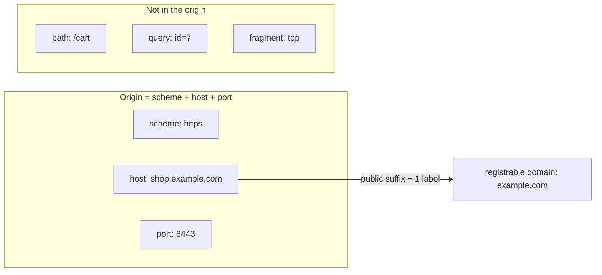

# The parts of https://shop.example.com:8443/cart?id=7#top

**Concept map** · teaches URLs and origins, URL parts and encoding, Origin versus site and the public suffix list

**Why this visual.** Show which parts of a parsed URL form the origin, which parts do not, and how the host gives the registrable domain that a site uses.

## What it shows

The URL parser splits the string into named parts. Scheme, host and port together are the origin, so a change to any one of them gives a different origin. Path, query and fragment never change the origin. The registrable domain is the public suffix plus one label, here example.com. A site is the scheme plus the registrable domain, so it is wider than an origin.

Text alternative: Flowchart of one URL split into six parts. A group labelled origin holds scheme https, host shop.example.com and port 8443. A second group, not in the origin, holds path /cart, query id=7 and fragment top. An arrow from the host leads to the registrable domain example.com, which the site uses, so subdomains share a site but not an origin.

## Check yourself

Do https://shop.example.com and https://shop.example.com:8443 have the same origin? Are they the same site?

Answer: Different origins, because the port is part of the origin (443 by default versus 8443). Same site, because the scheme and the registrable domain example.com match.

## Sources

- URL Standard (WHATWG Living Standard) — https://url.spec.whatwg.org/ (`whatwg-url-standard`)
- MDN Web Docs: HTTP and web networking — https://developer.mozilla.org/en-US/docs/Web/HTTP (`mdn-http-docs`)

## Used in

- lesson page `/frontend-engineering/how-the-web-works/internet-and-networking/lesson/03-urls-and-origins/` (file `site/src/content/lessons/frontend-engineering/how-the-web-works/internet-and-networking/03-urls-and-origins.mdx`)

Back to [[visuals-internet-and-networking|all visuals]].

## My insights
