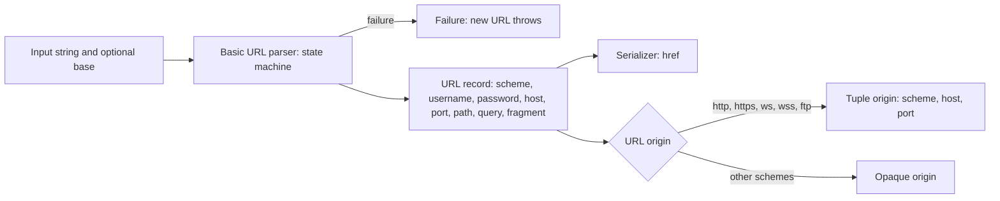

# From a URL string to a URL record, a serialization and an origin

**Workflow** · teaches URLs and origins, URL parts and encoding, Origin versus site and the public suffix list

**Why this visual.** Show that every URL string goes through one parser into a record of parts, and that the origin comes from that record, not from the raw text.

## What it shows

The basic URL parser reads the input string, with an optional base URL, and either fails or builds a URL record with eight fields. The serializer turns the record back into a string. The origin algorithm reads the same record: for http, https, ws, wss and ftp it returns a tuple of scheme, host and port, and for most other schemes it returns an opaque origin.

Text alternative: Flowchart: an input string and optional base go into the basic URL parser. On failure, new URL throws. Otherwise the parser builds a URL record with scheme, username, password, host, port, path, query and fragment. The record feeds a serializer that produces href, and an origin step that gives a tuple origin for http, https, ws, wss and ftp, or an opaque origin for other schemes.

## Check yourself

Two URLs differ only in port: https://a.example/ and https://a.example:8443/. Are they the same origin, and which record field decides it?

Answer: No. The tuple origin contains scheme, host and port, and the port field differs (443 by default versus 8443).

## Sources

- URL Standard (WHATWG Living Standard) — https://url.spec.whatwg.org/ (`whatwg-url-standard`)

## Used in

- [[whatwg-url-standard-internet-and-networking]]

Back to [[visuals-internet-and-networking|all visuals]].

## My insights
