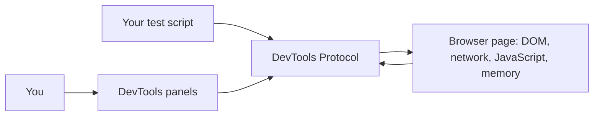

# Browser DevTools mastery (used in every phase) in brief

## What it is

Every browser has a set of built-in inspectors. Together they are called DevTools. They show the live page, its code, its network requests, its speed and its memory. You use them to find the cause of a bug from evidence, not from guesses.

## The problem it solves

A web page runs inside the browser, not inside your editor. Without DevTools you can only see the final pixels. You guess why a button is slow, why a style is wrong, or why memory grows. DevTools let you pause the code, read each request, and measure each task. For example, a task that blocks the main thread for more than 50 ms makes the page feel slow, and the Performance panel marks it.

## How it works in one picture

The diagram shows how the panels and your own scripts read the same running page.

The panels are a web app that talks to the page through the DevTools Protocol. A script, for example with Puppeteer, uses the same protocol, so anything you inspect by hand you can also automate. [[visual-how-it-works-browser-devtools-mastery|explanation and sources]]

## Where it is used in the real world

- Chrome DevTools is an open source web app that ships inside Chrome. You debug a real page instead of adding print lines and reloading.
- Puppeteer drives Chrome through the same protocol. Teams automate checks that would otherwise need a person at the browser.

## What you need to know first

- [[Basic programming]] — you already studied this.
- [[Command line]] — you already studied this.
- [[DOM]] — the DOM is the live tree of objects for page elements.
- [[HTTP]] — HTTP is how a browser asks a server for files.

## What you will be able to do

- Explain the phases of a network request shown in the waterfall.
- Debug async JavaScript with conditional breakpoints and async call stacks.
- Find a memory leak by comparing heap snapshots and reading retainers.
- Build a scripted page health report with the Chrome DevTools Protocol.
- Decide which DevTools panel to open first for a given symptom.

## My insights
