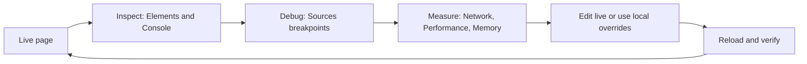

# Browser DevTools mastery (used in every phase) in brief

## What it is

Every browser ships a set of panels that show what a page is doing right now. These panels are the browser developer tools (DevTools). With them you inspect, debug, measure and fix a live page inside the browser.

## The problem it solves

Your editor shows the code you wrote. It does not show the page the browser built from that code. Styles get overridden, requests stall, and objects stay in memory after you remove them. Without DevTools you guess and reload. With DevTools you see the real state and test a fix in seconds.

## How it works in one picture

The diagram shows the loop you repeat on every bug.

You start from the page, find the element or code, pause it, and measure the cost. Then you try a fix in the browser and reload to confirm it. [[visual-how-it-works-browser-devtools-mastery|explanation and sources]]

## Where it is used in the real world

- Teams debug production code through source maps. They see their original files instead of minified output, so stack traces make sense.
- Teams record network and performance traces to find slow requests and long tasks. A trace gives numbers, not guesses.
- Teams run Lighthouse in continuous integration. It audits each build automatically, so regressions show before release.
- Teams inspect phones with Safari Web Inspector or remote debugging. Desktop emulation cannot show real device bugs.

## What you need to know first

- [[Browser developer tools]] — you already studied this.
- [[Document Object Model]] — the tree of objects the browser builds from HTML.
- [[HTTP request and response]] — the browser sends a request; the server returns status, headers, body.
- [[Call stack]] — the list of functions running now, newest on top.

## What you will be able to do

- Explain how the cascade produces an element's computed styles.
- Debug async code with breakpoints, the async call stack and source maps.
- Explain each timing phase of a request in the network waterfall.
- Find a long task and a memory leak from traces and heap snapshots.
- Build a CLI that triages HAR, trace and Lighthouse files against budgets.
- Decide when to use Firefox, Safari or a real device instead of desktop Chrome.

## My insights
