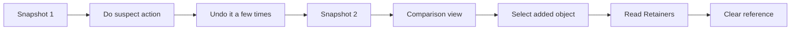

# Chrome DevTools: Fix memory problems and heap snapshots

Chrome DevTools team (Google), 2026, official documentation: the page "Fix memory problems" and its sub-page "Heap snapshots", read on 2026-11-18.

## The claim in one sentence

You can find a memory leak by watching memory grow, then taking heap snapshots and allocation recordings in the Memory panel to see which objects stay alive and which references hold them.

## The problem before this

Without a memory tool, a leak shows only as a page that slows down over time. The page "Fix memory problems" names three symptoms. A memory leak is steady growth caused by a bug. Memory bloat is more memory than needed, so performance is always poor. Frequent garbage collections pause your scripts, so the page seems to stall. Your editor cannot show which object keeps memory alive.

## Key ideas

### Start by watching, then measure

The Task Manager (Shift+Esc) shows live memory. Its "Memory footprint" column is operating system memory, where DOM nodes live. The "JavaScript Memory" column counts reachable JavaScript objects. A steady rise in the second column suggests new or growing objects (section "Monitor memory use in realtime"). The Performance panel with the Memory checkbox adds a counter pane for heap, documents, DOM nodes, listeners and GPU memory.

### A heap snapshot is a picture of memory at one moment

A heap snapshot covers only objects reachable from the global object, and each snapshot starts with a garbage collection (page "Heap snapshots"). The Summary view groups objects by constructor, the function that created them. The Comparison view shows what changed between two snapshots. The Containment view starts from entry points such as DOMWindow and GC roots. The Statistics view is a pie chart by category.

### Shallow size and retained size

Shallow size is the memory the object holds itself. Retained size is the memory you could free by deleting the object, so that what depends on it is no longer reachable. Distance is the length of the shortest path from the object to a root. A small object can have a large retained size. See [[Retained size]].

### Retainers explain why an object lives

The Retainers section lists the objects that point to the selected object. Right-click a retainer and choose "Ignore this retainer" to hide it and see what else keeps the object alive. Ignored ones show as `ignored` in the Distance column.

### Detached DOM nodes

A node is detached when it is removed from the DOM tree but JavaScript still references it, so the browser cannot free it (section "Discover detached DOM tree memory leaks"). The page's example builds a `ul` with ten `li` children and keeps it in a variable. The fix is to clear the reference. See [[Detached DOM node]].

### The allocation timeline finds when memory is taken

The Allocation Timeline records new memory in the JavaScript heap. New allocations show as blue bars, and each bar is a candidate leak. Zooming on a bar filters the Constructor pane to objects allocated in that window. Allocation sampling groups allocations by function, with the default view "Heavy (Bottom Up)".

## How it works

In plain words: you take a picture of memory, do the thing you suspect, undo it, and take another picture. The difference shows objects that should be gone but are not. Then you ask who still points at them.

The first five steps follow "Comparing snapshots" on the page "Heap snapshots". The last two follow the Retainers section and the detached DOM example on "Fix memory problems". [[visual-chrome-devtools-memory-docs-mechanism-browser-devtools-mastery|explanation and sources]]

1. Open Memory, pick "Heap snapshot" and a JavaScript VM instance, then click Take snapshot. Cmd+E or Ctrl+E repeats it.
2. Perform the action you suspect, then its reverse, a few times.
3. Take a second snapshot, switch to Comparison, and compare it to Snapshot 1.
4. Expand an entry to see added and deleted instances. The object ID (`@` number) matches the same object across snapshots.
5. In Summary, the constructor filter can show objects retained by detached nodes. Selecting an object fills the Retainers section.

**Analogy.** Two photos of a room before and after a party: whatever is new and still there after cleanup is what you ask about.

**Interpretation.** The pairing "do, then undo" matters. If the count still grows after the undo, something holds a reference.

## Results and evidence

- This is documentation, so it reports procedures and not benchmarks. The page "Fix memory problems" gives no hard number for what is too much memory. It says this depends on the device and browser, so test on your users' devices.
- The detached elements profile shows the exact detached HTML nodes and their count, including nodes kept alive by JavaScript references (page "Fix memory problems").
- The profiler links DOM nodes and CSS rules to JavaScript objects in both directions, which exposes forgotten detached subtrees (page "Heap snapshots").

## Limitations and criticisms

- Not all properties live on the JavaScript heap. Getters that run native code and non-string values such as numbers are not captured (page "Heap snapshots").
- The examples are simplified demos, such as 10,000 `div` nodes or a one-million-character string per click. The Task Manager is only a starting point. Real leaks are harder to isolate.
- The pages I read give few details on detached-node color coding or on allocation instrumentation, so I do not describe them here.

## What practitioners took from it

Adoption beyond the documentation could not be verified from the sources recorded for this topic, so nothing is claimed here.

## How it connects to this topic

- [[01-brief-browser-devtools-mastery|Browser DevTools mastery brief]] — this is the "Memory" part of the measure step, behind the outcome "find a memory leak from heap snapshots".
- [[Heap snapshot]] — the saved picture of memory that every method here starts from.
- [[Retained size]] — the size that tells you which object is worth fixing.
- [[Detached DOM node]] — the most common leak shape in the page's examples.
- [[Garbage collection]] — what frees memory, and what a leak prevents.

## Test yourself

1. What is the difference between shallow size and retained size, and which one tells you how much you would free by deleting an object?
2. Why do you perform an action and then its reverse before the second snapshot?
3. A node was removed from the page but still shows in a snapshot. What is it called, and what does the Retainers section tell you?

## My insights
