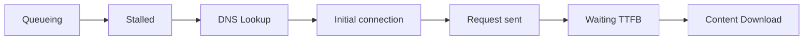

# Chrome DevTools: Network features reference

Kayce Basques and Sofia Emelianova (Chrome DevTools team), 2026, official documentation on developer.chrome.com, read on 2026-11-18.

## The claim in one sentence

The Network panel records every request a page makes and lets you slow it down, filter it, take it apart phase by phase and save it, so you can find out why a page loads slowly or wrongly.

## The problem before this

Without a network view, a developer sees only the final page. A slow or broken load looks the same whether DNS, the server, the size of the file or the browser itself caused it. Editor breakpoints do not show any of this, because the work happens between the browser and the server. The page "Network features reference" lists the controls that make these hidden steps visible and repeatable.

## Key ideas

### Record, then shape what you see

DevTools records requests while it is open; earlier requests are not counted (section "Record network requests"). Clear empties the table. Preserve log keeps requests across page loads. Filters (by type, by property such as `status-code` or `larger-than`, or by time) are combined with AND; OR is not supported (section "Filter requests").

### The waterfall and the Timing tab split a request into phases

The Waterfall column draws each request as a bar in time order. The Timing tab names each phase, so you can say which one is long (section "Analyze requests"). The phases are listed in "How it works".

### Initiator and priority explain why a request exists and when it ran

The Initiator column names what started the request: Parser, Redirect, Script, Early Hints (a `103` response) or Other. Hovering shows a stack trace. Priority shows how urgently the browser treats the request. Shift plus hover marks the initiator chain: initiators turn green, dependencies red.

### Throttling and blocking let you test bad conditions

The Throttling menu has presets (fast 4G, slow 4G, 3G), custom profiles and Offline. A warning icon shows while throttling is on. Blocked requests appear in red and a filter shows only them (sections "Change loading behavior" and "Filter requests").

### HAR export saves a session, with safe defaults

HAR (HTTP Archive) is a JSON format for captured session data. By default the export leaves out `Cookie`, `Set-Cookie` and `Authorization` headers (section "Export requests data").

## How it works

In plain words: the browser notes the time at each step of every request. DevTools draws those times as a bar. A long part of the bar points to the step that lost time. You then change one condition, such as speed, and reload to see if that part changes.

The diagram follows the Timing tab list in the section "Analyze requests". The source also lists Proxy negotiation and the two ServiceWorker phases (ServiceWorker Preparation, Request to ServiceWorker); they appear only when a proxy or service worker is involved. The diagram leaves out those three phases.
[[visual-chrome-devtools-network-docs-mechanism-browser-devtools-mastery|Explanation and sources of this diagram]]

1. **Queueing.** The browser delays the request. Reasons: higher-priority requests exist, six TCP connections are already open for the origin (HTTP/1.0 and 1.1 only), or the browser is briefly allocating disk cache space.
2. **Stalled.** The request waits after it has started, for the same reasons as Queueing.
3. **DNS Lookup.** The browser finds the server's IP address.
4. **Initial connection.** The browser sets up the connection: TCP handshakes or retries and SSL negotiation.
5. **Request sent.** The request goes out.
6. **Waiting (TTFB).** The browser waits for the first byte. That is one round trip of latency plus the time the server needs to prepare the response.
7. **Content Download.** The browser reads the response body. An unusually large value can mean a slow network or a busy browser.

**Interpretation.** A long Waiting (TTFB) bar points at the server or the round trip. A long Content Download bar points at payload size or network speed. A long Queueing bar points at too many competing requests.

**Throttling.** Choose a preset in the Throttling drop-down, or add a custom profile (Throttling > Custom > Add, then Settings > Throttling). With Field metrics enabled, one preset may be marked as recommended based on CrUX data. Throttling also applies to WebSocket connections since Chrome 99. **Blocking.** The reference page does not explain how to create block rules. It only mentions a "Network request blocking" tab in the drawer. **Sorting.** You can sort the waterfall by Start Time, Response Time, End Time, Total Duration or Latency.

**Size and Time.** Size is the response headers plus body as the server delivered them; with big request rows, the bottom number is the uncompressed size. Time runs from the start of the request to the last byte.

## Results and evidence

- This is a reference, so it states behaviour, not measurements. Every phase definition above comes from the section "Analyze requests".
- HAR exports are sanitized by default. To include sensitive data, enable Settings > Preferences > Network > "Allow to generate HAR with sensitive data", then pick the sensitive export option (section "Export requests data"). Save with right-click > Copy > Save all as HAR, or the Export HAR button; import by dragging a HAR file into the table.
- Copy options exist for one request, all requests or only filtered ones: URL, cURL, PowerShell, fetch, fetch (Node.js), and for a single request also preload element, response body or stack trace.
- Edit and resend as fetch opens a request as a `fetch()` call in the Console for editing and rerunning (section "Record network requests").

## Limitations and criticisms

- DevTools only records requests made while it is open, so open it before the page load you want to study (section "Record network requests").
- The page does not cover XHR or fetch breakpoints, and it does not describe how to create block rules or content overrides. It only links to a separate overrides guide for response headers (the Has overrides filter and column show which requests have overrides). Those topics need other references.
- Filters support AND only. A HAR with sensitive data can leak credentials if shared (section "Export requests data").

## What practitioners took from it

Adoption by practitioners could not be verified from the sources recorded for this topic, so nothing is claimed here.

## How it connects to this topic

- [[01-brief-browser-devtools-mastery|Browser DevTools mastery brief]] — this source backs the "measure" step of the brief's loop.
- [[Network waterfall]] — the bar chart and phases described above.
- [[Network throttling]] — slow-network testing.
- [[HAR file]] — the export format.
- [[HTTP request and response]] — the exchange each row in the table records.

## Test yourself

1. A request shows a long Waiting (TTFB) bar and a short Content Download bar. Which part of the exchange is most likely slow, and why?
2. What do the green and red highlights show when you hold Shift and hover over a request?
3. You export a HAR file with default settings. Which three headers are missing, and what setting changes that?

## My insights
