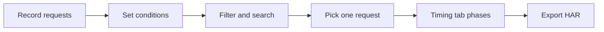

# Network features reference

Kayce Basques and Sofia Emelianova, Chrome DevTools team, Google (Chrome for Developers), 2026. Official documentation, read on 2026-11-19.

## The claim in one sentence

The Network panel records every request your page makes, lets you change how the page loads (cache, speed, offline), and breaks each request into timing phases, so you can see where the time went instead of guessing.

## The problem before this

A page loads dozens of files from servers you cannot see. Without a recorder you only notice that the page feels slow or that an image is missing. You could not tell if the delay came from finding the server, from the server's own work, or from a big file. You also could not repeat a slow visitor's experience on a fast office network.

## Key ideas

### The panel records while DevTools is open

The panel records all requests as long as DevTools is open (section "Record network requests"). You can stop recording, clear the table, or turn on Preserve log to keep requests across page loads. A request can also be edited and sent again as a fetch call from the Console.

### You can change how the page loads

Disable cache makes your visit look like a first-time visit, because repeat visits normally load from the browser cache. The Throttling menu offers fast 4G, slow 4G, 3G, Offline and custom profiles. A warning icon appears on the tab while throttling is on (section "Change loading behavior").

### Filters shrink the list

The filter box takes properties such as `domain`, `status-code`, `mime-type` and `larger-than`. Several properties combine with AND only. Type buttons (Fetch/XHR, JS, CSS, Img, WS) and a drag on the Overview timeline narrow the list further. Search (Command or Control plus F) looks inside headers and response bodies (sections "Filter requests" and "Search requests").

### Each request splits into timing phases

The Timing tab lists the phases of one request. The long phase tells you what to fix. This is the main reason to read the page. See [[Request timing phases]].

### Size has two numbers

The Size column shows the compressed bytes sent over the network plus headers. With Big request rows on, you also see the uncompressed size. The page's example is a document that transfers as 43.8 KB and expands to 136 KB (section "Analyze requests").

### Exports can leak secrets

A [[HAR file]] is a JSON export of the captured requests. By default it leaves out Cookie, Set-Cookie and Authorization headers. A setting can add them, and then the file must be treated as sensitive (section "Export requests data").

## How it works

In plain words: you open DevTools, reload the page and watch a list fill with one row per request. You pick conditions that match a real visitor, narrow the list, then open one row and read how its time was spent. The visual shows this order of work. The [[Network panel]] is where all of it happens.

The diagram follows the sections "Record network requests", "Change loading behavior", "Filter requests", "Analyze requests" and "Export requests data". [[visual-chrome-devtools-network-reference-mechanism-browser-devtools-mastery|explanation and sources]]

The Timing tab phases, in the order the page lists them (section "Analyze requests"):

1. Queueing: the request waits for higher-priority requests, for a free connection (HTTP/1.0 and 1.1 allow six per origin), or for disk cache space.
2. Stalled: delays after the connection starts, for the same reasons.
3. DNS Lookup: the browser finds the server's IP address.
4. Initial connection: TCP handshakes and SSL negotiation.
5. Proxy negotiation, then Request sent: the browser talks to a proxy if there is one, then sends the request.
6. ServiceWorker Preparation and Request to ServiceWorker: shown when a service worker handles the request.
7. Waiting (TTFB): the wait for the first byte. See [[Time to first byte]]. It includes one round trip plus server processing time.
8. Content Download: reading the response body. A very long time may mean a slow network or a busy browser.

**Interpretation.** A long Waiting phase points at the server. A long Content Download points at file size or the network. A long Queueing phase points at too many requests competing. The page lists causes for each phase but does not give this as a rule.

## Results and evidence

- This is documentation, not an experiment, so it has no measured results. Its guarantees are the behaviors it states.
- Recording runs by default while DevTools is open; Preserve log keeps it across loads (section "Record network requests").
- DevTools also throttles WebSocket connections since version 99; the page says you can check this by comparing message echo times (section "Change loading behavior").
- HAR exports omit Cookie, Set-Cookie and Authorization headers unless you enable "Allow to generate HAR with sensitive data" in Settings (section "Export requests data").
- Filters combine properties with AND only. The page's example is `mime-type:image/gif larger-than:1K` (section "Filter requests").

## Limitations and criticisms

- The page describes buttons and menus. It does not teach how to read a waterfall to reach a diagnosis, nor what a good TTFB value is. It gives no thresholds.
- Throttling is emulation by DevTools. The page says it gives presets and custom profiles but makes no claim that they match a real phone network.
- A "Provisional headers" warning means the request came from cache or was invalid, so the headers shown may be incomplete (section "Analyze requests"). Disabling the cache can show the full headers.
- Filter logic has no OR. You need a second pass to see two kinds of request at once, except with the type buttons.

## What practitioners took from it

Adoption by practitioners could not be verified from the sources recorded for this topic, so nothing is claimed here beyond the fact that the page is Google's official reference.

## How it connects to this topic

- [[01-brief-browser-devtools-mastery|Browser DevTools mastery brief]]: this page is the source for the brief's goal of explaining the phases of a request.
- [[Network panel]]: the concept this note details.
- [[Request timing phases]]: the part of the page that explains where time goes.
- [[HTTP]]: requests, headers and status codes are HTTP, which this panel makes visible.
- [[HAR file]]: the format for sharing a captured session.

## Test yourself

1. Which setting makes your visit behave like a first-time visitor, and why?
2. A request spends most of its time in Waiting (TTFB). Which two costs does that phase include?
3. What does a default HAR export leave out, and why does it matter?

## My insights
