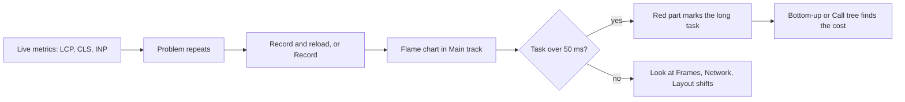

# Performance features reference

Kayce Basques and Sofia Emelianova, Chrome DevTools team, 2026, Chrome for Developers, official documentation. Read on 2026-11-19.

## The claim in one sentence

The Performance panel shows live Core Web Vitals, records a trace of what the browser did, and draws it as a flame chart, so you can find the exact slow task instead of guessing.

## The problem before this

Without a trace, a slow page is only a feeling. You see that a click lags, but you cannot see what the browser did during that time. You would add timing code by hand and reload. The panel records the work for you and marks the slow parts. This helps a learner who is new to HTTP and the DOM, because the same picture shows loading, scripts, style and paint in one place.

## Key ideas

### Live metrics come first

When you open the panel, it first shows the three [[Core Web Vitals]]: LCP, CLS and INP. They update as you use the page, and a SOFT NAV badge marks client-side navigations (section "Live metrics screen"). Use this screen to spot problems that appear only in some conditions. When a problem repeats, record a trace.

### Two kinds of recording

A runtime recording starts and stops while you use a running page. A load recording uses **Record and reload**. DevTools goes to about:blank, records the reload, and stops a couple of seconds after load ends (section "Record performance").

### CPU and network throttling

Throttling slows your own machine to mimic a weaker one. The CPU option **2x slowdown** makes the CPU run twice as slowly. The page says DevTools cannot truly simulate a mobile CPU, because the slowdown is relative to your computer. The **Calibrate** option builds a custom preset for low and mid-tier devices.

### The flame chart

The x-axis is time. The y-axis is the call stack. The page states the rule: "The events on top cause the events below." Darker yellow is scripting and purple is rendering, and these two colors stay the same across recordings (section "Analyze a performance recording"). See [[Flame chart]].

### Long tasks and the 50 ms rule

A task that runs longer than 50 ms gets a red triangle. Only the part past 50 ms is shaded red. A task of 400 ms or more has its last 350 ms in red. See [[Long task]].

### Tables for the cost

The **Call tree** shows root activities that cause the most work. **Bottom-up** shows activities that used the most time directly. **Event log** lists activities in order. Self Time is time spent in the activity itself. Total Time includes its children.

## How it works

In plain words: you watch live numbers, record a short trace when something is wrong, look for the red marks in the flame chart, and then use a table to see which function used the time.

The diagram follows the sections "Live metrics screen", "Record performance" and "Analyze a performance recording". [[visual-chrome-devtools-performance-reference-mechanism-browser-devtools-mastery|explanation and sources]]

1. Open the Performance panel and read the live metrics.
2. Open capture settings. Pick CPU and network throttling. Tick Screenshots if you need frames.
3. Click **Record** for a runtime trace or **Record and reload** for a load trace.
4. Drag across the Timeline overview to select a range. Keys W and S zoom, A and D move.
5. Click an event in the Main track to see duration, self duration, source link and stack trace.
6. Switch to Bottom-up to sort by direct cost.

Other tracks: Frames (green good, red dropped), Interactions (red triangle over 200 ms), Layout shifts (purple diamonds), Network (red triangle for render-blocking). **Analogy.** The flame chart is like a stack of boxes on a timeline: a wide box is slow, and the boxes under it are the calls it made.

## Results and evidence

- The page states one hard threshold for long tasks: 50 ms (section "Analyze a performance recording").
- The Interactions track marks interactions over 200 ms with a red triangle (same section).
- Live metrics can show CrUX field data when you turn it on. They then note differences between local and field values (section "Live metrics screen").
- The page lists no numeric LCP, CLS or INP thresholds in the Live metrics section.

## Limitations and criticisms

- Throttling is relative to your computer, so it cannot truly copy a phone (section "Throttle the CPU while recording").
- Field data only appears in the Insights tab and tooltips when you enable it in Live metrics.
- Disabling JavaScript samples shortens the Main track but removes call stacks (section "Record performance").
- This is a reference, not a method. It says how the panel works, not how to fix a slow page. I did not read the page's separate guides.
- Track settings are kept for new traces, but not across DevTools sessions.

## What practitioners took from it

Adoption by practitioners could not be verified from the sources recorded for this topic, so nothing is claimed here.

## How it connects to this topic

- [[01-brief-browser-devtools-mastery|Browser DevTools mastery brief]] — the brief's 50 ms task example comes from this panel.
- [[Core Web Vitals]] — the three metrics on the live screen.
- [[Flame chart]] — the main view of a recording.
- [[Long task]] — the red mark in the Main track.
- [[DOM]] — rendering events in the chart are work on the DOM and styles.

## Test yourself

1. What is the difference between Record and Record and reload, and when does a load recording stop?
2. In a flame chart, what do the x-axis, the y-axis and the vertical position of an event tell you?
3. A task lasts 120 ms. Which part is shaded red, and which tab would show the functions that used the time?

## My insights
