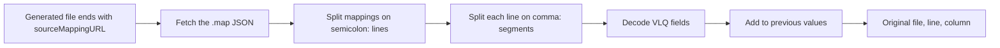

# ECMA-426: Source map format specification

Ecma International TC39-TG4, 2026 draft (live page dated 11 November 2026), a standard. Read on 2026-11-18 from tc39.es/ecma426.

## The claim in one sentence

A source map is a JSON file with a fixed format that links positions in generated code back to the original files, so any tool can show you your own code while the browser runs the compiled code.

## The problem before this

Build tools turn your code into other code: they bundle, minify and transpile it. The browser runs that output, so errors and breakpoints point at unreadable lines. The introduction says source maps were created to map transpiled code back to its sources, and that "the verbosity of the format started to become a problem" as projects grew (Introduction). Later versions of the format therefore traded some simplicity for smaller files. This standard writes the format down in one place.

## Key ideas

### A source map is plain JSON with a few fields

The `version` field must be the integer 3. `sources` lists the original files, `names` lists symbol names, and `mappings` holds the positions. `sourcesContent` can embed the original text, and `file` and `sourceRoot` are optional (Section 9).

### Positions are stored as small relative numbers

The `mappings` string is cut into lines and segments. Most numbers in a segment are relative to the previous segment, so they stay small and the file stays small (Section 9.2).

### Base64 VLQ writes small signed numbers as letters

VLQ means variable-length quantity. Each base64 letter carries 5 bits of value and one bit that says "more letters follow" (Section 6).

### ignoreList marks third-party code

`ignoreList` holds indices into `sources` for code such as framework or bundler output. The standard says developer tools may hide those files from people who step through code (Section 9). See [[Ignore listing]].

### A map is found by a link, not by guessing

The generated file points to its map with a `//# sourceMappingURL=` comment, or an HTTP header (Section 11).

## How it works

In plain words: the build tool writes a second file next to the output. A tool that wants to show original code reads that file, decodes the compact position table, and looks up where each generated spot came from.

The diagram follows Sections 6, 9.2 and 11. [[visual-ecma-426-source-map-mechanism-browser-devtools-mastery|explanation and sources]]

**Technical layer.** The mechanism has these parts.

1. Linking (Section 11). The comment `//# sourceMappingURL=<url>` links a script to its map. The HTTP header `sourcemap: <url>` wins if both exist. CSS uses a `/* */` comment. WebAssembly uses a custom section named `sourceMappingURL`. A relative URL is resolved against the script's origin.
2. Fetching (Section 11.2). The tool fetches the file and parses JSON. A server may prepend a line starting with `)]}'` (a guard against cross-site script reading), and the tool strips it first.
3. Splitting (Section 9.2). A `;` ends a generated line. A `,` separates segments inside a line.
4. Segments (Section 9.2). A segment has 1, 4 or 5 VLQ fields: generated column; source index; original line; original column; optional name index. One field means generated code with no source. Columns and lines count from 0.
5. Relative values (Section 9.2). The generated column resets to 0 at each `;`. The other fields carry over from the previous segment across the whole map, so `A` (zero) means "same as before".
6. VLQ decoding (Section 6). Letters `A`–`Z` and `a`–`f` end a number. Letters `g`–`z`, `0`–`9`, `+`, `/` mean another letter follows. Join the 5-bit groups, least significant first. The lowest bit of the result is the sign (1 means negative). The magnitude is the result divided by 2, rounded down. The spec's examples: `A` is 0, `C` is +1, `V` is −10, `iB` is 17. Values must fit in 32 bits.
7. Index maps (Section 10). A `sections` array holds full maps, each with an `offset` (line and column), sorted and not overlapping. This lets one file describe several joined outputs.

**Step trace** on the string `AAAA,CAAC;AACD`. I built it from the rules above, not from a spec example.

1. Split on `;`: two generated lines, `AAAA,CAAC` and `AACD`.
2. Line 1, segment `AAAA`: all fields 0. Generated column 0, source 0, original line 0, original column 0.
3. Line 1, segment `CAAC`: `C` is +1, `A` is 0, `A` is 0, `C` is +1. Generated column 1, source 0, original line 0, original column 1.
4. The `;` resets the generated column to 0. Source, original line and original column stay 0, 0, 1.
5. Line 2, segment `AACD`: `A` gives column 0, `A` keeps source 0, `C` adds 1 to the line, `D` is 3 (odd, magnitude 1) so it is −1.
6. Result: generated line 2, column 0 maps to source 0, original line 1, original column 0.

Animation candidate: ecma-426-source-map §6 and §9.2. A learner could change the mappings string and the previous values.

**Analogy.** Relative numbers work like walking directions ("two blocks on, one back") instead of street addresses.

## Results and evidence

- This is a specification, so it states rules, not measurements. It defines the format, the VLQ encoding and the linking steps (Sections 6, 9, 11).
- Sizes are bounded: VLQ values must fit in 32 bits, and larger values are invalid and may be rejected (Section 6).
- Columns count UTF-16 code units for JavaScript and CSS, and bytes for WebAssembly (Section 9.2).
- Consumers must ignore unknown extra properties instead of rejecting the map (Section 9).

## Limitations and criticisms

- The text I read does not describe scopes, debug IDs or range mappings. It also says language-neutral stack mapping is out of scope, and it leaves multi-level mapping (TypeScript to JavaScript to minified) as an open question (Annex B).
- The standard has no security or trust model. Many algorithms let a consumer "optionally report an error" and carry on, so tools may differ on bad input (Section 4 and Section 9).
- The page is a draft dated 11 November 2026, and the web version is called the most current. Details can still change.
- `ignoreList` only advises tools; it does not force them to hide anything. The older `x_google_ignoreList` still exists as a fallback in some browsers (Section 9).

## What practitioners took from it

Adoption by real tools could not be verified from the sources recorded for this topic, so nothing is claimed here beyond the source's own statement that developer tools use the format.

## How it connects to this topic

- [[01-brief-browser-devtools-mastery|Browser DevTools mastery brief]] — the brief says teams debug production code through source maps; this note is the format behind that.
- [[Source maps]] — the shared definition of the idea.
- [[Base64 VLQ]] — the encoding used in `mappings`.
- [[Ignore listing]] — how third-party frames are hidden in Sources and call stacks.
- [[Call stack]] — mapped stack traces show original files and lines.

## Test yourself

1. In `mappings`, what do `;` and `,` separate, and which field resets after a `;`?
2. Decode the VLQ letters `V` and `iB`, and explain what the lowest bit means.
3. Which two ways can link a generated script to its map, and which wins if both exist?

## My insights
