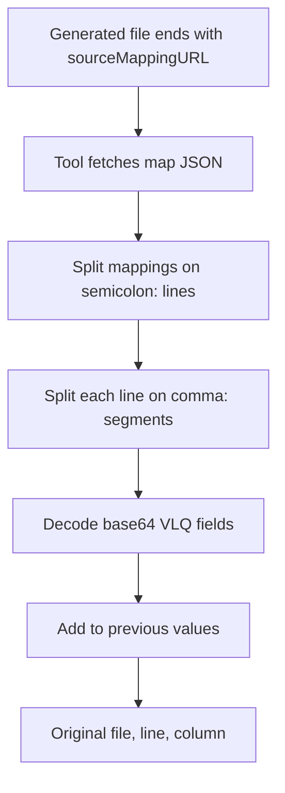

# ECMA-426: Source map format specification

Ecma International TC39, editors Asumu Takikawa, Nicolo Ribaudo and Jon Kuperman; 1st edition December 2024 as recorded in the source entry (the page read is the live draft at tc39.es); a standard.

## The claim in one sentence

A source map is a small JSON file that records, position by position, where each piece of generated code came from in the original files, so a debugger can show the code you wrote instead of the code the browser runs.

## The problem before this

Build tools turn your code into something else: they minify it (shrink it), bundle many files into one, or compile another language to JavaScript, WebAssembly or CSS. The result no longer matches what you wrote, so breakpoints and error stack traces point at unreadable lines. The standard's introduction names two goals: source-level debugging with mapping in both directions, and server-side stack trace deobfuscation. It also says earlier versions (v1, v2) were revised to v3 to keep files small as projects grew. See [[Minification]].

## Key ideas

### A map is a JSON object with a few fields

Section 9 lists the fields. `version` must be the number 3. `sources` lists the original files. `mappings` is one long encoded string. Optional fields are `file`, `sourceRoot` (a prefix for each source), `sourcesContent` (the original text embedded in the map), `names` (symbol names) and `ignoreList` (sources that are third-party code). Tools must ignore fields they do not know.

### Mappings are lines, then segments, then numbers

In section 9.2, a semicolon ends a generated line and a comma separates segments inside a line. A segment has 1, 4 or 5 fields: generated column, source index, original line, original column, and an optional name index. One field means generated code with no original. All positions start at 0.

### Numbers are stored as differences in base64 VLQ

Section 6 defines the number encoding, [[Base64 VLQ]]. Each base64 character carries 5 data bits and a continuation bit. Digits come least significant first, and the lowest bit of the first digit is the sign. Small differences cost one character, which keeps maps small.

### Index maps join several maps

Section 10 defines an index map: a `sections` array, where each section has an `offset` (line and column) and a full embedded `map`. Sections must be sorted and must not overlap. Consumers add the offset to every mapping and merge the source lists. This lets a tool glue maps of separate pieces into one.

### The generated file tells the tool where the map is

Section 11.1 says a JavaScript file ends with a `//# sourceMappingURL=<url>` comment, and CSS uses the same text inside `/* */`. A WebAssembly module uses a custom section of that name. The server may send an HTTP header `sourcemap: <url>` instead, and the header wins if both exist.

## How it works

In plain words: the browser loads the generated file, finds the address of its map, downloads the map, and decodes the mappings string into a table. The table says which original file, line and column each stretch of generated code came from. [[Source map]] lookups then run on that table.

**Analogy.** A source map is like the index of a translated book, which lists for each page of the translation the page of the original.

The diagram follows sections 6, 9.2, 11.1 and 12. [[visual-ecma-426-source-map-mechanism-browser-devtools-mastery|Explanation and sources of this diagram]]

Technical detail. Generated column is relative to the previous segment and resets to 0 at each `;`. Source index, original line, original column and name index are relative to their last use across the whole string, not reset per line (section 9.2). Section 12 defines one operation, `GetOriginalPositions`: it scans the sorted mappings from the end for the first one at or before the query position, and returns the original position of every mapping at exactly that generated position. An empty list means no match. Fetching (section 11.2) rejects bodies that are not UTF-8 JSON. For HTTP(S) only, a body starting with `)]}'` is stripped up to the first newline first.

Step trace. This is my worked example using the section 9.2 rules, not an example from the standard. Take `"mappings": "AAAA,SAASA;AACS"`. In base64, `A` is 0, `C` is 2 and `S` is 18. Per section 6, an even value halves and is positive, and an odd value is negative.

1. Split on `;`. Line 1 is `AAAA,SAASA`, line 2 is `AACS`.
2. Line 1, segment `AAAA` decodes to 0, 0, 0, 0. State: generated column 0, source 0, original line 0, original column 0.
3. Line 1, segment `SAASA` decodes to 9, 0, 0, 9, 0. State: generated column 9, original line 0, original column 9, name 0.
4. A `;` resets the generated column to 0. Source index, original line, original column and name index carry over.
5. Line 2, segment `AACS` decodes to 0, 0, 1, 9. State: generated column 0, original line 1, original column 18.
6. Lookup of generated line 2, column 3: the last mapping at or before it is that segment, so the result is that segment's original position: line 1, column 18 (0-based).

Animation candidate: ecma-426-source-map section 9.2 and 6. A learner could change the mappings string, the query position, and the segment field count.

## Results and evidence

- A standard, so it does not report measurements. It fixes behaviour: version must be 3 and the field list is closed except for ignored extras (section 9).
- VLQ values are limited to 32-bit quantities, and implementations may reject larger ones (section 6). The two examples there, `iB` is 17 and `V` is -10, both decode by the rules above.
- Many malformed-input cases are "optional errors": a tool may continue, report, or fail (sections 9 and 10).
- The page has a typo-like discrepancy in section 6: the unsigned formula prints a multiplier of 25, while the example `iB` only works with 32. I treat 32 as the intent.

## Limitations and criticisms

- The standard has no dedicated security section. It says nothing about maps that leak original code through `sourcesContent`, and the `)]}'` prefix rule exists for historical reasons (section 11.2).
- Only one operation is defined, lookup from generated to original (section 12). Original-to-generated lookup, which breakpoints need, is not specified as an operation, even though the introduction names bidirectional mapping as a goal.
- Mappings give positions, not meaning: nothing says how to display scopes or variable values. The format stores positions and names only.
- Maps trust the file they describe: if the map is stale or from another build, positions are simply wrong. The standard defines no checksum linking the two.

## What practitioners took from it

Adoption by tools could not be verified from this source entry, whose recorded usage list is empty, so I make no claim here.

## How it connects to this topic

- [[01-brief-browser-devtools-mastery|Browser DevTools mastery brief]] — DevTools use maps to show your original files in the Sources panel.
- [[Source map]] — the shared concept this digest defines.
- [[Base64 VLQ]] — how the mappings numbers are stored.
- [[Minification]] — the build step that makes maps necessary.
- [[HTTP]] — the `sourcemap` header travels with the generated file's response.

## Test yourself

1. Which fields of a segment reset at each semicolon, and which carry over across lines?
2. How does a tool find a source map for a JavaScript file, and which wins if both a comment and a header exist?
3. What does an index map's `offset` do to the mappings of its embedded map?

## My insights
