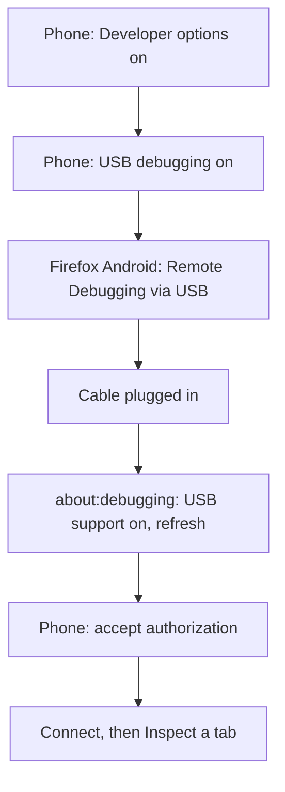

# Firefox DevTools User Docs

Mozilla, 2026, official user documentation of Firefox DevTools on Firefox Source Docs. I read the index and the pages on the Grid inspector, the Rules view, the Flexbox inspector, Edit fonts, the box model, the Accessibility inspector and about:debugging. I read only the opening of the Network Monitor page. I did not read the JavaScript Debugger pages.

## The claim in one sentence

Firefox DevTools give you visual inspectors for layout (Grid, Flexbox, box model), fonts and accessibility, plus a way to attach the same tools to a phone, so you can see why a page looks the way it does instead of guessing.

## The problem before this

CSS layout rules are text. A grid with named areas or a flex row that shrinks its items is hard to picture from code alone. Without tooling you edit a file, reload, and compare pixels. Accessibility is harder still: a screen reader sees a tree of roles and names, and that tree is invisible on screen. Testing on a real phone also needs a way to reach its tabs from your desktop.

## Key ideas

### Layout overlays draw the invisible structure

The Grid and Flexbox inspectors draw lines and item outlines on top of the real page. You switch them on from three places: a marker in the HTML pane, an icon next to `display: grid` or `flex` in the Rules view, or the Layout tab (pages "Examine grid layouts" and "Examine Flexbox layouts"). The overlay stays when you select other elements, so you can edit CSS and watch the effect.

### The Grid inspector has display settings and a mini map

The "Grid Display Settings" group has three switches: line numbers (on by default), area names (on by default, only for grids with named areas), and "Extend lines infinitely" (off by default; lines reach the viewport edge). Each grid on the page gets its own checkbox and colour. Subgrids sit under their parent. A mini grid view shows a small copy of the grid and a tooltip with the size and row and column numbers of an area you hover.

### The Flexbox inspector explains the final size

For a selected flex item, the Layout tab shows a diagram with Content Size, Flexibility (how much it grew or shrank), Minimum Size when the item is clamped, and Final Size. This answers "why is this item that wide?" from numbers, not trial and error.

### The Fonts tab edits type with sliders

The Fonts tab has three parts: Fonts used, a Fonts Editor and All fonts on page. The editor changes size, line height, weight and italic. For a variable font it lists each axis and its named instances. Edits are written as inline styles, so they show at once.

### The Accessibility inspector shows what assistive tools get

It displays the accessibility tree: items with a role (button, link) and a name. A "Check for issues" menu filters for Contrast, Keyboard and Text Labels problems. A simulator shows colour vision deficiencies. A numbered tabbing-order overlay shows keyboard focus order.

## How it works

In plain words: you pick an element, and the tool asks the browser for facts about it (its layout, its fonts or its accessibility role). It then draws those facts on the page or in a side panel. When you edit a value, the page updates at once. Nothing changes in your source file.

**Analogy.** An overlay is like tracing paper laid on a blueprint: the lines are not part of the building, but they show where the walls are.

For a phone, about:debugging is the entry point. The diagram follows the Firefox for Android USB steps.

The diagram follows the about:debugging page, section "Setup tab". [[visual-firefox-devtools-user-docs-mechanism-browser-devtools-mastery|explanation and sources]]

1. On the phone, tap the Build Number entry seven times to unlock Developer options.
2. Turn on USB debugging, then Remote Debugging via USB in Firefox for Android's Advanced settings.
3. Plug in the cable. On the about:debugging home page, turn on USB device support and refresh the list.
4. Accept the prompt on the phone. Click Connect, then Inspect beside a tab.

The same page lists "This Firefox" (local extensions and workers) and "Network" (debug servers you add by address). It also says wireless debugging works on Android 11 and later through adb.

**Interpretation.** Because the steps are a fixed chain, a missing step (for example the authorization prompt) is the first thing to check when a device does not appear.

## Results and evidence

This is documentation, so there are no benchmarks. It states these guarantees and limits.

- Grid preferences such as overlay colour and display settings persist across page loads, separately for each page ("Examine grid layouts").
- Edits in the Rules view are temporary and reset on reload. The Changes pane lists them, and Copy Rule saves them ("Track changes" in the Rules view page).
- Variable fonts need a recent OS, for example macOS 10.13 or later. Values in `font-variation-settings` override the matching basic properties such as `font-weight` ("Edit fonts").
- The tabbing-order overlay is static and does not follow later page changes ("Accessibility inspector").

## Limitations and criticisms

- The Accessibility inspector runs an engine in the background while the toolbox is open. The page warns it can skew Memory and Performance measurements and slow the browser a little.
- Overlays and font edits are not saved to your files. You must copy the CSS back by hand.
- The box model page names no limits, and the Network Monitor page I read is only an overview; this digest does not compare the Network Monitor or Debugger to Chrome. That gap is not tested here.
- A docs set shows features, not how often people choose them.

## What practitioners took from it

Adoption by practitioners could not be verified from the sources recorded for this topic, so nothing is claimed here.

## How it connects to this topic

- [[01-brief-browser-devtools-mastery|Browser DevTools mastery brief]] — Firefox is the second engine to learn after Chrome.
- [[Box model]] — the Box Model view lets you edit the box values and see tooltips for their rule.
- [[Flexbox]] — the Flexbox inspector shows why an item got its final size.
- [[Accessibility tree]] — the tree the Accessibility inspector displays.
- [[DOM]] — the HTML pane that marks grid and flex containers is a view of it.

## Test yourself

1. Which three places can you switch on a grid overlay, and which Display Settings option is off by default?
2. What does the Flexbox inspector's Final Size explanation help you understand?
3. List the order of steps to inspect a tab on an Android phone over USB, and say what you do on the phone after the cable is in.

## My insights
