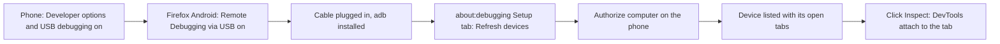

# Firefox DevTools User Docs

Mozilla, 2026, official user documentation of Firefox DevTools, read on 2026-11-18 (the overview, the Grid, Flexbox, Fonts and Accessibility pages, and about:debugging).

## The claim in one sentence

Firefox DevTools give you layout, font and accessibility views that show why a box has its size, shape or role, and about:debugging lets you inspect tabs on a phone from your desktop.

## The problem before this

In plain CSS work you read numbers in the Styles pane and guess how a grid or flex container places its children. A font problem means trial and error in a stylesheet. Testing on a phone means editing code and reloading blind. The docs show how Firefox puts each of these on screen (overview page, "Page Inspector" and "Connecting the Developer Tools").

## Key ideas

### Grid overlay with settings

Any element with `display: grid` gets a grid marker in the HTML pane and a grid icon in the Rules view. Clicking it draws the grid on the page. You can toggle line numbers and area names (both on by default) and "extend lines infinitely" (off by default). Each grid has its own color; a subgrid is indented under its parent (page "Examine grid layouts").

### Flexbox inspector explains sizes

Flex containers get a `flex` label and an overlay that outlines every item. Click an item in the Flex Items list to see Content Size, Flexibility, Minimum Size (only when clamped) and Final Size. This is the place to learn why an item ended up at its size (page "Examine flexbox layouts").

### Font editor, including variable fonts

The Fonts tab lists the fonts used by the selected element, an editor, and all fonts on the page. For a static font you edit size, line height, weight (a 100–900 slider) and italic. For a variable font, each axis gets its own control, and named instances sit in a dropdown (page "Edit fonts").

### Accessibility inspector

It shows the accessibility tree: roles, names, states and the linked DOM node. A "Check for issues" menu filters by Contrast, Keyboard or Text Labels. A simulator previews color vision deficiency (page "Accessibility Inspector").

### about:debugging as the connection hub

One page attaches DevTools to tabs, workers and extensions, on this Firefox or on a device. For Android over USB you need adb, not the full Android Studio SDK (page "about:debugging").

## How it works

In plain words: you do not read layout numbers. You turn an overlay on, and the browser paints the grid lines or flex items over your page. For a phone, you switch on debugging on both ends, plug in, and the phone's tabs appear in a list on your computer.

The steps follow the page "about:debugging", section "Setup tab". [[visual-firefox-devtools-user-docs-mechanism-browser-devtools-mastery|explanation and sources]]

1. On the phone, turn on Developer options and USB debugging. In Firefox for Android, enable Remote Debugging via USB.
2. Connect the cable. Open `about:debugging` and click Refresh devices.
3. Authorize the computer on the phone. The device appears with its open tabs.
4. Click Inspect. You can also edit the tab URL, reload it or go back.

Wi-Fi works on Android 11 or later with adb and a pairing code. A network location (host and port) works for another desktop Firefox, but not for Android.

For the grid overlay, the mechanism is a toggle: the Layout tab lists each grid with a checkbox, a color and a target icon. A mini grid view shows a small scaled copy; hovering an area highlights it on the page. **Interpretation.** The overlays turn CSS you wrote into a picture, so you debug placement by looking.

## Results and evidence

- Overlay color and display settings persist across page loads, per page ("Examine grid layouts").
- The Fonts editor converts units so the computed size stays the same when you switch units ("Edit fonts").
- Contrast results show a ratio and a WCAG AA or AAA status ("Accessibility Inspector").
- These are user docs. They state features, not measurements, so there are no benchmark numbers.

## Limitations and criticisms

- The docs name their own limits. Variable fonts need an up-to-date operating system. `font-variation-settings` overrides basic properties such as `font-weight` whatever the cascade order ("Edit fonts").
- The accessibility inspector shows Gecko's tree, not the platform's view. Its engine can distort Memory and Performance readings while DevTools is open. The tab-order overlay is a snapshot ("Accessibility Inspector").
- about:debugging has requirements: desktop Firefox 69 or later cannot debug Firefox for Android 68, and temporary extensions vanish on restart. It covers Firefox only. The docs do not cover Safari or iOS, and they do not compare Firefox with Chrome. The claim that Firefox does these tools better is the brief's framing, not the docs'.

## What practitioners took from it

Adoption by practitioners could not be verified from the sources recorded for this topic, so nothing is claimed here.

## How it connects to this topic

- [[01-brief-browser-devtools-mastery|Browser DevTools mastery brief]] — this source backs the "Firefox, Safari or a real device" outcome.
- [[Browser developer tools]] — Firefox is a second implementation of the same idea.
- [[Remote debugging]] — about:debugging is Firefox's version of attaching to a phone.
- [[Accessibility tree]] — the structure the accessibility inspector shows.
- [[Document Object Model]] — the accessibility tree links back to DOM nodes.

## Test yourself

1. Which three options of the grid overlay can you toggle, and which one is off by default?
2. What four numbers does the Flexbox inspector show for a flex item, and which appears only in one case?
3. What must you do on the phone, and in Firefox for Android, before about:debugging lists the device?

## My insights
