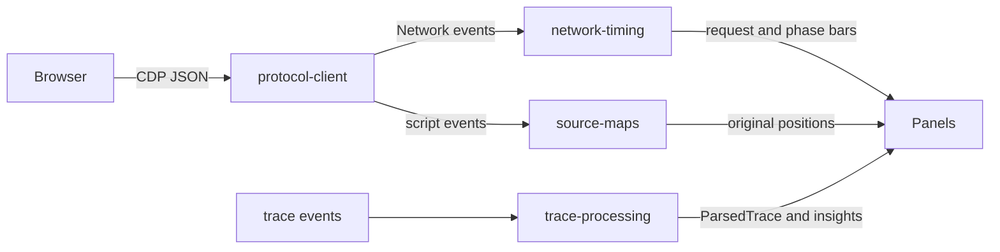
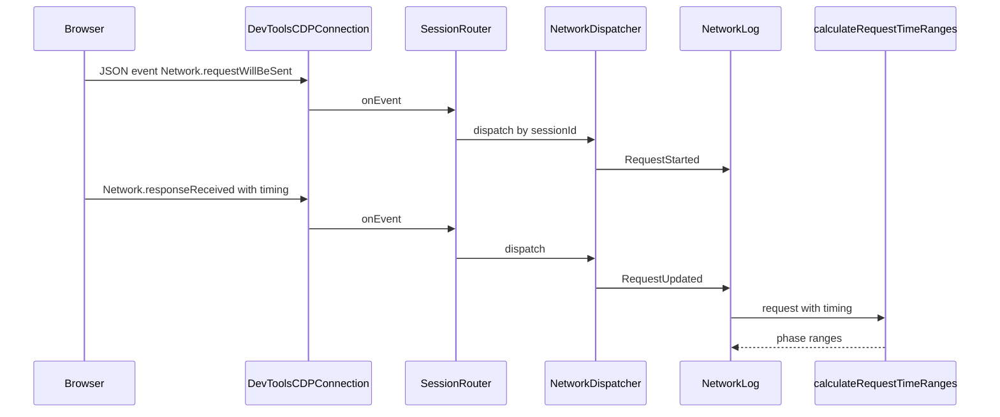

# ChromeDevTools/devtools-frontend — architecture

Four modules were analyzed at commit `92a1ec4`. Together they show how a panel gets its data: the browser sends JSON messages, a client routes them, and small model classes turn them into things a panel can draw.

## Module map

| Module | Responsibility | Note |
|--------|----------------|------|
| protocol-client | Sends CDP commands, matches replies by id, routes events to the right target | [[devtools-frontend-module-protocol-client|protocol-client]] |
| network-timing | Turns `Network.*` events into request objects and timing phases | [[devtools-frontend-module-network-timing|network-timing]] |
| source-maps | Finds, fetches, parses and searches source maps | [[devtools-frontend-module-source-maps|source-maps]] |
| trace-processing | Turns recorded trace events into a model and insights | [[devtools-frontend-module-trace-processing|trace-processing]] |

## The picture

The protocol client owns the wire (`front_end/core/protocol_client/DevToolsCDPConnection.ts:120-139 @ 92a1ec4`). Network code listens through a dispatcher it registers on its target (`front_end/core/sdk/NetworkManager.ts:188-191 @ 92a1ec4`). The debugger model hands each script's map URL to the source map manager (`front_end/core/sdk/DebuggerModel.ts:785 @ 92a1ec4`). The UI calls `Model.parse(events)` for traces (`front_end/models/trace/ModelImpl.ts:85-102 @ 92a1ec4`). The arrow from each module to "Panels" is the module's result type; the panel code itself was not analyzed. [[visual-devtools-frontend-module-map-browser-devtools-mastery|explanation and sources]]

## Main flow

In plain words: a network event travels from the browser to a request bar in six hops.

1. The transport hands each JSON message to `#onMessage`. A message with `method` and no `id` is an event (`front_end/core/protocol_client/DevToolsCDPConnection.ts:138-139 @ 92a1ec4`).
2. `SessionRouter.onEvent` reads the `sessionId` and calls `dispatch` on that target (`front_end/core/protocol_client/InspectorBackend.ts:219-223 @ 92a1ec4`).
3. The target splits `Domain.event` and calls the listener method, here on `NetworkDispatcher` (`front_end/core/protocol_client/InspectorBackend.ts:285-294 @ 92a1ec4`).
4. `requestWillBeSent` creates the request and `startNetworkRequest` fires `RequestStarted` (`front_end/core/sdk/NetworkManager.ts:1014-1040 @ 92a1ec4`, `:1376-1393 @ 92a1ec4`).
5. `responseReceived` copies the browser's `timing` object onto the request (`front_end/core/sdk/NetworkManager.ts:890 @ 92a1ec4`). `NetworkLog` listens to the manager's events (`front_end/models/logs/NetworkLog.ts:79-90 @ 92a1ec4`).
6. The view calls `calculateRequestTimeRanges`, which builds the named phases from the timing offsets (`front_end/models/network_time_calculator/RequestTimeRanges.ts:119-138 @ 92a1ec4`).

[[visual-devtools-frontend-request-flow-browser-devtools-mastery|explanation and sources]]

## Worth exploring interactively

- Command and reply round trip (FlowAnimation): agent `invoke` (`front_end/core/protocol_client/InspectorBackend.ts:700-707 @ 92a1ec4`), id and stored callback (`front_end/core/protocol_client/DevToolsCDPConnection.ts:55-80 @ 92a1ec4`), reply matched by id (`:120-137`).
- Phase builder (AlgorithmStepper): step through `calculateRequestTimeRanges` with sample timing numbers (`front_end/models/network_time_calculator/RequestTimeRanges.ts:106-171 @ 92a1ec4`).
- Decode a `mappings` string (AlgorithmStepper): five running counters change per segment (`front_end/core/sdk/SourceMap.ts:609-645 @ 92a1ec4`, `:1004-1019 @ 92a1ec4`).
- Source map attach lifecycle (StateMachine): attach, load, Attached or FailedToAttach (`front_end/core/sdk/SourceMapManager.ts:122-160 @ 92a1ec4`).
- Trace parse pipeline (FlowAnimation) and Processor lifecycle (StateMachine) (`front_end/models/trace/Processor.ts:154-267 @ 92a1ec4`, `:13-18`).

## For a video walkthrough

Animation candidate, main flow as hops:

1. Browser → DevToolsCDPConnection: JSON event (`front_end/core/protocol_client/DevToolsCDPConnection.ts:138-139 @ 92a1ec4`)
2. DevToolsCDPConnection → SessionRouter: onEvent (`front_end/core/protocol_client/InspectorBackend.ts:219-223 @ 92a1ec4`)
3. SessionRouter → NetworkDispatcher: dispatch by sessionId (`front_end/core/protocol_client/InspectorBackend.ts:285-294 @ 92a1ec4`)
4. NetworkDispatcher → NetworkLog: RequestStarted (`front_end/core/sdk/NetworkManager.ts:1376-1393 @ 92a1ec4`)
5. NetworkLog → calculateRequestTimeRanges: request with timing (`front_end/models/network_time_calculator/RequestTimeRanges.ts:119-138 @ 92a1ec4`)

Decision candidates (alternatives are named in the module notes):

- Load source maps at once or on demand. Lazy loading defers the download until asked; the alternative downloads every map when the script appears (`front_end/core/sdk/SourceMapManager.ts:176-181 @ 92a1ec4`). Trade-off: less network work against a slower first lookup.
- Measure progress by events or by clock. The trace processor yields every 50,000 events because `performance.now()` is costly in a hot loop (`front_end/models/trace/Processor.ts:195-228 @ 92a1ec4`).
- Fail a call by exception or by value. The protocol client returns an error value (`front_end/core/protocol_client/InspectorBackend.ts:708-722 @ 92a1ec4`).

## Design decisions worth noticing

Failures are data in this code base. A protocol error, a missing source map and a bad trace handler are each caught at a boundary and turned into a value or a null; see [[devtools-frontend-pattern-failures-as-values]]. Events are never assumed complete or in order; see [[devtools-frontend-pattern-tolerate-incomplete-events]]. Big inputs are handled in two passes with a dependency order, and in chunks so the UI stays alive; see [[devtools-frontend-pattern-two-pass-and-chunked-work]]. The ranked list is in [[devtools-frontend-findings]].

## Not analyzed

- build-and-infra (`package.json`, `BUILD.gn`, `DEPS`, `.github/workflows`): only manifest facts were read.
- `front_end/panels/*` view code (for example `NetworkLogView.ts`): the data path is in the chosen models.
- `front_end/models/heap_snapshot` and `models/cpu_profile` (Memory panel data).
- Trace handlers other than `NetworkRequestsHandler`, plus insights and Lantern internals.
- `front_end/core/sdk/DebuggerModel.ts` (breakpoints): the link from reverse source map lookups to a CDP breakpoint call is not shown.
- Vendored, generated, e2e test, i18n, docs and extension code.

## My insights
