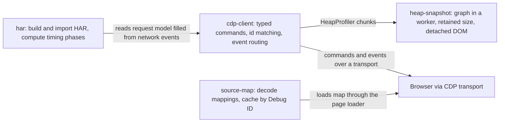
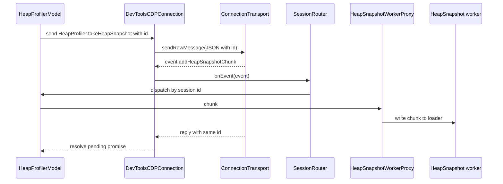
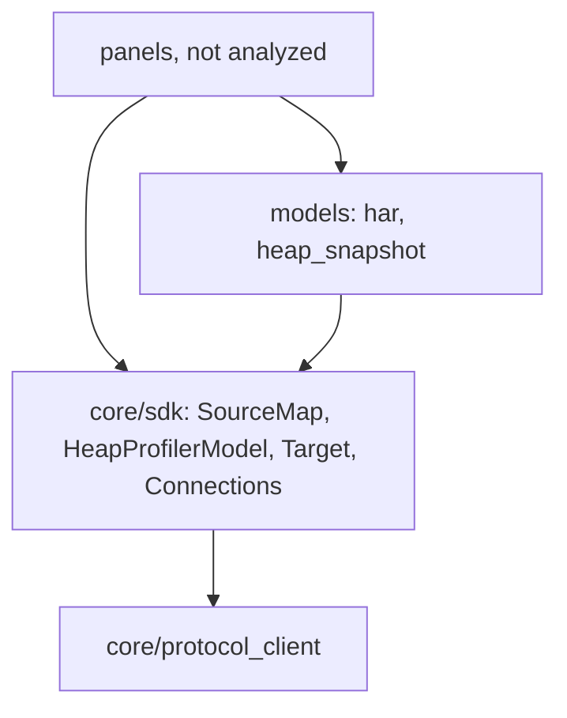

# ChromeDevTools/devtools-frontend — architecture

DevTools is a web app that inspects another page. It never touches that page directly. It sends JSON commands to the browser and listens for JSON events (the Chrome DevTools Protocol). Four slices were studied. This note shows how they fit together. It uses the module notes only.

## Module map

| Module | Responsibility | Note |
|--------|----------------|------|
| cdp-client | Sends typed commands, matches replies by id, routes events by session | [[devtools-frontend-module-cdp-client\|cdp-client]] |
| source-map | Decodes a source map into a sorted lookup table, caches it by Debug ID | [[devtools-frontend-module-source-map\|source-map]] |
| har | Turns request objects into HAR 1.2 and back, computes the timing phases | [[devtools-frontend-module-har\|har]] |
| heap-snapshot | Loads a V8 heap snapshot in a worker and computes retained size and detached DOM | [[devtools-frontend-module-heap-snapshot\|heap-snapshot]] |

## The picture

The cdp-client slice owns the wire (`front_end/core/protocol_client/DevToolsCDPConnection.ts:55-81 @ 572bfc0`). The heap model asks the browser for a snapshot through it (`front_end/core/sdk/HeapProfilerModel.ts:96-102 @ 572bfc0`). The source-map manager downloads maps with `PageResourceLoader` (`front_end/core/sdk/SourceMapManager.ts:143-145 @ 572bfc0`). The HAR module maps `SDK.NetworkRequest` objects (`front_end/models/har/Log.ts:13 @ 572bfc0`). The last arrow is weaker: the module notes show that HAR reads the request model but do not show which code fills it from protocol events. [[visual-devtools-frontend-module-map-browser-devtools-mastery|explanation and sources]]

## Main flow

Plain words first. DevTools sends a numbered JSON message and keeps a promise under that number. The browser can answer with the same number, and can also send unnumbered events at any time. A snapshot request does both: chunk events arrive first, and the numbered reply comes last.

1. The model suspends all targets, then calls `HeapProfiler.takeHeapSnapshot` (`front_end/core/sdk/HeapProfilerModel.ts:96-102 @ 572bfc0`).
2. `send` builds `{id, method, params, sessionId}`, stores a resolver and writes JSON to the transport (`front_end/core/protocol_client/DevToolsCDPConnection.ts:55-81 @ 572bfc0`).
3. A message with only a `method` is an event and goes to every observer (`front_end/core/protocol_client/DevToolsCDPConnection.ts:138-139 @ 572bfc0`). The `SessionRouter` finds the target by session id (`front_end/core/protocol_client/InspectorBackend.ts:218-223 @ 572bfc0`).
4. Each chunk becomes an event for the model (`front_end/core/sdk/HeapProfilerModel.ts:124-126 @ 572bfc0`). The page-side proxy feeds a worker loader (`front_end/models/heap_snapshot/HeapSnapshotProxy.ts:42-51 @ 572bfc0`).
5. The reply with the same id resolves the stored promise (`front_end/core/protocol_client/DevToolsCDPConnection.ts:120-137 @ 572bfc0`).

The step order of chunks before the reply is an inference from the two module notes; the notes do not cite a trace of one real session. [[visual-devtools-frontend-request-flow-browser-devtools-mastery|explanation and sources]]

animation candidate, hops for a `flow` scene:

1. HeapProfilerModel → DevToolsCDPConnection: send takeHeapSnapshot with id (`front_end/core/protocol_client/DevToolsCDPConnection.ts:55-81 @ 572bfc0`)
2. DevToolsCDPConnection → ConnectionTransport: write JSON (`front_end/core/protocol_client/DevToolsCDPConnection.ts:80 @ 572bfc0`)
3. ConnectionTransport → DevToolsCDPConnection: event or reply arrives (`front_end/core/protocol_client/DevToolsCDPConnection.ts:120-139 @ 572bfc0`)
4. SessionRouter → TargetBase: dispatch by session id (`front_end/core/protocol_client/InspectorBackend.ts:218-223 @ 572bfc0`)
5. HeapSnapshotWorkerProxy → HeapSnapshotLoader: write chunk (`front_end/models/heap_snapshot/HeapSnapshotProxy.ts:42-51 @ 572bfc0`)

## Module dependencies (when useful)

The folder names show a layering: protocol client at the bottom, SDK models on it, panel-facing models above (`front_end/core/protocol_client/InspectorBackend.ts:687-699 @ 572bfc0`, `front_end/core/sdk/HeapProfilerModel.ts:96-102 @ 572bfc0`, `front_end/models/heap_snapshot/HeapSnapshotModel.ts:347-350 @ 572bfc0`). The arrow from panels is not proven by the module notes, which did not read the panels. No cycle was seen, but no import graph was built.

## Worth exploring interactively

- Decode one mapping segment, AlgorithmStepper (from [[devtools-frontend-module-source-map|source-map]]): Base64 lookup, 5 data bits, continuation bit, sign bit, delta added (`front_end/core/sdk/SourceMap.ts:993-1013 @ 572bfc0`, `front_end/core/sdk/SourceMap.ts:623-635 @ 572bfc0`).
- HAR timing phases, AlgorithmStepper (from [[devtools-frontend-module-har|har]]): queue, blocked, DNS, connect, send, wait, receive (`front_end/models/har/Log.ts:282-346 @ 572bfc0`).
- Retained size via dominators, AlgorithmStepper (from [[devtools-frontend-module-heap-snapshot|heap-snapshot]]): essential edges, DFS, dominators, bottom-up sum (`front_end/entrypoints/heap_snapshot_worker/HeapSnapshot.ts:2273-2339 @ 572bfc0`).
- Command round trip, FlowAnimation (from [[devtools-frontend-module-cdp-client|cdp-client]]): id leaves, waits in a map, returns (`front_end/core/protocol_client/DevToolsCDPConnection.ts:55-137 @ 572bfc0`).
- Transport choice for remote debugging, StateMachine (`front_end/core/sdk/Connections.ts:229-248 @ 572bfc0`).

## Design decisions worth noticing

decision candidate: one transport interface or one hard-wired WebSocket. Options: (a) an abstract `ConnectionTransport` with embedder, WebSocket and stub classes; (b) call `WebSocket` directly. The code chose (a) so the same UI runs embedded, remote, hosted and in a trace viewer; the cost is one more layer (`front_end/core/protocol_client/ConnectionTransport.ts:7-25 @ 572bfc0`, `front_end/core/sdk/Connections.ts:229-248 @ 572bfc0`). See [[devtools-frontend-findings|findings]] 9.

decision candidate: parse a source map at once or on first lookup. Options: (a) decode in the constructor; (b) read `sources` now and decode `mappings` later. The code chose (b) and frees the raw JSON; the cost is a first-lookup delay (`front_end/core/sdk/SourceMap.ts:188 @ 572bfc0`, `front_end/core/sdk/SourceMap.ts:472-496 @ 572bfc0`). See [[devtools-frontend-pattern-lazy-and-off-thread-work|the lazy pattern]].

decision candidate: retained size by a walk per node or by a dominator tree. Options: (a) walk reachable nodes for each; (b) build the tree once and sum up it. The code chose (b) (`front_end/entrypoints/heap_snapshot_worker/HeapSnapshot.ts:2127-2129 @ 572bfc0`, `front_end/entrypoints/heap_snapshot_worker/HeapSnapshot.ts:2334-2339 @ 572bfc0`). See [[devtools-frontend-findings|findings]] 5.

## Not analyzed

- `front_end/panels/` (Elements, Network, Console UI): large UI code; only the models were read.
- `front_end/models/trace`, `ai_assistance`, `lighthouse`: unrelated to the assigned concepts.
- `front_end/third_party`, generated code, images, translations: vendored, generated, or translated.
- build-and-infra: dropped for budget; only manifests were read by the scout.
- `core/sdk/NetworkManager.ts`: too large for the budget.

## My insights
