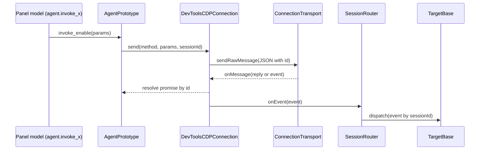

# ChromeDevTools/devtools-frontend — module: cdp-client

## Responsibility

This module is how the DevTools window talks to the browser it inspects. Every panel (Elements, Console, Network) needs to send commands such as "get the styles of this node" and to receive events such as "a console message arrived". The module wraps one transport (a WebSocket, the embedder channel, or a stub) in a typed command and event layer, and routes each message to the right target (page, worker, and so on) by its session id. This is also the layer behind remote device debugging: when the page is opened with a `ws` parameter, DevTools connects to a browser over the network (`front_end/core/sdk/Connections.ts:235-240 @ 572bfc0`).

## Key files

| File | Role |
|------|------|
| `front_end/core/protocol_client/CDPConnection.ts` | Types for commands, responses, events, errors; the `CDPConnection` interface |
| `front_end/core/protocol_client/ConnectionTransport.ts` | Abstract raw byte pipe (send string, receive message, disconnect) |
| `front_end/core/protocol_client/DevToolsCDPConnection.ts` | Numbers each command, keeps pending promises, routes replies and events |
| `front_end/core/protocol_client/PuppeteerDevToolsConnection.ts` | Makes a Puppeteer session look like a `CDPConnection` |
| `front_end/core/protocol_client/InspectorBackend.ts` | `SessionRouter`, `TargetBase`, per-domain agents and dispatchers |
| `front_end/core/protocol_client/InspectorBackend.test.ts` | Unit tests of event dispatch |
| `front_end/core/sdk/Connections.ts` | The concrete transports and the choice between them |
| `front_end/core/sdk/Target.ts` | `Target` (page, worker, tab...), suspend and resume |

## How it works

Plain words first: DevTools sends a JSON message with a number on it, and keeps a promise waiting under that number. When the browser answers with the same number, the promise finishes. Messages with no number are events and are handed to whoever listens.

1. A command method is generated per protocol command: `registerCommand` installs an `invoke_<name>` function on the domain's agent prototype (`front_end/core/protocol_client/InspectorBackend.ts:687-699 @ 572bfc0`).
2. `invoke` finds the connection through the target's router and calls `connection.send(method, params, sessionId)` (`front_end/core/protocol_client/InspectorBackend.ts:702-707 @ 572bfc0`).
3. `send` increments the message id, builds `{id, method, params, sessionId}`, stores a resolver in a map and writes JSON to the transport (`front_end/core/protocol_client/DevToolsCDPConnection.ts:55-81 @ 572bfc0`).
4. When a message returns, a message with an `id` resolves the stored promise (`front_end/core/protocol_client/DevToolsCDPConnection.ts:120-137 @ 572bfc0`); a message with only a `method` is an event and goes to every observer (`front_end/core/protocol_client/DevToolsCDPConnection.ts:138-139 @ 572bfc0`).
5. The `SessionRouter` is one such observer. It looks up the target by session id (empty string is the root) and calls `dispatch` (`front_end/core/protocol_client/InspectorBackend.ts:218-223 @ 572bfc0`).
6. `TargetBase.dispatch` splits `Domain.event`, finds the domain's dispatcher manager and calls each registered listener that has a handler of that name (`front_end/core/protocol_client/InspectorBackend.ts:285-294 @ 572bfc0`, `front_end/core/protocol_client/InspectorBackend.ts:754-775 @ 572bfc0`).
7. Child targets (iframes, workers) share the parent's router and need a session id, so one connection carries many targets (`front_end/core/protocol_client/InspectorBackend.ts:257-263 @ 572bfc0`).

Choosing the transport (`createMainTransport`): trace app uses a rehydrating transport; `?ws=` or `?wss=` uses a WebSocket; hosted mode without a socket uses a stub; otherwise the embedded channel to the browser host (`front_end/core/sdk/Connections.ts:229-248 @ 572bfc0`).

## Beyond the textbook

### One interface, several transports

- Textbook version: open a WebSocket and call `send`.
- What they do: `ConnectionTransport` is an abstract class with four methods, and the connection layer only sees that. Implementations are an embedder channel (`MainConnection`), `WebSocketTransport` and `StubTransport`. A factory is stored statically so a new root target can build its own transport.
- Why: the same UI must run embedded in Chrome, against a remote device over WebSocket, in hosted mode, and in a trace viewer. The comment on `CDPConnection` also says one connection must own its whole channel because message ids would collide.
- Evidence: `front_end/core/protocol_client/ConnectionTransport.ts:7-25 @ 572bfc0`, `front_end/core/sdk/Connections.ts:27 @ 572bfc0`, `front_end/core/protocol_client/CDPConnection.ts:61-67 @ 572bfc0`

### Messages queued until the socket opens

- Textbook version: call `socket.send` and hope it is open.
- What they do: `WebSocketTransport.sendRawMessage` pushes messages into an array while not connected and flushes them in `onOpen`.
- Why: DevTools creates targets and sends commands immediately, before the WebSocket handshake finishes (visible in the buffering code).
- Evidence: `front_end/core/sdk/Connections.ts:164-170 @ 572bfc0`, `front_end/core/sdk/Connections.ts:131-140 @ 572bfc0`

### Chunked messages are reassembled

- Textbook version: one message in, one message out.
- What they do: the embedded channel can deliver a big message in chunks. The first chunk carries the total size; chunks are appended until the buffer length equals that size, then one `onMessage` fires.
- Why: large protocol payloads (for example big responses) are split by the host; the code rebuilds them.
- Evidence: `front_end/core/sdk/Connections.ts:62-75 @ 572bfc0`

### Helpful error for remote debugging origin rules

- Textbook version: show "disconnected".
- What they do: when the WebSocket fails, the dialog text tells the user to check Chrome's `--remote-allow-origins` flag.
- Why: a frequent real cause of failing remote debug connections is the origin not being allowed by the browser.
- Evidence: `front_end/core/sdk/Connections.ts:19-23 @ 572bfc0`, `front_end/core/sdk/Connections.ts:120-129 @ 572bfc0`

### Pending calls are failed, not left hanging

- Textbook version: drop the session and forget the promises.
- What they do: when a session unregisters, every pending call for that session resolves with a `SESSION_NOT_FOUND` error. Disconnect and "Connection is closed" also resolve with an error value rather than throwing.
- Why: callers `await` these promises, so a never-answered call would freeze a panel.
- Evidence: `front_end/core/protocol_client/DevToolsCDPConnection.ts:84-96 @ 572bfc0`, `front_end/core/protocol_client/InspectorBackend.ts:201-209 @ 572bfc0`, `front_end/core/protocol_client/InspectorBackend.ts:703-706 @ 572bfc0`

### Errors as values and a quiet list

- Textbook version: throw on every protocol error and log everything.
- What they do: `send` returns `{result}` or `{error}`; `invoke` turns an error into `getError()` and logs it with `console.error` unless its code is in `IGNORED_ERRORS` (stub, rehydration, server error, session not found).
- Why: those codes are expected during teardown or offline modes, so logging them would be noise. The error codes are kept in sync with the browser's C++ dispatcher (comment).
- Evidence: `front_end/core/protocol_client/InspectorBackend.ts:660-665 @ 572bfc0`, `front_end/core/protocol_client/InspectorBackend.ts:708-716 @ 572bfc0`, `front_end/core/protocol_client/CDPConnection.ts:33-46 @ 572bfc0`

### Reply session check

- Textbook version: match replies by id only.
- What they do: a reply is also dropped if its session id differs from the one the request used, and replies with unknown ids are ignored because "we might see puppeteer proxied messages here". Root session is both `''` and `undefined`, so they compare with `?? ''`.
- Why: ids are only unique per connection, and shared channels can carry foreign traffic.
- Evidence: `front_end/core/protocol_client/DevToolsCDPConnection.ts:123-135 @ 572bfc0`

### Suspend with a generation counter

- Textbook version: a boolean flag.
- What they do: `Target.suspend` bumps `#suspendGeneration`, awaits `preSuspendModel`, then stops if a `resume` happened in between. A crashed target is marked suspended without touching its models, and is resumed when it recovers.
- Why: suspend and resume are async and can interleave; the counter prevents a stale suspend from finishing after a resume.
- Evidence: `front_end/core/sdk/Target.ts:255-289 @ 572bfc0`, `front_end/core/sdk/Target.ts:242-252 @ 572bfc0`

### Puppeteer adapter without loading Puppeteer

- Textbook version: import the library and use it.
- What they do: `PuppeteerDevToolsConnection` imports Puppeteer only as types and hard-codes the two event name strings, so the runtime bundle does not pull Puppeteer in. It forwards every session event with `session.on('*')`.
- Why: stated in the comment: avoid importing Puppeteer runtime JavaScript.
- Evidence: `front_end/core/protocol_client/PuppeteerDevToolsConnection.ts:5-13 @ 572bfc0`, `front_end/core/protocol_client/PuppeteerDevToolsConnection.ts:94-101 @ 572bfc0`

## Tests and what they protect

`InspectorBackend.test.ts` has three tests of `TargetBase.dispatch` using a `MockCDPConnection` and sinon stubs. They check that an event for an unknown domain logs a protocol error (`front_end/core/protocol_client/InspectorBackend.test.ts:15-30 @ 572bfc0`), that an unspecified event of a known domain logs only a warning (`front_end/core/protocol_client/InspectorBackend.test.ts:32-47 @ 572bfc0`), and that a dispatcher without a handler is skipped without an error while another dispatcher still receives the event (`front_end/core/protocol_client/InspectorBackend.test.ts:49-66 @ 572bfc0`). The connection, transports and `Target` have no test in this slice.

Test hooks live in production code: `test.dumpProtocol`, `test.onMessageSent`, `test.onMessageReceived` and `test.sendRawMessage` let the harness log or inspect every message (`front_end/core/protocol_client/DevToolsCDPConnection.ts:37 @ 572bfc0`, `front_end/core/protocol_client/DevToolsCDPConnection.ts:68-76 @ 572bfc0`). A `DebuggableCDPConnection` interface exposes raw traffic to the protocol monitor (`front_end/core/protocol_client/CDPConnection.ts:81-92 @ 572bfc0`).

## Error handling, performance, and security

- Unknown message shape: a message with neither `id` nor `method` is reported as a protocol error (`front_end/core/protocol_client/DevToolsCDPConnection.ts:140-141 @ 572bfc0`).
- Sending on the Puppeteer root session throws; an unknown session returns a `SESSION_NOT_FOUND` error value (`front_end/core/protocol_client/PuppeteerDevToolsConnection.ts:61-74 @ 572bfc0`).
- Stub mode answers every command with `DEVTOOLS_STUB_ERROR` after a `setTimeout` so callers still get an async reply (`front_end/core/sdk/Connections.ts:196-210 @ 572bfc0`).
- Security: the browser decides which origins may open a debug socket (`--remote-allow-origins`, named in the UI string at `front_end/core/sdk/Connections.ts:20-23 @ 572bfc0`). The `ws` value comes from the page URL query and is prefixed with `ws://` or `wss://` without further validation in this file (`front_end/core/sdk/Connections.ts:235-238 @ 572bfc0`).
- Performance: agents are created with `Object.create(prototype)` so command functions exist once per domain, not once per target (`front_end/core/protocol_client/InspectorBackend.ts:274-278 @ 572bfc0`, `front_end/core/protocol_client/InspectorBackend.ts:669-676 @ 572bfc0`). There is no timeout on pending commands in this slice.

## Technologies and services seen

- Chrome DevTools Protocol (JSON messages with id, method, params, sessionId) — the wire format (`front_end/core/protocol_client/CDPConnection.ts:13-31 @ 572bfc0`)
- WebSocket (browser API) — remote debugging transport (`front_end/core/sdk/Connections.ts:99 @ 572bfc0`)
- Puppeteer (types only) — alternative connection source (`front_end/core/protocol_client/PuppeteerDevToolsConnection.ts:5 @ 572bfc0`)
- Mocha and Sinon — unit tests (`front_end/core/protocol_client/InspectorBackend.test.ts:5-6 @ 572bfc0`)
- TypeScript generated protocol typings (`generated/protocol-mapping`) — typed commands (`front_end/core/protocol_client/CDPConnection.ts:5 @ 572bfc0`)
- Chromium crdtp dispatcher — C++ source of the error codes (`front_end/core/protocol_client/CDPConnection.ts:34 @ 572bfc0`)

## Worth exploring interactively

- Command round trip — `invoke_x` called (`front_end/core/protocol_client/InspectorBackend.ts:687-699 @ 572bfc0`) → `send` assigns id and stores resolver (`front_end/core/protocol_client/DevToolsCDPConnection.ts:55-81 @ 572bfc0`) → transport writes JSON (`front_end/core/protocol_client/DevToolsCDPConnection.ts:80 @ 572bfc0`) → reply with the same id resolves the promise (`front_end/core/protocol_client/DevToolsCDPConnection.ts:120-137 @ 572bfc0`) — fits FlowAnimation because the learner sees an id leave, wait in the map, and come back.
- Transport selection — trace app, `ws`, hosted, embedded (`front_end/core/sdk/Connections.ts:229-248 @ 572bfc0`) — fits StateMachine or SystemDiagram because the URL and host mode decide which transport is plugged in (useful for remote device debugging).

## Open questions

- The command and event typings are generated; their source (`generated/`) was not in this slice.
- How `TargetManager` creates child targets and sessions is outside this slice.
- Console and Elements styles panels (the assigned concepts) are not in this module; only their transport is.

## My insights
