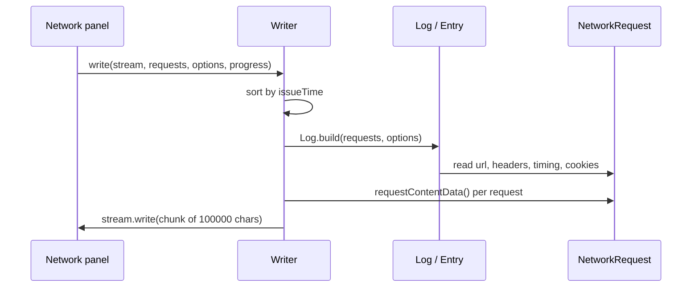

# ChromeDevTools/devtools-frontend — module: har

## Responsibility

A HAR file is a JSON record of every network request a page made. This module turns the Network panel's request objects into a HAR 1.2 file (export) and turns a HAR file back into request objects (import). It also decides how Chrome's timing phases (the waterfall) map onto the HAR timing fields and back.

## Key files

| File | Role |
|------|------|
| `front_end/models/har/Log.ts` | Builds the HAR log, pages, entries and the timing phases from a request |
| `front_end/models/har/Writer.ts` | Sorts requests, loads response bodies, writes the JSON in chunks with progress |
| `front_end/models/har/Importer.ts` | Rebuilds network requests, cookies, timings and resource types from a HAR log |
| `front_end/models/har/HARFormat.ts` | Defensive parser classes that validate imported JSON |
| `front_end/models/har/har.ts` | Public exports: HARFormat, Importer, Log, Writer |
| `front_end/models/har/*.test.ts` | Tests placed beside the code |

## How it works

Export, in plain words: sort the requests by start time, build one HAR entry per request, fetch each response body, then write the JSON text out in pieces.

1. `Writer.write` builds the content first, stops if the user cancelled, then streams it (`front_end/models/har/Writer.ts:56-66 @ 572bfc0`).
2. Requests are sorted by `issueTime()`, because that value is exported as `startedDateTime` (`front_end/models/har/Writer.ts:75-76 @ 572bfc0`).
3. `Log.build` runs `Entry.build` for every request in parallel with `Promise.all`, and returns version `'1.2'`, creator, pages, entries (`front_end/models/har/Log.ts:25-33 @ 572bfc0`).
4. Each entry gets its body through `requestContentData()`; the content text is added after the entry exists (`front_end/models/har/Writer.ts:79-82 @ 572bfc0`, `front_end/models/har/Writer.ts:108-123 @ 572bfc0`).
5. `JSON.stringify` with two-space indent produces the string (`front_end/models/har/Writer.ts:90 @ 572bfc0`, `front_end/models/har/Writer.ts:141 @ 572bfc0`).
6. `writeToStream` cuts the text into 100,000-character chunks and reports progress per chunk (`front_end/models/har/Writer.ts:132-136 @ 572bfc0`, `front_end/models/har/Writer.ts:142 @ 572bfc0`).

Import is the reverse: sort entries by date, create a request per entry with id `har-<n>`, link it to a page load, then fill it (`front_end/models/har/Importer.ts:14-55 @ 572bfc0`).

## Beyond the textbook

### Waterfall phases are computed, with fallbacks for broken timing data

- Textbook version: copy start and end times of DNS, connect, send, wait, receive into the file.
- What they do: `buildTimings` starts every phase at `-1` (unknown) except send, wait and receive, which start at `0`. Queue time is the gap between `issueTime` and `startTime`. Blocked is the earliest of DNS, connect or send start, and a proxy time can raise it. DNS, connect, SSL and send are then derived from the end times. The last two phases, wait and receive, are measured from `responseReceivedTime` and `endTime`. The total `time` sums the phases but counts only non-negative values (`-1` means "not applicable").
- Why: comments say "ssl is included in the connect field, so do not double count it", that send "should not be -1 for legacy reasons even if it is served from cache", and that QUIC sometimes reports a send start before connection end (`crbug.com/740792`), so a negative send is clamped to 0.
- Evidence: `front_end/models/har/Log.ts:265-353 @ 572bfc0`, `front_end/models/har/Log.ts:96-101 @ 572bfc0`, `front_end/models/har/Log.ts:316-323 @ 572bfc0`

### A failed or unanswered request puts all its time in "blocked"

- Textbook version: leave the timings empty when no response arrived.
- What they do: with no timing object and no response, the whole duration from issue to end is reported as `blocked`.
- Why: "we don't have any more details after blocked, so attribute all to blocked". A test protects it: blocked is 5000 ms for a 5 s request with no response.
- Evidence: `front_end/models/har/Log.ts:333-337 @ 572bfc0`, `front_end/models/har/Log.test.ts:205-218 @ 572bfc0`

### Chrome-only data rides in underscore fields, so other tools still read the file

- Textbook version: write only the fields in the HAR spec.
- What they do: the HAR 1.2 spec allows custom fields that start with an underscore. The exporter adds `_initiator`, `_priority`, `_resourceType`, `_fromCache`, `_connectionId`, `_webSocketMessages`, `_eventSourceMessages`, `_blocked_queueing`, and several service-worker timing fields. The importer reads them back with `customAs*` helpers, so a DevTools round trip loses little.
- Why: the interface comment says "Custom HAR 1.2 fields use leading underscores". Absent fields are `delete`d from the entry, so the JSON stays clean.
- Evidence: `front_end/models/har/Log.ts:123-137 @ 572bfc0`, `front_end/models/har/Log.ts:150-199 @ 572bfc0`, `front_end/models/har/Log.ts:447-460 @ 572bfc0`, `front_end/models/har/Importer.ts:93 @ 572bfc0`, `front_end/models/har/HARFormat.ts:44-70 @ 572bfc0`

### Sanitized export removes secrets and also event-stream data

- Textbook version: export everything, or tell users to be careful.
- What they do: with `sanitize: true`, cookies on both sides are emptied, `set-cookie` is removed from response headers, and `authorization` and `cookie` are removed from request headers. Server-sent event message data is also dropped, "as it could contain sensitive information". Tests check both the default (kept) and the sanitized case.
- Why: HAR files get shared in bug reports. The import side knows data may be missing: "message.data may be undefined, if saved in a sanitized context".
- Evidence: `front_end/models/har/Log.ts:139-148 @ 572bfc0`, `front_end/models/har/Log.ts:190-193 @ 572bfc0`, `front_end/models/har/Importer.ts:147 @ 572bfc0`, `front_end/models/har/Log.test.ts:114 @ 572bfc0`, `front_end/models/har/Log.test.ts:144 @ 572bfc0`, `front_end/models/har/Log.test.ts:188 @ 572bfc0`

### Response bodies that are not valid text are stored as base64

- Textbook version: write the body string as it is.
- What they do: a check scans for Unicode non-characters and lone surrogates; if found, the text is base64 encoded and `encoding: 'base64'` is set.
- Why: such characters do not survive a JSON text file safely.
- Evidence: `front_end/models/har/Writer.ts:92-106 @ 572bfc0`, `front_end/models/har/Writer.ts:114-121 @ 572bfc0`

### Large exports are chunked, cancellable, and show progress

- Textbook version: `JSON.stringify`, then one write.
- What they do: a composite progress object has two parts ("Collecting content…", "Writing file…"). The code checks `progress.canceled` after building and inside the write loop; the writing loop awaits each 100,000-character chunk.
- Why: a long session can be tens of megabytes, and the UI must stay responsive and cancellable.
- Evidence: `front_end/models/har/Writer.ts:43-52 @ 572bfc0`, `front_end/models/har/Writer.ts:59-65 @ 572bfc0`, `front_end/models/har/Writer.ts:132-136 @ 572bfc0`

### Import treats the file as untrusted input

- Textbook version: `JSON.parse` and read the fields.
- What they do: every HAR class extends a base class that rejects non-objects, converts dates and numbers with `safeDate` and `safeNumber` (which throw on bad data), and returns `undefined` for malformed custom fields. The importer only accepts a priority value that is a real protocol enum member and a service-worker source from a fixed set. Negative sizes become 0. A test says URLs in initiators are kept "for display as inert text".
- Why: HAR files come from other people, so the importer must not trust their shape.
- Evidence: `front_end/models/har/HARFormat.ts:13-34 @ 572bfc0`, `front_end/models/har/HARFormat.ts:98-100 @ 572bfc0`, `front_end/models/har/Importer.ts:185-195 @ 572bfc0`, `front_end/models/har/Importer.ts:223-232 @ 572bfc0`, `front_end/models/har/Importer.ts:115-123 @ 572bfc0`, `front_end/models/har/Importer.test.ts:659-670 @ 572bfc0`

### Import rebuilds the waterfall by adding phases back up

- Textbook version: show the HAR durations as they are.
- What they do: `setupTiming` keeps a running total `lastEntry` and adds each phase to get start and end offsets (`accumulateTime`). It subtracts queue time from blocked, because queueing moves `requestTime` instead. It subtracts SSL from connect, then adds it back to `connectEnd`, because HAR counts SSL inside connect. `endTime` is the larger of the entry's total duration and the summed phases.
- Why: the comments explain each rule; it reverses the export math so an imported waterfall looks like the original.
- Evidence: `front_end/models/har/Importer.ts:284-345 @ 572bfc0`

### Imported requests are guessed into resource types with a fallback chain

- What they do: the type is taken from the `_resourceType` field, else Document for the page's main request, else the MIME type, else the URL extension, else Other. An event-stream body without saved messages is re-parsed into messages.
- Evidence: `front_end/models/har/Importer.ts:256-282 @ 572bfc0`, `front_end/models/har/Importer.ts:151-163 @ 572bfc0`

## Tests and what they protect

- Writer: entries come out sorted by start time even when input is reversed; unfinished event-stream requests export all messages; WebSocket messages export (`front_end/models/har/Writer.test.ts:29-50 @ 572bfc0`, `front_end/models/har/Writer.test.ts:52-70 @ 572bfc0`, `front_end/models/har/Writer.test.ts:72 @ 572bfc0`).
- Log: a whole-log conversion, initial priority, cookie and authorization handling with and without sanitize, initiator, remote address, connection id, service worker info, WebSocket, form data, query parameters and IPv6 (`front_end/models/har/Log.test.ts:24 @ 572bfc0`, `front_end/models/har/Log.test.ts:99 @ 572bfc0`, `front_end/models/har/Log.test.ts:233-262 @ 572bfc0`, `front_end/models/har/Log.test.ts:381 @ 572bfc0`). A snapshot file `Log.snapshot.txt` sits beside the test.
- Importer: request count, main fields, pageref documents, timings, remote address, priorities (including "only accepts an initial priority that is a protocol value"), cookies, EventSource messages, and the `isImportedHar` flag (`front_end/models/har/Importer.test.ts:235-357 @ 572bfc0`, `front_end/models/har/Importer.test.ts:429 @ 572bfc0`, `front_end/models/har/Importer.test.ts:652 @ 572bfc0`).

## Error handling, performance, and security

- Bad input: import throws on a non-object, an invalid date, a NaN number, or a missing `entries` array (`front_end/models/har/HARFormat.ts:15 @ 572bfc0`, `front_end/models/har/HARFormat.ts:25 @ 572bfc0`, `front_end/models/har/HARFormat.ts:33 @ 572bfc0`, `front_end/models/har/HARFormat.ts:99 @ 572bfc0`). Bad WebSocket frames are skipped, not fatal (`front_end/models/har/Importer.ts:199-211 @ 572bfc0`).
- Performance: entries are built in parallel; output is chunked (`front_end/models/har/Log.ts:27-31 @ 572bfc0`, `front_end/models/har/Writer.ts:132-136 @ 572bfc0`).
- Security: the sanitize option (see above). Known limit, from a TODO: the request body size is wrong if the data is not UTF-8 (`front_end/models/har/Log.ts:411-415 @ 572bfc0`).
- A file header notes some fields are "not yet supported due to back-end limitations" (`front_end/models/har/Log.ts:8 @ 572bfc0`).

## Technologies and services seen

- HAR 1.2 format (softwareishard spec): the file format this module reads and writes (`front_end/models/har/Log.ts:5 @ 572bfc0`, `front_end/models/har/Log.ts:32 @ 572bfc0`).
- Chrome DevTools Protocol types (`Protocol.Network.*`): initiator, priority, cookie and service-worker types (`front_end/models/har/Log.ts:14 @ 572bfc0`).
- `SDK.NetworkRequest`, `SDK.PageLoad`, `SDK.Cookie`: the in-memory request model the HAR maps to (`front_end/models/har/Log.ts:13 @ 572bfc0`).
- DevTools `i18n` module: localized progress titles (`front_end/models/har/Writer.ts:53 @ 572bfc0`).
- TypeScript, with tests using `describe`/`it`/`assert` beside the source (`front_end/models/har/Writer.test.ts:27 @ 572bfc0`).
- Browser `TextEncoder` and `TextDecoder` for byte sizes and decoding (`front_end/models/har/Log.ts:415 @ 572bfc0`, `front_end/models/har/Importer.ts:160 @ 572bfc0`).

## Worth exploring interactively

### 1. Timing phases from request to HAR (FlowAnimation or AlgorithmStepper)

Component: AlgorithmStepper, a bar that grows phase by phase.

1. Queue time is the gap from `issueTime` to `startTime` (`front_end/models/har/Log.ts:282-284 @ 572bfc0`).
2. Blocked adds the earliest of DNS, connect, send start (`front_end/models/har/Log.ts:290-293 @ 572bfc0`).
3. DNS, SSL, connect, send come from end minus start (`front_end/models/har/Log.ts:303-319 @ 572bfc0`).
4. Wait runs from the highest phase end to `responseReceivedTime` (`front_end/models/har/Log.ts:339-342 @ 572bfc0`).
5. Receive runs to `endTime` (`front_end/models/har/Log.ts:344-346 @ 572bfc0`).
6. Total time sums the non-negative phases (`front_end/models/har/Log.ts:99-101 @ 572bfc0`).

### 2. Export pipeline (FlowAnimation)

1. Sort by issue time (`front_end/models/har/Writer.ts:76 @ 572bfc0`).
2. Build entries in parallel (`front_end/models/har/Log.ts:28-31 @ 572bfc0`).
3. Sanitize if asked (`front_end/models/har/Log.ts:141-148 @ 572bfc0`).
4. Load bodies and base64 when needed (`front_end/models/har/Writer.ts:79-82 @ 572bfc0`, `front_end/models/har/Writer.ts:114-117 @ 572bfc0`).
5. Stringify and write in chunks (`front_end/models/har/Writer.ts:90 @ 572bfc0`, `front_end/models/har/Writer.ts:132-135 @ 572bfc0`).

## My insights
