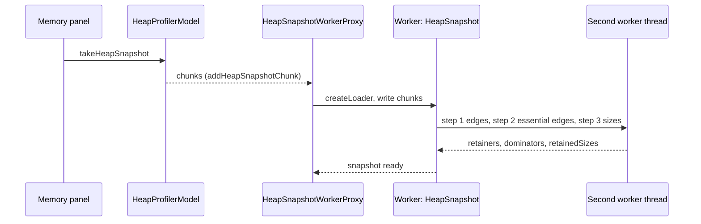

# ChromeDevTools/devtools-frontend — module: heap-snapshot

## Responsibility

This slice turns a heap snapshot file from V8 into something the Memory panel can browse. It runs in a Web Worker so the page stays responsive. It loads the JSON, builds the object graph, then computes retainers (who points at an object), dominators, retained sizes, and whether DOM nodes are detached. The UI side talks to the worker through a proxy. The CDP side only asks the browser to produce the snapshot and streams the chunks back.

## Key files

| File | Role |
|------|------|
| `front_end/entrypoints/heap_snapshot_worker/HeapSnapshot.ts` | Graph model: nodes, edges, retainers, dominators, retained size, detachedness (4,926 lines) |
| `front_end/entrypoints/heap_snapshot_worker/HeapSnapshotLoader.ts` | Parses the snapshot JSON as chunks arrive |
| `front_end/entrypoints/heap_snapshot_worker/HeapSnapshotWorkerDispatcher.ts` | Worker-side message switch: create, call, dispose objects |
| `front_end/models/heap_snapshot/HeapSnapshotProxy.ts` | Page-side proxy objects that forward calls to the worker |
| `front_end/models/heap_snapshot/HeapSnapshotModel.ts` | Shared types, such as the `DOMLinkState` enum |
| `front_end/core/sdk/HeapProfilerModel.ts` | CDP wrapper: take snapshot, collect garbage, receive chunks |

## How it works

1. The model suspends all targets, then calls the CDP `HeapProfiler.takeHeapSnapshot` command; targets resume in `finally` (`front_end/core/sdk/HeapProfilerModel.ts:96-102 @ 572bfc0`).
2. The browser sends the snapshot as string chunks. Each chunk becomes an event (`front_end/core/sdk/HeapProfilerModel.ts:124-126 @ 572bfc0`; `front_end/core/sdk/HeapProfilerModel.ts:205-206 @ 572bfc0`).
3. The page creates a worker and a loader proxy; the worker starts a `HeapSnapshotLoader` (`front_end/models/heap_snapshot/HeapSnapshotProxy.ts:32-34 @ 572bfc0`; `front_end/models/heap_snapshot/HeapSnapshotProxy.ts:42-51 @ 572bfc0`; `front_end/entrypoints/heap_snapshot_worker/HeapSnapshotWorkerDispatcher.ts:46-48 @ 572bfc0`).
4. The loader finds the `"snapshot"` token and parses the meta header, then the big integer arrays (nodes, edges) piece by piece, then the strings (`front_end/entrypoints/heap_snapshot_worker/HeapSnapshotLoader.ts:201-216 @ 572bfc0`; `front_end/entrypoints/heap_snapshot_worker/HeapSnapshotLoader.ts:117-128 @ 572bfc0`).
5. `HeapSnapshot` then runs a fixed pipeline with progress text: edge indexes, retainers, DOM state, flags, dominated nodes, shallow sizes, retained sizes, distances (`front_end/entrypoints/heap_snapshot_worker/HeapSnapshot.ts:1082-1100 @ 572bfc0`).
6. Retainers are built on a second worker thread. Step 1 sends edge targets, step 2 sends the "essential edges" bitmap, step 3 sends self sizes (`front_end/entrypoints/heap_snapshot_worker/HeapSnapshot.ts:1213-1239 @ 572bfc0`).
7. The second thread builds the reverse edge lists, runs the dominator algorithm, sums retained sizes, and posts typed arrays back as transferables (`front_end/entrypoints/heap_snapshot_worker/HeapSnapshot.ts:862-893 @ 572bfc0`).
8. The main worker waits, installs the results, and later reads `retainedSize()` from the `retainedSizes` array (`front_end/entrypoints/heap_snapshot_worker/HeapSnapshot.ts:1242-1251 @ 572bfc0`; `front_end/entrypoints/heap_snapshot_worker/HeapSnapshot.ts:423-424 @ 572bfc0`).

The arrows come from the steps above, each cited there.

### Concept bridge: retained size, retainers, detached DOM

- Shallow size is the memory of the object itself. Retained size is the memory that would be freed if the object went away. In code, retained size starts as self size and each node adds itself to its dominator (`front_end/entrypoints/heap_snapshot_worker/HeapSnapshot.ts:2329-2339 @ 572bfc0`).
- A retainer is an incoming edge: another object that points at this one. `buildRetainers` counts incoming edges per node, then fills a flat array with source node and edge (`front_end/entrypoints/heap_snapshot_worker/HeapSnapshot.ts:1268-1299 @ 572bfc0`).
- A detached DOM node is a DOM object no longer in the page tree but still in memory. V8 gives some nodes a state: unknown, attached, or detached (`front_end/models/heap_snapshot/HeapSnapshotModel.ts:347-350 @ 572bfc0`).

## Beyond the textbook

### Dominators with the Lengauer-Tarjan algorithm

- Textbook version: retained size is the sum of everything reachable from a node, found with a graph walk per node.
- What they do: build a dominator tree once with the Lengauer-Tarjan algorithm, then add sizes up the tree in one pass.
- Why: the code comment cites the 1979 paper. An object's retained size is exactly its self size plus the sizes of the nodes it dominates, so one linear sum replaces a walk per node.
- Evidence: `front_end/entrypoints/heap_snapshot_worker/HeapSnapshot.ts:2127-2129 @ 572bfc0`, `front_end/entrypoints/heap_snapshot_worker/HeapSnapshot.ts:2334-2339 @ 572bfc0`

### Not every edge counts as retaining

- Textbook version: every reference keeps its target alive.
- What they do: `computeIsEssentialEdge` drops weak edges, self edges, root shortcuts, WeakMap table edges, and edges from non-page objects to page objects. Only the remaining edges feed the dominator tree.
- Why: comments say WeakMap values are held by key and table together, so the key edge is used for more useful results; the page-object rule stops the debugger's references from changing dominators.
- Evidence: `front_end/entrypoints/heap_snapshot_worker/HeapSnapshot.ts:2046-2050 @ 572bfc0`, `front_end/entrypoints/heap_snapshot_worker/HeapSnapshot.ts:2062-2065 @ 572bfc0`, `front_end/entrypoints/heap_snapshot_worker/HeapSnapshot.ts:2085-2089 @ 572bfc0`

### Detachedness is propagated through the graph

- Textbook version: "detached" is a flag on a DOM node, read as is.
- What they do: V8 marks only some native nodes. A worklist pass spreads the state: anything reachable from an attached node is attached; anything else reachable from a detached node is detached, and its name gets a `Detached ` prefix. The pass stops at non-native (JavaScript) nodes, and ignores hidden, invisible, and weak edges.
- Why: comments say each embedder entry point knows its own state, so the pass does not push state through JavaScript. Old snapshots without the field fall back to names that start with `Detached `.
- Evidence: `front_end/entrypoints/heap_snapshot_worker/HeapSnapshot.ts:3053-3065 @ 572bfc0`, `front_end/entrypoints/heap_snapshot_worker/HeapSnapshot.ts:3103-3109 @ 572bfc0`, `front_end/entrypoints/heap_snapshot_worker/HeapSnapshot.ts:3125-3130 @ 572bfc0`, `front_end/entrypoints/heap_snapshot_worker/HeapSnapshot.ts:3037-3047 @ 572bfc0`

### Typed arrays, packed bits, and a second thread

- Textbook version: one JavaScript object per node and edge.
- What they do: nodes and edges stay in flat typed arrays indexed by ordinal. Detachedness (2 bits) and the class index (upper 30 bits) share one `Uint32Array` slot. Retainer and dominator work runs in a second worker, and buffers move by transfer, not copy. The code notes that `firstEdgeIndexes` is copied because each thread needs its own.
- Why: snapshots can hold millions of objects. Flat arrays and transfer avoid object overhead and structured-clone copies. A comment also says local variables are preloaded "for better performance".
- Evidence: `front_end/entrypoints/heap_snapshot_worker/HeapSnapshot.ts:900-904 @ 572bfc0`, `front_end/entrypoints/heap_snapshot_worker/HeapSnapshot.ts:1220-1221 @ 572bfc0`, `front_end/entrypoints/heap_snapshot_worker/HeapSnapshot.ts:2132 @ 572bfc0`

### Iterative algorithms, to avoid stack overflow

- Textbook version: recursive depth-first search.
- What they do: DFS and path compression use explicit arrays and a preallocated stack.
- Why: comments say the recursive version can overflow the stack on huge graphs.
- Evidence: `front_end/entrypoints/heap_snapshot_worker/HeapSnapshot.ts:2163-2166 @ 572bfc0`, `front_end/entrypoints/heap_snapshot_worker/HeapSnapshot.ts:2199-2203 @ 572bfc0`

### Survive broken snapshots and report, not crash

- Textbook version: assume every node is reachable from the root.
- What they do: nodes the DFS never reached are counted. Nodes with only weak retainers get their own DFS from the root. Remaining ones (for example a clique retaining itself) are attached to the root. Each case sends a problem report to the main worker, which logs a warning.
- Why: the heap graph from a real browser is not always clean, and the UI still needs a full tree.
- Evidence: `front_end/entrypoints/heap_snapshot_worker/HeapSnapshot.ts:2240-2270 @ 572bfc0`, `front_end/entrypoints/heap_snapshot_worker/HeapSnapshot.ts:1189-1191 @ 572bfc0`

### Pause the page while snapshotting

- Textbook version: just ask for a snapshot.
- What they do: suspend all targets first and always resume in `finally`.
- Why: not stated in the code; the likely reason is that a stable heap gives a consistent snapshot, but this is an inference.
- Evidence: `front_end/core/sdk/HeapProfilerModel.ts:96-102 @ 572bfc0`

## Tests and what they protect

- `HeapSnapshot.test.ts` builds small mock snapshots and checks exact outputs: dominators tree `[0, 0, 0, 0, 2, 3]` and retained sizes `[20, 2, 8, 10, 5, 6]` (`front_end/entrypoints/heap_snapshot_worker/HeapSnapshot.test.ts:544-577 @ 572bfc0`).
- There is a large retained-size test, which suggests overflow or big-number cases were worth guarding (`front_end/entrypoints/heap_snapshot_worker/HeapSnapshot.test.ts:579-583 @ 572bfc0`). Retained sizes are `Float64Array` (`front_end/entrypoints/heap_snapshot_worker/HeapSnapshot.ts:2327 @ 572bfc0`).
- Retaining-path tests cover weak edges, maximum nodes, depth, and siblings (`front_end/entrypoints/heap_snapshot_worker/HeapSnapshot.test.ts:789 @ 572bfc0`, `front_end/entrypoints/heap_snapshot_worker/HeapSnapshot.test.ts:849-944 @ 572bfc0`).
- Dominator lookups include a diamond graph, and one test filters by `isDetached` (`front_end/entrypoints/heap_snapshot_worker/HeapSnapshot.test.ts:1353 @ 572bfc0`, `front_end/entrypoints/heap_snapshot_worker/HeapSnapshot.test.ts:2681 @ 572bfc0`).

## Error handling, performance, and security

- Loader errors: missing token, truncated input, and incomplete JSON throw named errors (`front_end/entrypoints/heap_snapshot_worker/HeapSnapshotLoader.ts:170 @ 572bfc0`, `front_end/entrypoints/heap_snapshot_worker/HeapSnapshotLoader.ts:121 @ 572bfc0`, `front_end/entrypoints/heap_snapshot_worker/HeapSnapshotLoader.ts:205 @ 572bfc0`).
- A bad edge target is rejected (`front_end/entrypoints/heap_snapshot_worker/HeapSnapshot.ts:1208-1210 @ 572bfc0`).
- The dispatcher catches errors per call and sends back message, stack, and method name (`front_end/entrypoints/heap_snapshot_worker/HeapSnapshotWorkerDispatcher.ts:98-105 @ 572bfc0`). The second thread posts `{error}` on failure and the first rejects its promise (`front_end/entrypoints/heap_snapshot_worker/HeapSnapshot.ts:894-896 @ 572bfc0`, `front_end/entrypoints/heap_snapshot_worker/HeapSnapshot.ts:1195-1197 @ 572bfc0`).
- Long calls: the proxy polls every 300 ms and emits a WAIT event if a call was pending on two checks, so the UI can show busy state (`front_end/models/heap_snapshot/HeapSnapshotProxy.ts:141-151 @ 572bfc0`).
- Security: the `evaluateForTest` message runs `self.eval` in the worker (`front_end/entrypoints/heap_snapshot_worker/HeapSnapshotWorkerDispatcher.ts:75-88 @ 572bfc0`); it exists for tests, and the worker is isolated from the page.

## Technologies and services seen

- Web Workers and transferable buffers — run the graph work off the main thread (`front_end/models/heap_snapshot/HeapSnapshotProxy.ts:32 @ 572bfc0`, `front_end/entrypoints/heap_snapshot_worker/HeapSnapshot.ts:882-893 @ 572bfc0`)
- Chrome DevTools Protocol, `HeapProfiler` domain — the source of snapshot chunks and progress events (`front_end/core/sdk/HeapProfilerModel.ts:99 @ 572bfc0`, `front_end/core/sdk/HeapProfilerModel.ts:191-210 @ 572bfc0`)
- Lengauer-Tarjan dominator algorithm — retained sizes (`front_end/entrypoints/heap_snapshot_worker/HeapSnapshot.ts:2127-2129 @ 572bfc0`)
- Typed arrays and a bit-vector utility — compact graph storage (`front_end/entrypoints/heap_snapshot_worker/HeapSnapshot.ts:2097 @ 572bfc0`)
- TextUtils `BalancedJSONTokenizer` — reads the snapshot header (`front_end/entrypoints/heap_snapshot_worker/HeapSnapshotLoader.ts:211 @ 572bfc0`)

## Worth exploring interactively

- Retained size via dominators — steps: (1) mark essential edges (`front_end/entrypoints/heap_snapshot_worker/HeapSnapshot.ts:2096-2111 @ 572bfc0`); (2) build reverse lists (`front_end/entrypoints/heap_snapshot_worker/HeapSnapshot.ts:1275-1299 @ 572bfc0`); (3) DFS from the root (`front_end/entrypoints/heap_snapshot_worker/HeapSnapshot.ts:2238 @ 572bfc0`); (4) process vertices in reverse DFS order to find immediate dominators (`front_end/entrypoints/heap_snapshot_worker/HeapSnapshot.ts:2273-2311 @ 572bfc0`); (5) start from self sizes and add each node to its dominator (`front_end/entrypoints/heap_snapshot_worker/HeapSnapshot.ts:2329-2339 @ 572bfc0`) — fits AlgorithmStepper because the learner would see the tree form and the retained numbers grow bottom-up.
- Detached DOM propagation — steps: (1) seed states from the snapshot (`front_end/entrypoints/heap_snapshot_worker/HeapSnapshot.ts:3136-3144 @ 572bfc0`); (2) spread "attached" along edges (`front_end/entrypoints/heap_snapshot_worker/HeapSnapshot.ts:3146-3149 @ 572bfc0`); (3) spread "detached" to what is left and rename with the `Detached ` prefix (`front_end/entrypoints/heap_snapshot_worker/HeapSnapshot.ts:3151-3159 @ 572bfc0`) — fits StateMachine (unknown, attached, detached) or AlgorithmStepper because node colors change as the wave moves.

## Open questions

- How the Memory panel UI turns `HeapSnapshotNode` data into the Summary, Containment, and Comparison views is outside this slice.
- Why targets are suspended during a snapshot is not stated in the code.

## My insights
